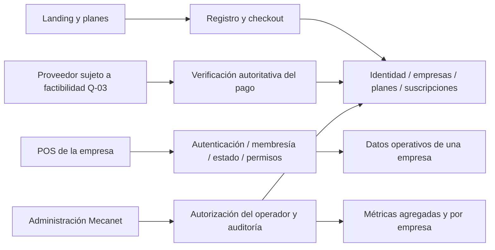

# Opciones de arquitectura SaaS — borrador, no baseline aprobada

**Vigencia CP-012, 2026-10-12:** SC-005/DEC-021 aprueba operación propia de Mecanet en el VPS, sin gestión de despliegues por Coolify; SC-006/DEC-054 establece PostgreSQL. El contrato vigente propuesto de despliegue es [DEP-IND](#dep-ind--despliegue-independiente-propuesto-cp-012), junto con el candidato relacional P1-L1 en [SPECIFICATION_CANDIDATE](SPECIFICATION_CANDIDATE.md). **Todo el cuerpo CP-002…CP-011 anterior a DEP-IND es antecedente histórico:** no incorpora automáticamente MongoDB, connect-mongo, réplica/oplog, CORS entre app/API, recursos de Coolify ni sus PASS al nuevo candidato. Las invariantes seleccionadas deben aparecer expresamente en el manifiesto CP-012; este paquete entero no es baseline. Compose/mismo origen siguen PROPOSED, A sigue pendiente y DEC-057 concede B condicional, todavía no efectiva. Recursos existentes, incluido Mecanet heredado, permanecen protegidos.

**Antecedente CP-011:** RG-001/DEC-053 está APPROVED y aplicado al orden. El candidato S-18 P1-L1 v0.1-CP011 incorporaba solo fragmentos identificados del contrato CP-010, no este paquete entero. Las secciones CP-010 de propuesta/gates conservan su estado histórico; límites vigentes en ROADMAP/PLANNING_STATE CP-012. Diseños no incluidos y condiciones comerciales siguen sus límites antes del primer trabajo dependiente; no aprobación de baseline por extensión.

**Revisión vigente CP-010, 2026-10-08:** contratos MT-A…F, MC-A…H y despliegue/G-01…06 leídos completos sobre HEAD `f72bd2393e26eeaf97f6962baf520a71e50e356b` (CP-009). La recomendación consolidada y el análisis de dependencias al final precisan diseño/entorno/proveedor/lanzamiento. Q-02, B2, sus mecanismos y cualquier ajuste de gates permanecen **SUGGESTED / NOT APPROVED**. Solo correcciones documentales y razonamiento sobre evidencia existente; sin nueva consulta de tarifas, inspección remota, prueba de producto ni experimento en este contrato.

Revisión CP-009: 2026-10-08, base documental/HEAD `3ec4c1ea5ab12fdff9c7be42864d708757e93be1` (CP-008). Aprobación humana de DEC-012 y evidencia original MC: 2026-10-07, base `fcd93a809d907e06e2ce514f71437827c993c74a`; ampliación DEC-028 y consolidación CP-007 sobre `31a854db72e6012cc26fcf17ead2287c107a5790`: 2026-10-08. CP-008 concretó Q-02 e incorporó DEC-036/037/038 y SC-004 sobre `472b6853173d8fdee46e831ef32ada5319da5578`. CP-009 incorpora recurrencia, delegación, sesiones, telemetría, retención y recuperación aprobadas; concreta proveedores externos sin contratarlos. Fuentes: decisiones humanas directas y [SOURCES](../docs/evidence/SOURCES.md). Todo mecanismo recomendado sigue **SUGGESTED**, sin gate aprobado, producto/configuración/infraestructura modificados ni pruebas funcionales nuevas; la evidencia histórica conserva fecha/base.

Navegación: [arquitectura aprobada](#arquitectura-aprobada-en-cp-006) · [medición y control MC](#cp-006--contrato-de-medición-y-control-mc) · [gates](#matriz-de-design-gates-propuesta) · [despliegue](#cp-002--diseño-mínimo-del-despliegue-objetivo) · [recuperación](#d-copia-externa-y-recuperación). Condiciones comerciales/demo y reglas de caja/cambio inmediato se mantienen en [SUBSCRIPTION_PROPOSAL](SUBSCRIPTION_PROPOSAL.md) y [SAAS_DISCOVERY](SAAS_DISCOVERY.md), sin duplicar catálogos ni calendarios. **SC-004:** no existe saldo POS futuro, billetera ni credencial de beneficiario por ese propósito; se conserva registro durable del cambio, pagos SaaS e historia inmutable. DEC-030/035 quedan históricos solo en el alcance sustituido por DEC-038.

## Invariantes candidatas para el Design Gate

SUGGESTED: una empresa nunca lee/escribe/exporta/restaura datos de otra; el ámbito se resuelve en el servidor a partir de identidad, membresía y estado de producto. Ni un header, hostname, parámetro o campo enviado por el cliente concede autoridad. Sin ámbito válido se rechaza la operación; no hay fallback a la base histórica.

SUGGESTED: separar identidad del operador de Mecanet, dueño/administrador de empresa y empleados; `desarrollador` heredado no se convierte automáticamente en superadministrador SaaS. Acciones sensibles del operador requieren la matriz aprobada DEC-045 de SAAS_DISCOVERY y auditoría. El MVP recomendado no incluye soporte con acceso POS ni impersonación; no se mantiene como pregunta obligatoria para continuar.

CONFIRMED: una empresa por suscripción en el MVP, sin sucursales, hasta 20 empresas previstas en seis meses. SUGGESTED: mantener un backend modular mientras el volumen y el aislamiento requerido no justifiquen procesos separados. No se propone reescritura del POS ni adopción de Kubernetes/microservicios sin evidencia.

## Qué significa «una base»

Una **base lógica** organiza colecciones y permisos; un **proceso/replica set MongoDB** aporta ejecución y almacenamiento; un **VPS** aporta recursos físicos compartidos. Crear veinte bases dentro del mismo MongoDB no crea veinte servidores, límites propios de CPU/RAM ni redundancia.

### Arquitectura aprobada en CP-006

**CONFIRMED / DEC-012 APPROVED:** base central para identidades y suscripciones, más una base lógica por empresa con credencial propia, dentro del MongoDB de Mecanet; proceso interno de provisión/mantenimiento separado de la API pública. Todo permanece en infraestructura Mecanet, sin servidores independientes por cliente. La elección base por empresa está resuelta: la comparación A/B de CP-005 queda como historia en Git, no como decisión pendiente.

La adaptación propuesta conserva invariantes locales del POS al sustituir modelos/conexiones globales por contexto empresarial obligatorio. Quedan por validar credenciales, conexiones, índices, transacciones, mantenimiento y recuperación. API, proceso Mongo y host siguen compartidos: una base lógica no reserva CPU/RAM ni elimina el impacto entre empresas. Mongo describe estos compromisos; no se trasladan cuotas comerciales de Atlas al VPS. [SRC-01](https://www.mongodb.com/docs/atlas/build-multi-tenant-arch/).

La aprobación no ratifica todos los parámetros de MT-A…F, mecanismos de revocación/credenciales ni cuotas productivas. CP-009 confirma la autoridad, sesiones y custodia en sus alcances DEC-045…052; los mecanismos se revisan separadamente. Un resultado de capacidad insuficiente exige revisar límites/coste con evidencia; cambiar arquitectura requiere decisión adicional, no seleccionar otra distribución silenciosamente. DEC-021 conserva VPS/Coolify y los recursos ajenos.

### MT-A — Distribución y autoridad propuestas

La distribución central/empresa y el trabajador privado están **CONFIRMED** por DEC-012. Nombres lógicos, schemas y mecanismos de esta descomposición siguen **SUGGESTED**. Una identidad central puede tener membresías sin duplicar contraseña; habilitar pertenencia a varias empresas en la experiencia del MVP sigue sin decidirse, no se añade un selector comercial por inferencia.

| Grupo | Ubicación propuesta / autoridad durable | Componente autorizado | Pendiente y límite |
|---|---|---|---|
| Identidades empresariales, pertenencias y permisos | Central: Identity (credencial, activo, tokenVersion), Membership (identityId, tenantId, activo, rol/overrides, versión), RolePolicy y delegación por empresa/acción con otorgante titular, versión y revocación | Módulo de identidad/autorización; acciones de usuarios mediante permisos explícitos. La empresa no recibe credenciales Mongo | DEC-046/048 y matriz F1-A de SAAS_DISCOVERY: el titular concede/revoca, sin redelegación ni transferencia por un delegado. POS admin no concede billing; cardinalidad de pertenencia y mecanismo siguen DG-TENANT |
| Ubicación y estado técnico de empresas | Central: TenantDirectory con ID opaco, alias de servidor, nombre físico generado, referencia/versión de secreto, schemaVersion, dataEpoch y estado de aprovisionamiento | Resolver del API con lectura; trabajador de aprovisionamiento/mantenimiento con escrituras acotadas | No guardar contraseña en este directorio ni aceptar nombre de DB/URI del navegador; custodia/rotación por aprobar |
| Catálogo, suscripciones y referencias de pago | Central: precios versionados, períodos, suscripción, consentimiento/revocación de recurrencia, generación de programación, eventos/pagos verificados e intenciones idempotentes de alta/cobro/reconciliación | Módulo de billing y trabajador mediante operaciones permitidas; panel solo proyección/acciones autorizadas | DOP/USD independientes, anual/prepago, primer pago y lifecycle DEC-041…044 CONFIRMED; calendario autoritativo en SUBSCRIPTION_PROPOSAL. Proveedor/afiliación/impuestos pendientes; sin PAN/CVV ni datos de negocio |
| Datos de cada empresa | Su base: Product, Customer, Supplier, Sale, Return, Quotation, PurchaseOrder, CashierSession, CashWithdrawal, Settings, AuditLog y Log de negocio; perfil local de actor para las referencias históricas User | Repositorios de negocio, jobs y exportaciones con contexto autorizado y credencial exclusiva de esa base | Perfil histórico sin contraseña/tokenVersion/permiso global; el rol en una factura no concede autoridad. DEC-049: exportación POS durante 30 días tras baja efectiva, después purga; impago/suspensión no inicia ese plazo. Conservación obligatoria documental necesita criterio externo |
| Demo y abuso | SUGGESTED: base lógica demo separada en Mongo Mecanet, credencial propia; sesión ficticia aislada por namespace. Identidad registrada en control central y metadatos de abuso con propósito/política propios | Módulo demo; resolver de demo nunca entrega TenantContext empresarial ni identidad de operador | Registro/correo verificado, una activa/cuenta, tres inicios/cuenta/24 h y demás límites DEM CONFIRMED en CP-009. Retenciones por clase DEC-049; dump completo coherente y restore sin resurrección propuestos en DEM-D/G-04. No excluir namespaces del replay ni crear otro servicio |
| Operador, métricas y auditoría de plataforma | Central: OperatorIdentity separada de membresías, OperatorAudit, cuotas versionadas y proyecciones administrativas/uso; contrato MC | Un operador principal sin delegación inicial, módulo de operador y productor de métricas con mínimo privilegio, sin credencial de infraestructura en navegador/API | DEC-013/028/045 confirman alcance, MFA y sesiones; DG-ADMIN/OBS revisan mecánica/campos. No ventas, clientes, contenido demo, logs brutos, secretos ni soporte implícito |

La autoridad de autenticación permanece central. El perfil local permite que un recibo siga refiriéndose al mismo actor sin hacer populate hacia documentos de identidad con secretos. Su sincronización idempotente puede retrasar la presentación, nunca la revocación: la autorización no consulta el perfil local. RoleSectionAccess deja de ser una colección operativa autoritativa y pasa a RolePolicy central; su extracción y la de User necesitan migración explícita y pruebas, sin renombrar datos ahora.

**Tres fronteras distintas:** la aplicación verifica pertenencia/acción/recurso y evita referencias cruzadas; las credenciales Mongo limitan los namespaces que cada cliente puede tocar; la configuración de Mongo/redes verifica autenticación, roles efectivos y ausencia de exposición pública. Ninguna sustituye a las demás. Mongo permite privilegios por base/colección, no autorización empresarial por fila en A. [SRC-33](https://www.mongodb.com/docs/v7.0/core/authorization/). Coolify/redes/entornos y aislamiento frente a otras apps siguen G-02/DEP-D1: no usar credenciales, Mongo, volúmenes o redes privadas de Nexora.

### MT-B — Recorrido de una operación y revocación

**Sesión recomendada CP-008, SUGGESTED:** `express-session` familia 1.x con `connect-mongo` familia 6.x, patch publicado/pinning/compatibilidad en Q-11 antes de instalar; estado central y cookie host-only del API `__Host-mecanet-session`, `Secure`, `HttpOnly`, `SameSite=Lax`, `Path=/`, sin `Domain`. Demo y operador usan nombres/propósitos distintos (`__Host-mecanet-demo`, `__Host-mecanet-operator`) y no se aceptan unos en rutas de otros. ID opaco generado por CSPRNG nativo de 32 bytes, firma/formato de cookie de la biblioteca, colección estándar del conector más propósito/identidad/versión de seguridad/expiración/revocación. Tratar registros/secretos de firma como sensibles, con permisos y copia cifrada; ninguna sesión cruda en logs/diagnóstico. No se afirma hash del ID en almacenamiento ni se propone adaptador criptográfico propio. No JWT/localStorage de navegador, IDs en URL/body ni otro transporte alternativo para SaaS. `saveUninitialized:false`, `resave:false`, sin MemoryStore productivo; autoridad y expiración se comprueban en servidor y no dependen de TTL. [SRC-64](https://cheatsheetseries.owasp.org/cheatsheets/Session_Management_Cheat_Sheet.html).

Los README oficiales respaldan sesión servidor, opciones de cookie y reutilización de cliente Mongo; el de connect-mongo actual declara Node 24, driver 6.x y Mongo 7 dentro de su matriz, y su manifiesto master declara familia 6. **Master no acredita un patch publicado ni compatibilidad probada en Mecanet.** Reutilizar el cliente central ya presupuestado, conservar driver 6.20 y usar `autoRemove:'disabled'`: el trabajador prepara el índice TTL mediante migración, nunca permisos DDL del API. La autoridad de inactividad/absoluta siguiente vive en campos propios y no en el refresh automático del conector; un `touch` provocado por polling no concede vigencia. [SRC-68](https://github.com/expressjs/session#readme), [SRC-69](https://github.com/jdesboeufs/connect-mongo#readme).

**CONFIRMED DEC-045/047:** empresa **30 min de inactividad y 8 h absolutas**; operador **15 min/8 h**, reautenticación sensible válida **5 min** y MFA; demo termina como máximo a los **30 min aprobados**, sin renovación por actividad. Mecánica SUGGESTED: polling/telemetría no prolonga inactividad; una acción autenticada interactiva sí, mediante actualización condicionada del estado central. Rotar ID al login/reauth/cambio de privilegio; logout o recuperación de contraseña revoca sesiones de forma durable. El backend aplica plazos aunque la cookie siga presente; TTL solo retira registros terminales conforme a retención aprobada. No «recordarme» ni renovación indefinida propuestos. Expirar sesión impide nuevas acciones, conserva intención/resultado ya admitidos y permite recuperarlos tras autenticación; no cierra ni reescribe una caja por sí solo. El mecanismo y experiencia se revisan con Q-31; los tiempos aprobados no vuelven al cuestionario.

La SPA usa solicitudes con credenciales a `https://api.mecanet.site/api`; CORS acepta exactamente `https://app.mecanet.site` y credenciales, nunca `*` o cualquier subdominio. Para cambios de estado recomendar **token CSRF sincronizador por sesión**, obtenido por lectura autenticada `no-store`, enviado en cabecera y validado contra central, junto con Origin exacto; Referer con origen exacto solo si falta Origin, y denegar si ninguno permite establecer el origen. El login/recuperación usa pre-sesión CSRF acotada; preflight no ejecuta efectos. No hay mutación por GET. Callbacks de proveedor quedan en namespace separado, con autenticidad propia aún dependiente del contrato del proveedor elegido en Q-03: no reciben una exención genérica que otras rutas puedan usar. SameSite/HttpOnly no corrigen XSS ni sustituyen autorización/CSRF. [SRC-65](https://cheatsheetseries.owasp.org/cheatsheets/Cross-Site_Request_Forgery_Prevention_Cheat_Sheet.html).

Ejemplo propuesto: registrar una venta mediante API directa, sin confiar en la pantalla ni en que un ID sea difícil de adivinar.

1. **Identidad:** verificar cookie mediante la biblioteca, resolver sesión central y propósito, exigir vigencia/no revocación y consultar Identity activa con versión de seguridad coincidente. Un ID de sesión no aporta rol, empresa, plan ni nombre de base. Lectura/verificación fallida deniega, sin fallback al JWT/localStorage heredado. TD-08 recibe esta solución candidata; su implementación sigue sin verificar.
2. **Pertenencia:** tenantId de ruta/header sirve solo como selector no confiable. Buscar la Membership exacta de esa identidad y empresa; ausencia, baja o discrepancia se rechaza antes de abrir base de negocio. Un ID de tenant/cliente/producto enviado en el cuerpo no reemplaza ese contexto.
3. **Permisos:** resolver rol/overrides y delegación vigente para empresa/acción concreta; denegar por defecto. Contratación, cancelación, cambios e invitaciones usan F1-A de SAAS_DISCOVERY: permiso POS no basta, no redelegación ni propiedad por extensión y consentimiento del medio de pago separado. Evaluar entitlements, suscripción y límites comerciales vigentes. Primer pago, gracia y acceso tras gracia DEC-031/034/037: después de gracia solo cuenta/estado/facturas SaaS/pago/soporte/exportación autorizada y acotada, sin POS ordinario; pago verificado y estado técnico utilizable permiten reactivar sin levantar suspensión de seguridad. DEC-042 concreta DEC-036: calendario original durante gracia; después, nuevo período menos los siete días ya concedidos una sola vez, según SUB; no calcular calendario en la sesión. MC no concede permisos, precios ni continuidad comercial.
4. **Empresa:** leer TenantDirectory y exigir estado técnico utilizable, versión compatible y dataEpoch vigente; resolver conexión por ID interno y versión de secreto. Error, directorio ausente o central inaccesible deniegan; nunca recurrir a MONGODB_URI_FALLBACK ni a un modelo global. Crear contexto inmutable con identidad, membresía, permisos, tenantId, época, modelos y préstamo de conexión.
5. **Recurso:** validar Customer/Product/Sale y demás referencias en los modelos de esa conexión; aplicar también permisos de objeto/propiedad cuando correspondan. No usar populate de otra conexión ni filtros Mongo arbitrarios del cliente. Si se falsifican IDs de B en contexto A, no se lee B ni se permite crear referencias a B. Si el mismo ID existe en ambas bases, se trata únicamente como objeto local de A, sujeto a su permiso.
6. **Operación:** sesión/transacción procedente de esa conexión cuando la invariante lo exija (MT-D); validar límites dentro de la operación atómica pertinente. Respuesta, log/audit, job y cache conservan el contexto. Claves de cache incluyen empresa, propósito y dataEpoch; no cache global de Settings/SMTP. Jobs guardan identidad/autoridad de ejecución explícita y revalidan contexto/permisos al ejecutarse, sin convertir una petición antigua en autorización permanente.

**Revocación SUGGESTED:** sin cache positiva de pertenencias/permisos al inicio. Acusar recibo de la baja/cambio solo tras escritura durable `majority`; lecturas de autorización por documento con clave única, en primary y `linearizable`, `maxTimeMS` acotado, fuera de sesiones causales/transacciones de negocio. Esta lectura exige disponibilidad y puede costar latencia: medirla, no degradar a permisos antiguos ante timeout. Mongo 7 documenta esa visibilidad respecto de escrituras majority anteriores al inicio de la lectura y sus restricciones. [SRC-41](https://www.mongodb.com/docs/v7.0/reference/read-concern-linearizable/).

Garantía recomendada: una **nueva comprobación iniciada tras confirmarse la revocación** la respeta. Una operación ya autorizada/en curso puede terminar según el plazo admitido y las reglas de reconciliación; SUB concreta la frontera posgracia sin extenderla a intenciones nuevas; se revalida antes de una escritura sensible o cada lote largo, sin prometer atomicidad entre control central y commit empresarial. No cancelación retroactiva en el MVP; la matriz de pruebas distingue ambos lados del ack. Restauración/rotación técnica sí usa la barrera de drenaje MT-E. Plazo propuesto para lectura de autoridad: 500 ms, dentro del plazo total; un timeout produce indisponibilidad sin permisos antiguos. Se mantiene lectura por documento/clave única, no se llama «snapshot global» a varias lecturas linealizables sucesivas.

Credenciales distintas: usuario empresarial autentica en ámbito empresa, sesión demo solo en demo y operador solo en su módulo. Audiencia/propósito, verificadores y autorización separados impiden convertir cualquiera de ellos en los otros. El rol heredado desarrollador no abre rutas empresariales de todas las empresas; soporte excepcional requeriría una decisión futura específica, sin impersonación prevista; Q-06 está resuelta y no concede ese acceso. A nivel Mongo, clientes de control, negocio, demo y mantenimiento tienen credenciales diferentes; esta frontera aún requiere negativas reales. El proceso compartido sigue pudiendo poseer varias de ellas: no ofrece aislamiento frente a compromiso total del API.

### MT-C — Conexiones, modelos, privilegios y presupuesto

**DETECTED, LOCAL CP-005:** [lock](../package-lock.json) y metadatos instalados indican Mongoose **8.24.4**, driver MongoDB **6.20.0**. [config/db.js](../config/db.js) usa mongoose.connect global con maxPoolSize default 20; los modelos exportan mongoose.model y los controladores los importan globalmente. [authMiddleware](../middleware/authMiddleware.js) consulta User global y tokenVersion; [sectionAccess](../services/sectionAccess.js) concede todas las secciones a desarrollador. Se contrastaron mecanismos concretos, no se volvió a inventariar el proyecto. Mongo **7.0.43**, replica set de un miembro y ARM64 son **REPORTED CP-002**: no se reconsultaron versión, FCV, usuarios ni estado remoto.

Mongoose distingue useDb sobre pool compartido y conexiones independientes. La fuente local 8.24.4 confirma que useDb reutiliza MongoClient; no permite dar una credencial distinta a cada base por invocarlo. Recomendación B: una conexión central y createConnection independiente por empresa admitida, nunca por request; schemas/fábricas registrados con conn.model y referencias locales. No exportar modelos globales en rutas/jobs empresariales. Configurar explícitamente autoIndex/autoCreate desactivados en runtime y buffering desactivado para fallar de forma controlada: provisión aplica el manifiesto de índices, el login no lo modifica. [SRC-02](https://mongoosejs.com/docs/8.x/docs/connections.html#multi-tenant-connections).

Propuesta mínima de privilegios: cliente central del API CRUD solo en las colecciones centrales necesarias; la separación entre módulos centrales es de autorización de aplicación, no de ese cliente común. Cada cliente empresarial CRUD solo en su base/colecciones declaradas, sin root/readWriteAnyDatabase, gestión de usuarios, drop ni DDL. Demo no accede a control/negocio. El proveedor de métricas recibe solo la operación/namespace necesarios para el agregado aprobado, no todos los documentos ni credencial root. Los permisos exactos para transacciones y medición se validan en QA; no se dan por satisfechos por el nombre del rol.

**Aprovisionamiento sin credencial administrativa en el API público:** el proceso interno separado está APPROVED en DEC-012. Se propone un trabajador por entorno, misma imagen/código modular, administrado por Coolify, sin entrada pública y un trabajo a la vez. No es un backend por empresa ni necesita broker nuevo. Una colección central de operaciones durables le entrega solo trabajos con tipo/estado permitido; vuelve a validar autorización y genera nombres físicos, sin ejecutar comandos/nombres arbitrarios de la cola. Credenciales administrativas limitadas al Mongo exclusivo de Mecanet y acceso humano restringido; su compromiso afecta todas sus bases. Rotación, índices/migraciones y altas se coordinan con backups según G-04. Privilegios mínimos, custodia y presupuesto están propuestos en MT-C/MC/G; su eficacia requiere QA y aprobación, siguen SUGGESTED; aprobar el proceso no demuestra su seguridad ni autoriza crearlo ahora.

Custodia candidata concreta: volumen privado por entorno gestionado por Coolify, trabajador con escritura y API con lectura restringida; archivo de credencial por referencia opaca/versión, escritura atómica, sin rutas del cliente. El directorio central contiene la referencia, nunca la contraseña. Sin mounts a web, otras apps o socket Docker; sin secretos en imágenes, logs, repo o panel. Validar permisos de contenedor/host, rotación y reconstrucción antes de adoptarlo. La API comprometida podría leer las credenciales montadas: el volumen no es un vault ni aislamiento de proceso por empresa. No se diseña cifrado propio ni se contrata otro almacén. El acceso independiente de recuperación o recreación/rotación de usuarios Mongo debe quedar resuelto en G-04; no basta copiar el volumen local.

Concreción recomendada Q-02: un cliente central por API, un cliente independiente por tenant admitido y uno de demo; clave de cache `(tenantId, credentialVersion, dataEpoch)`, inicialización única por clave y LRU solo sin préstamos. Abrir/cerrar requiere reserva durable de cliente/socket en el registro central por proceso/generación; la apertura en curso cuenta. Techo de ensayo **40 clientes empresariales entre las dos APIs coexistentes**, conservando 20 por proceso; conexiones centrales/demo y monitores se presupuestan aparte en el subtotal 196 siguiente. Despliegue no habilita una tercera API sin nuevo sobre de capacidad. El directorio no permite URI de cliente ni resolver nombres fuera de su allowlist; la API no ejecuta gestión de usuarios/DDL. El pool espera dentro de la cola MC, no delante de ella.

Rotación recomendada: marcar tenant en mantenimiento y bloquear nuevas admisiones, drenar todos sus préstamos/tickets; crear usuario nuevo de privilegios equivalentes desde el trabajador, escribir archivo secreto versionado de forma atómica, verificarlo con cliente temporal y cambiar directorio por CAS de versión. Cerrar clientes antiguos sin préstamos y revocar usuario anterior antes de reabrir. Si falla antes del cambio, conserva versión vigente; si la credencial antigua está comprometida no volver a ella por rollback, mantener mantenimiento y terminar rotación. El API no ve la credencial de provisión. Registrar referencias/versiones/resultado, nunca valores. Este flujo y el máximo agregado se prueban en P1; el coste real del total de sockets sigue Q-34.

| Parámetro inicial de ensayo, SUGGESTED | Justificación / verificación pendiente |
|---|---|
| Pool central máximo 5; empresa máximo 2; demo máximo 2 si se adopta su Mongo separado lógicamente; minPoolSize 0, maxConnecting 1 | Empezar con concurrencia contenida; medir espera, latencia, memoria y transacciones largas antes de cambiar valores. No son cuotas comerciales |
| Máximo 20 clientes empresariales cacheados por proceso API | Techo de ensayo, no capacidad certificada ni obligación de abrirlos todos. Cache por tenantId + versión de credencial + dataEpoch; inicialización única concurrente. Contar también conexiones en apertura/cierre para no exceder el techo |
| maxIdleTimeMS 60 s, waitQueueTimeoutMS 2 s; selección de servidor máximo 2 s dentro del plazo total MC de 8 s | Q-02 recomienda 2 s en lugar de los 10 s candidatos CP-005 para no ocultar una caída dentro de una petición interactiva. Tiempo finito no acota la cola: MC controla agregado entre procesos/usuarios/sesiones/jobs; pool y cupo activo son magnitudes distintas |
| Préstamos y drenaje de conexiones | Requests, transacciones, cursores y jobs retienen préstamo; solo expulsar un cliente inactivo sin préstamos. Si no hay hueco, denegar admisión temporalmente, sin cerrar sesiones activas. Rotación/restauración bloquea entrada y espera drenaje antes de cambiar generación |

Driver 6.x documenta pools **por MongoClient y por servidor**, sockets de monitorización y que el timeout de espera no acota la cola; minPoolSize 0 no elimina monitorización de un cliente abierto. La página solicitada para 6.20 redirige a 6.x; la revisión local confirma la versión y propiedad de sesiones, sin prueba de rendimiento. [SRC-32](https://www.mongodb.com/docs/drivers/node/v6.x/connect/connection-options/connection-pools/).

Estimación de diseño para **un miembro y un proceso API**, lectura al primary: con N clientes empresariales, datos `5 + 2N + 2` y hasta `2(N + 2)` sockets de monitorización, total candidato **11 + 4N = 91 para N=20** incluyendo la demo candidata. Dos APIs coexistiendo al desplegar darían hasta 182 bajo esos supuestos. Para el trabajador: proponer cuatro clientes como máximo, central/admin/validación/métricas con pools 2/2/1/1 y minPoolSize 0; hasta 6 datos + 8 monitorización = 14 más, una empresa en mantenimiento a la vez y cierre del cliente de validación al terminar. **196** sería el subtotal de ese reemplazo con un trabajador; CP-008 incorpora explícitamente el cliente de métricas separado que faltaba en la estimación previa193, todavía sin herramientas de copia/restore, clientes de otras apps ni reserva. El cálculo no demuestra conexiones reales, RSS, latencia ni admisión del host. Si cambia número de miembros, pools usados, réplicas o almacén demo, recalcular por cliente/servidor antes de DEP-D2; no usar 91 como máximo universal de Mongo.

Inventario estático reutilizado/contrastado: 14 modelos + 14 índices _id + 35 declaraciones = **63 unidades colección/índice por copia íntegra, 1260 para veinte**. No son archivos medidos, límite duro ni estimación de RAM. La separación central evita copiar credenciales y políticas, pero agrega perfiles, contadores/idempotencia y colecciones centrales: presupuesto definitivo `unidades centrales + demo + Σ(colecciones + índices efectivos de cada empresa)`. No reducir auditoría para alcanzar una orientación de Atlas ni asumir que mover User soluciona el coste. En QA, listar índices realmente construidos, tamaños, conexiones/RSS y consultas; revisar redundancias con evidencia. CP-006 permite experimentos locales acotados si reducen una incertidumbre: no hace falta probar otra topología para reabrir una elección aprobada. Un ensayo decisivo para aceptar los parámetros se sitúa antes del gate correspondiente, con Environment Gate; no se ejecutó Mongo en este bloque.

### MT-D — Unicidad, consultas e invariantes

La unicidad de Mongo se aplica a la colección/index correspondiente; una restricción parcial solo cubre documentos que cumplen su filtro. Sparse omite campos ausentes, **incluye null explícito**. En los schemas Customer/Supplier hay índices unique+sparse; comentarios de Customer sobre múltiples null no prueban ese comportamiento. Normalización de opcionales y duplicados deben revisarse antes de migrar, sin tocar datos actuales. [SRC-35](https://www.mongodb.com/docs/v7.0/core/index-unique/), [SRC-36](https://www.mongodb.com/docs/v7.0/core/index-sparse/), [SRC-37](https://www.mongodb.com/docs/v7.0/core/index-partial/).

| Ámbito | Restricción candidata | Relación con el código / decisión |
|---|---|---|
| Control | Email normalizado único para identidad empresarial; Membership única (identityId, tenantId); RolePolicy única (tenantId, rol); directorio único por ID y ubicación física | Extraer auth de User y política de RoleSectionAccess. Email de cliente del POS no es identidad de acceso ni unicidad global |
| Billing/alta/recurrencia | Clave de evento/transacción por proveedor + cuenta comercial + ID externo; ciclo e intención de cargo por empresa/generación/calendario, resultado durable y referencia de consentimiento | Forma final depende del proveedor seleccionado en Q-03, sin interfaces inventadas. Una transacción externa no paga dos empresas/ciclos; payload distinto bajo la misma clave se rechaza. Cancelación/generación se revalida antes del despacho; resultado desconocido se consulta antes de repetir |
| Empresa | SKU y números de factura, compra, cotización, devolución y retiro únicos dentro de su DB; pueden repetirse entre A y B | Conserva ámbito de índices existentes; no convertir número de factura en identificador global. Política fiscal/numeración legal pendiente, sin promesa de secuencia sin huecos |
| Opcionales y perfiles | Identificadores/email/teléfono de Customer y RNC de Supplier conservan alcance local mientras se resuelve su regla; perfil de actor enlazado de forma única a membresía/identidad según diseño de migración | Candidato normalizar vacío/null a ausencia y definir índice parcial para valor admitido; validar duplicados y semántica antes de construir. No aprobar un cambio comercial sobre teléfonos compartidos |
| Settings, contadores e idempotencia | Settings con _id fijo; contador por tipo/período en documento único; operación por empresa/acción/clave con intención y resultado | getInstance actual hace findOne+create; generación actual lee último número o countDocuments+1. Son carreras posibles, no resultados de una prueba concurrente |

Consultas leídas: [productController](../controllers/productController.js) filtra archivo/categoría/marca/proveedor, busca regex y calcula stock bajo con expr; [saleController](../controllers/saleController.js) filtra fecha/usuario/estado, ordena y además lee ventas para estadísticas; compras ordena por createdAt; retornos/cotizaciones tienen índices declarados sobre referencias/estado/fechas. Propuesta de manifiesto mínimo: conservar unicidad e índices útiles existentes; evaluar `(createdAt, _id)` para paginación temporal de ventas/compras, `(user, createdAt, _id)` si domina el filtro de cajero y combinaciones estado/fecha o igualdad/orden solo con consultas representativas. Revisar índices individuales redundantes tras explain, no añadir todas las combinaciones.

La pauta igualdad/orden/rango orienta esa evaluación, no certifica rendimiento. [SRC-42](https://www.mongodb.com/docs/v7.0/tutorial/equality-sort-range-guideline/). Regex sin prefijo/case-insensitive, expr entre campos y estadísticas que leen todas las ventas no quedan resueltos por esos índices. Topes server-side de página/rango/exportación y coste por operación se diseñan con Q-02; no cambiar límites de planes por esta observación. Medir documentos/keys examinados, planes, tamaños y p95 con datos sintéticos de distribución acordada en P2.

Mongo garantiza atomicidad de un documento; invariantes que afectan varios documentos justifican transacciones en el mismo replica set. [SRC-34](https://www.mongodb.com/docs/v7.0/core/write-operations-atomicity/), [SRC-40](https://www.mongodb.com/docs/v7.0/core/transactions/). El código ya utiliza sesiones/transacciones en los cuatro flujos siguientes, pero con mongoose global: no son capacidades SaaS verificadas.

| Operación / evidencia de código | Invariante / mecanismo SUGGESTED | Verificación necesaria |
|---|---|---|
| createSale en saleController | Venta + cambios de stock + historial/totales Customer + resultado idempotente dentro de transacción empresarial. Predicado de stock suficiente y comprobación de actualización; contador atómico e índice único para número | Dos ventas sobre último stock, fallo intermedio, petición repetida y respuesta perdida: sin negativo ni doble efecto |
| Cambio inmediato DEC-038 y cancelación Sale | Serializar elegibilidad por venta/línea/cantidad/importe original, artículo sin usar y en buen estado dentro del plazo aprobado; devolución + reemplazos de valor suficiente + diferencia cobrada + stock + operación durable en transacción empresarial. Cajero prepara, administrador autorizado confirma; sin saldo futuro ni cuarentena ordinaria para aceptar usados | Reintentos concurrentes no devuelven/cambian/cancelan dos veces; respuesta perdida recupera el mismo resultado. CC conserva reservas 668→667 y líneas con distintos precios, cierres previos intactos; garantías obligatorias se revisan aparte |
| Recepción PurchaseOrder | Marcar recepción y sumar existencias una sola vez, con condición de estado/versión y transacción local | Dos recepciones simultáneas, reintento/reinicio; stock y estado juntos |
| Conversión Quotation | Cotización convertida/vínculo + venta + stock + Customer en la misma transacción | Doble conversión y falta de stock: una venta o fallo sin efectos parciales |
| Actualización de un documento, counter/Settings o revocación individual | Operación condicional atómica por _id/versión; no transacción multidocumento por defecto. Número final respaldado por índice único | Upserts simultáneos, E11000 y reintento; contador se incluye en la transacción de venta si su consumo debe acompañar el commit |
| Cierre de caja actual | DETECTED: lee ventas/retiros y crea CashierSession sin transacción ni asignación exclusiva. DEC-029 exige caja/cierre individuales, conjunto exclusivo e inmutable y cierre por encargado del turno | Contrato CC vigente en SAAS_DISCOVERY: titular distinto de ejecutor, asignación/serialización/idempotencia; cambio posterior enlazado en su período, sin reabrir ni editar cierre histórico |

Implementación futura: sesión creada desde la conexión empresarial, pasada a **cada** operación de la unidad; secuencia await, sin Promise.all dentro de transacción. El driver rechaza una sesión de otro MongoClient, comprobado también en su fuente local 6.20.0. Adoptar lectura snapshot/primary y escritura majority con journaling para transacciones de negocio, verificando soporte/configuración reales; un miembro no añade redundancia. Reintentos acotados según errores transitorios/resultado de commit desconocido, intención idempotente durable y recuperación del resultado; no repetir efectos externos dentro del callback. [SRC-38](https://mongoosejs.com/docs/8.x/docs/transactions.html), [SRC-39](https://www.mongodb.com/docs/drivers/node/v6.x/crud/transactions/).

Los logs/audit posteriores al commit en ventas pueden fallar después de guardar la operación; no responder/reintentar como si nada se hubiera vendido. Diseñar confirmación a partir del resultado durable; si un evento/audit/correo debe garantizarse, guardar intención de entrega en la misma DB/transacción y despacharla con contexto e idempotencia. No se contrata una cola ni se crea un servicio de eventos. Credenciales SMTP/Settings y export/import actuales también son globales: deben recibir contexto y excluir secretos; import/reset históricos siguen fuera de las rutas SaaS hasta diseño específico (TD-02).

Control central y empresa usan clientes/credenciales distintos: **no transacción común entre ambos en esta propuesta**. Pago verificado, provisión, membresía y habilitación se coordinan por estados durables/reintentos y reconciliación; una base creada no equivale a suscripción activa. DEC-031 exige primer pago verificado antes de habilitar negocio real; estados y recuperación en SUBSCRIPTION_PROPOSAL. La reserva central MC tampoco es el commit empresarial: conserva incertidumbre y reconcilia antes de liberar/reintentar. No ampliar privilegios del API ni afirmar exactly-once de un proveedor externo.

**Recurrencia y delegación CP-009, mecanismo SUGGESTED:** autorización empresarial, consentimiento del medio, calendario y ejecución tienen registros distintos. Concesión/revocación/uso de permiso delegado se vinculan a empresa, acción, otorgante titular y versión; una invitación aceptada consume usuario habilitado según SUB. El worker reclama una intención durable de ciclo, verifica suscripción/calendario/generación/cancelación y consentimiento vigentes inmediatamente antes de cada intento externo; no hereda indefinidamente la sesión o el rol de quien lo programó. Cancelar cambia generación y deja auditoría/intención de cancelar programación externa, conserva acceso pagado y reconcilia la carrera con un cargo ya enviado conforme a SUB. Respuesta perdida nunca dispara un nuevo cargo a ciegas. Tras restore, jobs de cobro quedan bloqueados hasta consultar proveedor y reconciliar ciclos, cancelaciones y transacciones; ninguna cola antigua inicia automáticamente cobros de meses suspendidos. IDs y métricas de intentos/reintentos son técnicos, no ingresos: el panel solo cuenta pagos verificados por moneda.

### MT-E — Mantenimiento y recuperación por empresa

Provisión propuesta: operación central idempotente → reserva de ID/ubicación → DB/colecciones/índices y usuario Mongo limitado → secreto/versionado → comprobaciones con esa credencial → estado técnico listo. Solo después se aplica el estado comercial aprobado. Una caída entre pasos deja una operación reanudable y recurso incompleto inaccesible; no borra DBs ajenas, no repite setup-client, no habilita parcialmente. Worker y API usan contratos de estados y mínimo privilegio; nombres generados y propiedad del recurso se verifican incluso ante un job manipulado.

Mantenimiento: manifiesto versionado de schemas/índices y compatibilidad de código, registro por empresa del avance; cambios aditivos primero, transformación acotada después y retiro solo tras verificar compatibilidad. Un tenant canario sintético antes del lote; una empresa por trabajo inicialmente. No syncIndexes automático ni construcción de índices al login. Detectar duplicados antes de unique; si falla, detener esa migración y conservar estado/evidencia, sin eliminar datos para hacerla pasar. No habilitar una empresa con schema incompatible; fallar controladamente sin actualizar a todas parcialmente. Índices consumen I/O/RAM/disco; coordinar DDL, backup y carga, medir y aplicar abortos G-03. El rollback del contenedor solo se admite con schema compatible; cambios destructivos requieren plan propio DG-MIGRATION.

Restauración individual propuesta, complementa G-04 y sus objetivos aprobados DEC-050 aún sin ensayo:

1. Restaurar **primero el dump completo con oplog** en recuperación aislada, sin egreso/jobs de producción. Verificar punto consistente, hashes, versiones e índices. Después extraer la base empresarial, manteniendo IDs y referencias; no filtrar/renombrar durante el replay (SRC-26/27, reutilizadas). Ese destino necesita presupuesto propio: la preparación de un restore individual no puede ocupar durante horas el único cupo de copias del origen donde siguen activas otras empresas. Si comparte host/Mongo, solo admitirlo cuando duración y recursos medidos preserven los trabajos cada30min y la frescura RPO; en caso contrario, preparar en el destino aislado autorizado o revisar la operación antes de iniciarla. No hay capacidad adicional ni infraestructura aprobadas por esta recomendación.
2. Preparar base nueva/generación nueva con credencial restringida y versión de schema compatible, sin sobrescribir la activa. Reconstruir índices y perfiles, comprobar referencias, totales de control, stock/ventas/devoluciones y canarios; comparar con manifiesto de la copia y objetivo RPO de una hora, aún no demostrado.
3. **No retroceder control central** en un restore individual: identidad, revocaciones, permisos, suscripción y pagos actuales siguen siendo autoridad. Reconciliar perfiles y vínculos contra ella; si falta identidad, conservar actor histórico sin reactivarlo. No copiar secretos productivos a QA; custodia/recreación de usuarios Mongo se comprueba en recuperación restringida.
4. Colocar esa empresa en mantenimiento, impedir nuevos contextos/leases, detener admisión de jobs y drenar peticiones/cursores/transacciones de todos los procesos. Si no se puede acreditar drenaje, abortar el corte; no basta cambiar un nombre en cache. Tras verificación, cambiar directorio por comparación de versión (dataEpoch/credencial/schema), invalidar clientes/caches y reabrir con canarios y rollback preparado. Las otras empresas no cambian de directorio, aunque Mongo/host compartidos pueden sufrir carga y requieren presupuesto.
5. Restaurar idempotencia empresarial puede perder resultados posteriores a la copia: bloquear replays automáticos de operaciones de la generación anterior y reconciliar las inciertas antes de permitir reenvíos. No prometer ausencia de pérdidas ni doble efecto solo por conservar una clave. Billing central se reconcilia con proveedor en P3; un restore global también debe restaurar/reconciliar control/identidades y journal externo conforme a G-04, no aplicar la regla de «central actual» a un host perdido. Todas las sesiones restauradas se invalidan, demo es terminal y cualquier hueco de purga/revocación impide reabrir el ámbito afectado.

Conservar/borrar base anterior y copias exige política y acceso aprobados, no plazos inventados. Recuperar una empresa desde copia completa sigue necesitando espacio y acceso al conjunto en entorno restringido: B facilita la selección final, no una copia individual inmediata ni backup externo demostrado. Un restore que depende del único host no cumple G-04.

### MT-F — Evidencia futura, gates y alcance de aprobación

Las pruebas siguientes están **NOT VERIFIED**. La tabla define evidencia a obtener, no resultados ni autorización de ejecutar sobre el VPS. Environment Gate precede a cada entorno. Se reutilizan DEM-V1…5, COM-01/02 y DEP-V* existentes donde se indica.

| ID / garantía | Prueba futura y resultado exigido | Gate de diseño / fase límite de verificación |
|---|---|---|
| MT-V1 / contexto y credenciales | A/B con IDs iguales/diferentes; alterar tenantId/ruta/header/cuerpo y llamar API directa, export/jobs/populate. No lecturas/escrituras cruzadas; credencial Mongo A falla al consultar B; faltante central no cae a DB histórica | DG-TENANT P0-C; corte identidad→recurso P1, todas las superficies POS P2; destino real DEP-V2/P6 |
| MT-V2 / revocación | Revocar membresía, rol/override y tokenVersion; iniciar comprobaciones tras ack, simular timeout y probar job en cola. Denegar sin cache vieja; registrar explícitamente operación previamente autorizada que puede acabar | Aceptar semántica de revocación DG-TENANT P0-C; identidad P1 y acciones POS P2, permisos operador P4 |
| MT-V3 / tres ámbitos | Token empresa contra demo/operador y viceversa; forzar mismo ID, propósito alterado y acceso a datos de sesión ajena. Denegación server-side aun sin UI | DG-TENANT/ADMIN, mecanismo de almacén demo Q-02/DEP-D2 en P0-C; condiciones Q-13 ya resueltas DEC-027. DEM-V1 fundación P1 y datos/cuotas P2; panel P4, recorrido DEM-V5/P5 |
| MT-V4 / conexiones | Arranque concurrente del mismo tenant, techo lleno, cola agotada, cursor/transacción abiertos durante evicción y rotación, central caída; sin fuga, cierre activo ni fallback | Presupuesto/contrato MT-C y DEP-D2 P0-C/D; ciclo básico P1, concurrencia POS P2 y carga/reemplazo P6 |
| MT-V5 / unicidad e integridad | SKU/número iguales en A/B permitidos, duplicados en A rechazados; null/ausencia/normalización, singleton y numeración concurrentes; duplicado preexistente aborta migración sin borrarlo | Manifiesto/schema DG-TENANT/MIGRATION P0-C; índices/referencias/migración POS P2 |
| MT-V6 / atomicidad e idempotencia | Venta/stock, devolución+cancelación, recepción y conversión simultáneas; fallos intermedios, reintento, commit/ACK incierto y log posterior fallido. Resultado único o ningún efecto parcial según contrato | Invariantes y cierre de caja resueltos P0-C; P2 antes de declarar POS completo; billing externo separado COM-02/P3 |
| MT-V7 / provisión, migración y restore | Fallar cada paso de alta, índice y cambio de época; restore A con B canario intacto, permisos actuales preservados, replays viejos bloqueados y secretos propios; corte aborta si no drena | DG-MIGRATION/DEP-D2 P0-C; restore sintético básico P1; empresa/índices/datos P2; alta/pagos/reconciliación P3; host perdido DEP-V4/P6 |
| MT-V8 / capacidad | Dataset y concurrencia acordados: índices efectivos/tamaños, conexiones/RSS/espera, p95/errores, scans, build/reemplazo/copias y ruido compartido. Aplicar abortos G-03; sin capacidad inferida de reposo/20 empresas | Q-02/DEP-D2 antes de admitir entorno; experimento aislado en P0 solo si es decisivo y autorizado, cargas de cada módulo P1…P5, conjunto P6 |

| Laguna resuelta como diseño | Decisión necesaria / estado actual | Qué aún no se verifica ahora | Trabajo independiente habilitado |
|---|---|---|---|
| MT-A/B: distribución, autoridad y recorrido | DEC-012 APPROVED; DEC-045…048 concretan operador, delegación, sesiones y transferencia. Mecánica de revocación/credenciales SUGGESTED | MT-V1/2/3; diseño P0-C, fases según tabla | Matriz F1-A/acciones/campos y negativos en SAAS_DISCOVERY; cuotas/medición MC |
| MT-C/D: clientes, índices y atomicidad | Solución técnica Q-02 SUGGESTED para revisión; caja individual/cierre inmutable y cambio inmediato sin saldo futuro CONFIRMED DEC-029/038 | MT-V4/5/6/8, soporte/config Mongo efectiva, capacidad no medida | Contratos de caja/cambio inmediato y evidencia histórica separada en SAAS_DISCOVERY; perfiles MC |
| MT-E: mantenimiento y restore | DEC-049…052 aprueban retención/objetivos/custodia Edgar y destino fuera Oracle; G-04 recomienda B2 y protección/journal SUGGESTED, coste/proveedor efectivo pendientes | MT-V7/8 y DEP-V*, ninguna recuperación acreditada | Manifiesto/canarios sintéticos según política aprobada y entorno autorizado, sin inspeccionar copias reales |

**Alcance aprobado y límite:** CP-006 aprueba distribución central/base por empresa, credenciales propias y trabajador interno separado; no ratifica toda la política técnica del borrador. CP-008 sustituye saldo futuro POS por cambio inmediato durable mediante DEC-038/SC-004; no elimina ledger de pagos SaaS ni historia. Las decisiones humanas y mecanismos técnicos mantienen estados separados. No hay Specification/Design/Development Gate cerrado ni READY FOR DEVELOPMENT.

Las verificaciones futuras se obtienen en su fase y entorno autorizados. La documentación pública y una simulación local no demuestran límites del kernel, seguridad de credenciales, atomicidad Mongo real ni capacidad del VPS. Este bloque no vuelve a solicitar decisiones ya aprobadas ni exige producción verificada para continuar P0.

## Separación administrativa propuesta

Este diagrama representa los ámbitos aprobados; recorrido y mecanismos son **SUGGESTED**. No define subdominio administrativo, framework nuevo ni permisos de soporte. La autoridad sobre un pago no reside en el navegador, redirección de éxito o un precio recibido del cliente.

## Pagos: renovación aprobada, proveedor sujeto a factibilidad

CONFIRMED: mercado RD, Edgar como persona, autoservicio desde lanzamiento, catálogo DOP/USD independiente, anualidad con 15% sobre doce mensualidades/prepago, primer pago verificado y ausencia de reembolsos ordinarios. DEC-041…044 confirman renovación automática, calendario, cancelación y cambios de plan; DEM conserva su contrato aprobado. Q-03 compara AZUL/CardNET y recomienda condicionalmente en SUBSCRIPTION_PROPOSAL; **AZUL no es obligatorio**. No cuenta comercial, aceptación, fiscalidad ni suficiencia jurídica inferidas. Se reutilizan SRC-03/04 como evidencia histórica, sin interpretar páginas públicas como API/contrato integrado probado.

Antes del trabajo dependiente del proveedor, acreditar su contrato técnico: admisión de Edgar, cargo DOP/USD y liquidación por separado; checkout/tokenización sin PAN/CVV en Mecanet; recurrencia mensual/anual y calendario DEC-042; confirmación auténtica, consulta/reconciliación, repetidos/reordenados/reintentos, revocación/cancelación, reversos/disputas, sandbox y tarifas/restricciones. La integración externa requiere DG-PAY; fundación puede programar interfaz simulada y estados internos sin contratar ni inventar endpoints/firmas. Documentación privada faltante y evidencia límite permanecen únicamente en Q-03/SUB.

Propuesta de garantías independientes del proveedor:

1. Catálogo de precios versionado con importe en unidad menor, moneda y período mensual/anual. Cálculo y cotización anual trazables en servidor con la fórmula aprobada DEC-026; redondeo mitad hacia arriba a unidades menores, una vez al final, propuesto en SUB. Un precio DOP y otro USD son decisiones comerciales, sin conversión de divisas inventada ni descuento del navegador.
2. Evento/pago externo verificado contra cuenta comercial, empresa, plan/versión, período, importe, moneda y estado; unicidad durable de transacción/evento. Reintentos y ACK perdido no duplican cobro ni activación ni extienden dos veces el período anual.
3. Provisionamiento idempotente: pago confirmado y creación de recursos son pasos recuperables. Si el alta falla tras cobrar, debe existir estado y reparación explícitos.
4. Aplicar renovación **automática** mensual/anual, cancelación, impagos/gracia y cambio de plan según DEC-041…044; mecanismo y condiciones adicionales Q-38 siguen propuestos. Aprobar recurrencia como producto no autoriza ejecutar un cargo ahora. DEC-032 excluye reembolsos ordinarios: cobros duplicados/incorrectos, disputas, reversos y prestación fallida se registran/reconcilian por separado, sin inventar permisos de devolución. No purgar datos por impago.
5. Reconciliación periódica para eventos perdidos, con auditoría y prueba tras reinicio. No guardar datos de tarjeta en app/logs/Sentry/backups.

Stripe no se da por disponible para una entidad dominicana en la lista consultada; Paddle queda solo como alternativa por investigar. No se selecciona segundo proveedor ni se crea una cuenta/entidad. [SRC-05](https://stripe.com/global), [SRC-06](https://www.paddle.com/help/start/intro-to-paddle/which-countries-are-supported-by-paddle).

## CP-006 — Contrato de medición y control (MC)

**CONFIRMED, DEC-013/028 y SC-002; consolidación CP-007:** cuotas operativas administrables agregadas por empresa, techo global para Mecanet y el host compartido, **sin reservas físicas individuales garantizadas de CPU/RAM**. Las gráficas distinguen medición directa, estimación y recursos compartidos/no atribuibles; el panel ajusta límites dentro del alcance administrativo aprobado. La elección del modelo MVP está resuelta. MC-C separa los tres perfiles aceptados **solo para ensayo** de los parámetros técnicos **SUGGESTED**. Configuración de producción pendiente de validación; capacidad y eficacia **NOT VERIFIED**. El contrato no se reduce a solicitudes HTTP/suscripciones: identifica recurso saturado, actividad que contribuye, punto de control y margen para admitir trabajo.

### MC-A — Semántica, ámbitos y precisión

- **HOST:** consumo global del VPS, incluidas otras aplicaciones y sistema. **MECANET:** recursos exclusivos de web/API/Mongo/trabajador/medición y sus tareas. **TENANT:** actividad autenticada y base empresarial identificada por el servidor. **COMPARTIDO / NO ATRIBUIBLE:** control central, proxy común, cache/GC/WiredTiger/journal/oplog, tareas generales y tráfico sin empresa autenticada. Demo se presenta por separado; no suma suscriptores de pago. Ninguna etiqueta del navegador concede atribución.
- **DIRECTA:** lectura de un contador en el ámbito que realmente mide; no implica integración existente ni entrega sin pérdidas. **ESTIMADA:** modelo con fórmula, supuestos y fecha visibles. **NO DISPONIBLE:** no existe atribución fiable con esta arquitectura/fuente; se muestra así, nunca cero. Toda gráfica incluye unidad, ámbito, fuente/versión, ventana, `asOf`, retraso, reinicios, cobertura/muestreo y calidad. Muestra ausente o contador reiniciado crea una discontinuidad, no consumo negativo.
- **Cuota máxima:** techo de admisión/consumo definido para una ventana, sin promesa de disponibilidad simultánea. **Prioridad:** orden relativo al competir; no reserva de CPU/RAM ni permiso de monopolizar. **Reserva física garantizada:** mínimo disponible con capacidad y aislamiento verificables; queda fuera del modelo MVP aprobado DEC-028. El turno equitativo y los subcupos de trabajo siguen SUGGESTED; no convierten un cupo de aplicación en CPU/RAM dedicada. MC-G registra las limitaciones y el cambio de alcance que exigiría otra garantía, no una elección pendiente para este MVP.
- Para CPU usar segundos de CPU por intervalo y porcentaje con denominador explícito: 100% de **una vCPU** difiere de 100% del host. Para RAM diferenciar RSS del proceso y memoria contabilizada por contenedor; no sumarlos como consumos distintos. Node documenta CPU del proceso y RSS/heap, no del tenant; las diferencias durante peticiones concurrentes no atribuyen su coste. [SRC-45](https://nodejs.org/docs/latest-v24.x/api/process.html). La latencia incluye esperas y no se convierte en CPU. La correlación entre carga de A y CPU global es indicio, no reparto contable.

### MC-B — Matriz recurso → medición → control

Las columnas describen el contrato objetivo; **no son lecturas obtenidas**. MiB/GiB usan base 1024; bytes se guardan sin redondeo. Las pruebas MC-V al final comparten provenance y SHA explícitos.

| Recurso | Unidad | Fuente propuesta | Ámbito | Calidad de atribución | Límite aplicable | Punto de aplicación | Al exceder / faltar dato | Verificación pendiente |
|---|---|---|---|---|---|---|---|---|
| MC-01 CPU del host | s CPU/intervalo, % del total vCPU | Contadores OS mediante lectura permitida del host; SRC-43/49 | HOST | Directa del VPS, no hardware físico dedicado | Presupuesto global/admisión G-03; no cuota de tenant | Coolify sobre servicios Mecanet y admisor de tareas propias | Frenar admisión pesada/demo/build propios; nunca terminar otras apps | MC-V1/6; fuente/denominador/picos ARM64 |
| MC-02 RAM del host | bytes totales/disponibles, presión/OOM | Resumen OS autorizado y eventos; sin nombres de procesos ajenos | HOST | Directa; disponible no es RAM asignable íntegra a Mecanet | Margen de seguridad G-03, incluyendo coexistencia y recuperación | Admisión global y límites de servicios | No iniciar trabajo que comprometa margen; salud/OOM aborta ensayo propio | MC-V1/6; cache, muestreo y reacción antes de OOM |
| MC-03 CPU/RAM de servicios | s CPU, bytes cgroup/RSS, throttling/OOM | cgroup de cada recurso Mecanet; diagnóstico Node separado; SRC-43/45 | MECANET, por servicio/release | Directa del grupo/proceso; no sumar padre+hijo ni RSS+cgroup | Techos CPU/RAM vía Coolify, por medir/aprobar | Runtime; build necesita control independiente | CPU puede ralentizar; RAM puede terminar proceso. Reducir admisión antes del techo, recuperar idempotencia | MC-V1/6; controles efectivos, límites y reemplazo |
| MC-04 CPU/RAM empresarial | Sin valor exacto; mostrar actividad MC-11/12/15 al lado | No hay contador fiable por empresa en API/Mongo compartidos | TENANT y COMPARTIDO | **No disponible**; no heap delta, duración ni división por clientes | Cuotas de trabajo/entradas/concurrencia; no cgroup por DB | Aplicación antes de admitir/ejecutar | Rechazar o esperar trabajo de esa empresa; límite físico sigue siendo común | MC-V3/6; limitación MC-G, reserva física fuera del modelo MVP aprobado |
| MC-05 Disco/IOPS del host y volumen | bytes usados/libres, bytes/s, ops/s | Filesystem/dispositivo y estadísticas permitidas; SRC-49 | HOST y volumen MECANET identificado | Directa del ámbito; volumen compartido no es tenant | Margen G-03, presupuesto de crecimiento/backup/índices | Admisor Mecanet, retención aprobada de artefactos; límites I/O solo si soportados/aprobados | Pausar crecimientos/jobs propios; alerta; no limpieza automática de datos/recursos ajenos | MC-V1/6; dispositivo, capacidad, espacio temporal y límites reales |
| MC-06 Datos lógicos por empresa | bytes BSON sin comprimir | `dbStats.dataSize`, escala 1, base resuelta por directorio; SRC-44 | TENANT | Directa del dato Mongo al muestrear, no disco físico | Umbral lógico QL del perfil; contador de crecimiento admitido y margen MC-D | Antes de escrituras, contador/predicado empresarial y reconciliación | Bloquear crecimiento ordinario si rebasa umbral; no borrar históricos; acceso esencial acotado | MC-V2/3/5; cobertura de todas las escrituras y desviación |
| MC-07 Datos/índices asignados | bytes `storageSize`, `indexSize`, `totalSize`; cantidad índices | `dbStats` por DB y manifiesto de índices; SRC-44 | TENANT; central/demo separados | Directa de asignación Mongo, incluye espacio libre interno; no factura/disco completo | Umbral de alerta por base derivado de ensayo; manifiesto de índices; margen físico global | API limita crecimiento; solo trabajador crea índices con presupuesto | Pausar crecimiento/DDL no esencial; diagnóstico. No `drop`/compactar/borrar para bajar la gráfica | MC-V2/6; ratio real, picos de índice y exclusiones |
| MC-08 Disco compartido de Mecanet | bytes central/demo/oplog/journal/logs/copias/imágenes | Fuentes separadas del recurso correspondiente, sin scans de negocio | MECANET / COMPARTIDO | Medido donde exista fuente; residual etiquetado como estimación | Presupuesto operativo propio por clase; retenciones DEC-049 y artefactos por revisar | Admisión de provisión/copia/mantenimiento, configuración Coolify | No admitir nuevos trabajos sin espacio; conservar copia válida dentro de su retención | MC-V2/6; no sumar copias/índices dos veces ni repartir residual arbitrariamente |
| MC-09 Red física del host/servicios | bytes RX/TX y bytes/s por interfaz | Interfaces seleccionadas OS/runtime; SRC-49 | HOST; MECANET si interfaz atribuible | Directa de interfaz; proxy común/loopback/veth requieren frontera explícita | Presupuesto de egress; protección de ingreso de Mecanet por rutas/tamaños | Proxy/servicio Mecanet autorizado; trabajos salientes acotados | Frenar trabajo propio; no alterar firewall o tráfico de otras apps | MC-V1/4/6; evitar doble conteo y no confundir interfaz con factura Oracle |
| MC-10 Transferencia API por empresa | bytes payload admitidos/enviados y bytes/min | Contadores de flujo del API tras autenticar, tamaños serializados/chunks | TENANT; anónimo/demo separados | Directa en esa frontera de aplicación, con cobertura; excluye TLS/TCP, retransmisiones, assets, DB y copias | QT del perfil y tamaño por respuesta/entrada | Antes de reservar respuesta de escritura o enviar cada lote/chunk de lectura | 413 al cuerpo excesivo; 429/reintento previo o reporte parcial marcado. No cortar confirmación ya reservada | MC-V4/5; compresión/chunk/reintento/desconexión y respuesta perdida |
| MC-11 Peticiones y errores | solicitudes/min, contadores por clase/status | Admisor + agregados de aplicación por ruta plantilla, no URL cruda | TENANT / DEMO / SIN ATRIBUIR | Directa de lo observado; pérdida/muestreo visibles | QH del perfil + antiabuso por identidad/IP y global | Antes de trabajo costoso; controles previos a autenticación también acotados | 429 con espera calculada o 503 si sobrecarga global; respuesta sin datos de otros tenants | MC-V3/4; todas las entradas, no solo UI; no Sentry como contador total |
| MC-12 Latencia/carga de operaciones | ms p50/p95, muestras, unidades de coste UC/min | Histograma de tiempo transcurrido y catálogo de operación versionado | TENANT / MECANET | Latencia directa; UC **estimación de demanda**, no CPU ni dinero | QC del perfil; límites de tamaño/rango/plazo | Reserva antes de admitir; nueva reserva antes del siguiente lote | Espera acotada/rechazo previo; no repetir efectos confirmados | MC-V3/5/6; calibración con queries/stock/reportes representativos |
| MC-13 Clientes/pools/sockets | clientes, sockets/servidor, checked-out, espera/timeouts | Registro de clientes + eventos driver; servidor agregado autorizado; SRC-32/47 | TENANT para cliente exclusivo; MECANET para total; monitorización separada | Directa cliente instrumentado; no usuarios/sesiones ni CPU DB | MT-C: clientes/pools/colas + techo agregado en MC-C | Antes de abrir cliente y obtener conexión; cache/drain | Rechazo temporal si no hay hueco, sin evictar préstamo activo ni fallback | MC-V3/6; apertura concurrente, monitores, rollouts y clientes de copia |
| MC-14 Operaciones activas/cola | nº activos/pendientes, edad de cola | Tickets/contadores centrales, estado/generación/owner | TENANT y MECANET, **todos los procesos** | Directa del registro de admisión; trabajo incierto sigue ocupado | QA/QW del perfil y global; plazo de espera | Admisión/claim transaccional y liberación verificada | Cola llena → rechazo; timeout no libera un trabajo todavía vivo | MC-V3/5; partición, caída, doble claim, ticket huérfano |
| MC-15 Queries/reportes/jobs | nº/lotes, ms, docs/keys examinados solo en ensayos permitidos | Instrumentación de clases de consulta + explain QA; no payload/profiler global | TENANT; mantenimiento/backup común separado | Contadores/latencia directos; coste por UC estimado | maxTimeMS aplicable, filas/rango, memoria de respuesta, concurrencia de reportes | Repositorios y runner; permiso/contexto revalidado por lote | Cancelar lectura/cursores segura; commit incierto se reconcilia; no matar Mongo | MC-V3/5/6; ruta real, transacciones y puntos de interrupción |
| MC-16 Demo | sesiones admitidas, cuotas/entradas y carga agregada | Contadores autoritativos de DEM y admisor común con clase demo | DEMO, no tenant pago | Directa de sesión/registro; CPU/RAM sigue compartida | Límites aprobados DEM + presupuestos adicionales SUGGESTED | Registro/login/admisión/API demo y ejecución de lote | No nueva sesión/trabajo al agotar cupo; vencimiento servidor; no conversión en negocio real | DEM-V y MC-V3/6; cuotas agregadas/reintentos/abuso |
| MC-17 Medición y control | CPU/RAM, bytes, series/filas, operaciones DB, eventos descartados | Métricas del productor, almacenamiento y admisor; presupuesto MC-F | MECANET / COMPARTIDO | Directa cuando instrumentado; forecast de coste estimado | Techo propio de recolección/almacenamiento propuesto; retenciones DEC-049 aprobadas | Productor y agregador, nunca escaneo por refresco de UI | Degradar detalle/muestreo con aviso, no borrar cuotas/audit durable ni inventar ceros | MC-V7; carga del control bajo abuso y fallo de ingesta |
| MC-18 Negocio de Mecanet | empresas/estados, pagos por moneda/período | Suscripciones/pagos durables verificados | CENTRAL SaaS | Directa según libro y fecha de corte; no telemetría estimada | Permisos/rangos de consulta, sin coste adicional automático | API operador autorizada, consultas agregadas | Denegar acceso indebido/rango costoso; conservar hechos financieros | MC-V8/COM; discrepancias se reconcilian, sin leer ventas del POS |

Precisiones de fuente: `dataSize` es lógico sin comprimir; `storageSize` incluye espacio asignado libre y excluye índices; `indexSize` incluye asignación de índices; `totalSize = storageSize + indexSize`. No sumar `dataSize + totalSize`. `fsUsedSize` corresponde al filesystem y **no se suma por empresa**. No hay en ese contrato un tamaño lógico de índices separado ni CPU/RAM por DB; se muestra no disponible. [SRC-44](https://www.mongodb.com/docs/v7.0/reference/command/dbstats/). El residual físico contiene además journal/oplog/copias y diferencias de momento/frontera: no asignarlo como «otros tenants» ni restarlo de magnitudes incompatibles.

### MC-C — Perfiles base y capacidad agregada

**CONFIRMED / DEC-028 ampliada el 2026-10-08:** estos tres parámetros por plan se aceptan únicamente como punto de partida para experimentar. No son configuración productiva, capacidad acreditada ni nueva condición de precio. Cantidades comerciales aprobadas: Esencial 4 usuarios/300 productos, Negocio 10/4.000, Máxima 25/10.000; sus semánticas de conteo quedan en SUBSCRIPTION_PROPOSAL. Usuarios habilitados no equivalen a sesiones ni operaciones simultáneas. Todos los planes conservan las mismas funciones aprobadas.

| Parámetro aceptado solo para ensayo | Esencial | Negocio | Máxima | Frontera que debe comprobarse |
|---|---|---|---|---|
| QH, solicitudes/min por empresa | 120 | 240 | 360 | Techo agregado de admisión HTTP; semántica de ventana móvil propuesta abajo, sin añadir la ráfaga al máximo |
| QA, operaciones simultáneas por empresa | 2 | 3 | 4 | Total de unidades de ejecución activas de esa empresa, ordinarias/esenciales, peticiones/jobs/reportes y todos los procesos |
| QL, datos lógicos por empresa | 512 MiB | 2 GiB | 5 GiB | Datos BSON de la base empresarial, incluido histórico/auditoría/idempotencia; índices y disco físico se muestran aparte. No es permiso de purga ni reserva de disco |

**Semántica técnica SUGGESTED para QH:** como máximo `N` solicitudes admitidas en cualquier intervalo móvil `(t − 60 s, t]`. No hay reinicio al cambiar el minuto del reloj. Antes de admitir una nueva, el total de admisiones aún dentro de esa ventana debe ser menor que `N`, tanto para empresa como para sus carriles y el techo global. La ráfaga adicional `B` se propone como máximo en cualquier ventana móvil de **1 s**, también inclusiva por la derecha; limita aún más ese mismo conjunto. **B está dentro de N, nunca suma N+B.** Un bucket de reposición media que permita superar N en 60 s no satisface este contrato. Una implementación aproximada solo cabe si es conservadora: puede denegar antes y debe documentar esa pérdida de disponibilidad, pero no admitir más de N ni cambiar el significado de 120/min por conveniencia técnica.

Ejemplo de frontera, aún sin ejecutar: con N=120 y B=20, admitir 20 en cada instante de los segundos 0, 1, 2, 3, 4 y 5 consume las 120. Hasta el segundo 60 no cabe otra por QH, aunque comience un minuto calendario intermedio. En el segundo 60 expiran únicamente las primeras 20; se pueden admitir hasta 20 si los demás controles lo permiten. La milésima anterior sigue denegada. El contador separa **recibidas, rechazadas antes de admisión y admitidas**: el techo N aplica a admitidas; recibir o rechazar tráfico no acredita capacidad ni permite realizar su trabajo.

Los siguientes parámetros complementarios conservan estado **SUGGESTED**, incluidos los subcupos esenciales. No forman parte de las tres cifras aceptadas:

| Parámetro técnico por tenant | Esencial | Negocio | Máxima | Fundamento / frontera |
|---|---|---|---|---|
| QH, ráfaga B en ventana móvil de 1 s | 20 | 40 | 60 | Tope suplementario dentro de N/60 s; ensayar sincronización de pestañas/reintentos |
| QC, UC reservadas por 60 s; ráfaga UC por 1 s | 300; 50 | 600; 100 | 900; 150 | Ventanas móviles con ambos techos, como QH; coste convencional de trabajo, no CPU |
| QW, tickets esperando; espera interactiva máxima | 8; 2 s | 12; 2 s | 16; 2 s | Cola finita agregada, también para jobs pendientes; espera no mantiene conexión Mongo. Un job futuro con otro plazo requiere clase y máximo explícitos |
| Queries activas / reportes activos | 2 / 1 | 2 / 1 | 2 / 1 | Guardas agregadas adicionales a QA; maxPoolSize por proceso no las sustituye. Un reporte no dispone de CPU exclusiva |
| QT, bytes payload API saliente por 60 s; ráfaga por 1 s | 10 MiB; 2 MiB | 20 MiB; 4 MiB | 30 MiB; 6 MiB | Ventanas móviles con ambos techos; frontera de aplicación, no tráfico físico/facturable del VPS |
| Prioridad de turno entre empresas elegibles | Igual | Igual | Igual | Cuota mayor no permite saltar todas las colas; no promete mínimo físico ni disponibilidad simultánea |

**Solicitud, operación y coste no son sinónimos.** Una solicitud QH es cada intento HTTP autenticado con ámbito empresarial válido que el admisor acepta para una ruta empresarial, una sola vez aunque espere en cola. Una operación QA es una unidad de ejecución acotada desde su claim hasta terminar realmente consultas, transacción, cursor y respuesta; un ticket esperando ocupa QW, no QA. Una intención durable de venta/cierre puede requerir varias solicitudes y conservar su identidad entre ellas, sin mantener un cupo activo mientras espera una acción humana. El cambio de ticket de espera a activo es atómico; no puede ocupar simultáneamente varios claims ni abrir una cola paralela sin límite.

Una solicitud puede iniciar un trabajo diferido y responder: su ejecución HTTP libera QA al terminar y el job obtiene su propio claim antes de trabajar. El job sigue siendo la misma intención durable cuando corresponde, pero su trabajo no está exento. Cada ejecución paralela consume cupo; un padre no puede esconder cien tareas/query runners bajo una sola operación. La propuesta mínima procesa sublotes secuencialmente; además se aplican la guarda total de queries y la de reportes. Un batch cuenta como una solicitud HTTP, pero todos sus objetos/lotes tienen tamaño y UC acotados. Usar varios recursos dentro de una ejecución secuencial no crea por sí mismo varias operaciones QA.

| Entrada / resultado | Cuenta QH | QA, QC, otros controles y reintento |
|---|---|---|
| Ruta empresarial admitida, incluyendo polling de estado, HEAD y respuesta 304 | Una por intento HTTP admitido | Usa el cupo y coste de su clase; polling con frecuencia acotada y backoff, nunca otra cuota por pestaña. Cache local sin petición no cuenta |
| Retry tras timeout, resultado perdido o clave idempotente repetida | Cada nuevo intento admitido cuenta, incluso si recupera un resultado guardado | Consulta de resultado breve con su propio cupo/UC; no repite efecto, reserva de línea, stock, cobro o cambio. La clave no crea un canal gratuito |
| Admitida que luego devuelve validación/conflicto/4xx/5xx, aborta o agota espera | Conserva una admisión en su ventana | No devolver QH por resultado fallido; sí liberar cupo/reservas no consumidas solo tras comprobar fin. El fallo no da una nueva intención por defecto |
| Denegada antes de admisión por cuota, cola llena, sobrecarga, identidad o ámbito inválido | No adquiere admisión empresarial ni abre trabajo; queda en recibido/rechazado del ámbito válido o antiabuso | El rechazo cuesta presupuesto de entrada/control, acotado; no cargar un tenant indicado por un atacante. Sin retry interno infinito ni promesa de cupo tras una espera |
| Job/lote/retry interno sin nueva petición HTTP | No inventar una solicitud HTTP | QA/QC, queries, cola y presupuesto global aplican a cada ejecución real. Retry conserva intención; nueva reserva de coste si vuelve a ejecutar trabajo. Propósito/contexto/permiso obligatorios |
| Archivos estáticos y health/preflight técnico de alcance fijo | Fuera de QH empresarial | Presupuesto propio acotado de web/proxy/entrada; bytes y coste forman parte de MECANET/HOST. Una consulta de estado del negocio no se reclasifica como health |
| Autenticación, registro, recuperación y control del operador | Sobres separados de DEM-C, no QH de un tenant no autenticado | Sus propios límites agregados y coste de autoridad/hash/envío; compiten por el presupuesto físico global. No exención por ser internos o administrativos |

Para cuota empresarial/ventana proponer 429; para autoridad no disponible o sobrecarga global, 503. `Retry-After` usa el primer instante estimado en que las ventanas relevantes podrían permitir el intento, con granularidad/redondeo conservadores; no reserva sitio ni garantiza éxito. Cola/capacidad incierta devuelve espera de backoff acotada en vez de fingir una fecha exacta. Reintentos automáticos tienen número/plazo finitos y jitter; nunca repetir ciegamente una mutación de resultado incierto. Valores de backoff y clasificación final de rutas se calibran como paquete técnico MC-H.

UC es una **unidad técnica convencional**: lectura paginada 1, mutación POS 3, inicio de reporte 20 y cada lote de hasta 500 filas 5 adicionales, como perfil inicial versionado. Reservar UC antes de cada ejecución/lote y conciliar solo trabajo no iniciado; trabajo intentado consume su coste aunque falle. Un retry de transacción/comando con trabajo real requiere nueva cobertura UC sin duplicar la intención de negocio; para una clase atómica la reserva previa cubre un número máximo de intentos, sin pausa ilimitada dentro de una transacción. El runner cede entre lotes si falta presupuesto. Las rutas se clasifican antes de habilitarlas; no existe ruta «sin clase» ni Mongo arbitrario del cliente. Los pesos, límites de reintento y ventanas QC/QT son propuestas sin benchmark; no los avalan las fuentes ni representan segundos CPU.

En QC/QT una reserva viva no caduca por haber transcurrido la ventana: queda pendiente hasta ejecutar/enviar o acreditar cancelación. La admisión compara consumo de la ventana **más reservas vivas**, sin contar dos veces al convertir reserva en consumo, y respeta también el techo corto. Para QT el instante del consumo corresponde al envío medido, no a la llegada de la solicitud; chunks/reportes reservan antes de emitir. El presupuesto de una confirmación de escritura se cubre antes del commit; una lectura puede esperar/dividir lotes bajo plazo. Este tratamiento conservador evita enviar hoy bytes «reservados ayer» por fuera del techo. Tamaño de respuesta se acota antes de prometerla; estimación insuficiente no autoriza payload ilimitado ni anular una venta ya confirmada: conservar resultado y recuperación acotada.

Guardas recomendadas: cuerpo API ordinaria 256 KiB, página 100 objetos, respuesta paginada 1 MiB; reporte 10.000 filas por trabajo/lotes de 500, rango máximo 31 días por lote y rango mayor segmentado. Exportar todo el histórico permanece posible por trabajos secuenciales con progreso/reanudación, incluido acceso reducido DEC-037 cuando el permiso lo admite. Plazo interactivo total **8 s**, autoridad ≤500 ms, admisión/cola ≤2 s, selección/pool ≤2 s dentro del tiempo restante; lectura `maxTimeMS` ≤2 s, transacción empresarial ≤3 s y como máximo **dos intentos de trabajo** incluidos en su reserva/plazo. Commit incierto no se repite como venta nueva. Reporte: consulta/lote ≤5 s y trabajo ≤30 s; respuesta inicial encola o rechaza dentro del plazo interactivo. Ningún timeout acumulado amplía el deadline. Backoff cliente recomendado 1/2/4 s con jitter, máximo tres reintentos de lectura/consulta de estado; escritura incierta consulta su intención antes de reenviar. `maxTimeMS` interrumpe en puntos del servidor y excluye red; no es límite físico de CPU ni prueba de abortar un commit. [SRC-46](https://www.mongodb.com/docs/v7.0/reference/method/cursor.maxtimems/).

**Techo agregado SUGGESTED para ensayo**, adicional a cada perfil: 8 operaciones activas de negocio en total (6 ordinarias de empresas, 1 esencial, 1 demo), 48 tickets en espera (40/4/4 por esos carriles), QH máximo 600 por ventana móvil de 60 s y 100 por 1 s (reparto 480/60/60 y 80/10/10); QC máximo 1.200 por 60 s y 200 por 1 s (reparto 1.080/60/60 y 160/20/20); un reporte empresarial activo global. Se aplican simultáneamente el máximo total, el del carril y el de empresa, sobre todos los usuarios/sesiones/procesos/replicas en servicio, incluidos jobs de negocio. No hay cupo nuevo al iniciar sesión, abrir otra pestaña, cambiar IP, desplegar una segunda API o pasar un reporte al trabajador. Cada carril conserva techo de actividad, cola y ventanas; tráfico ordinario/demo no consume la parte esencial. No se presta un cupo y se anuncia simultáneamente como reservado. Son cupos del admisor, no recursos físicos garantizados ni máximo de todas las conexiones TCP. Autenticación/registro/control conservan sus sobres DEM-C, adicionales a estos 8 cupos, dentro del presupuesto físico conjunto: no son tráfico exento. Mantenimiento pesado: un trabajo propio a la vez, coordinado con copias/índices/build/reemplazo, bajo presupuesto propio y global; el consumo de Mongo y del control también cuenta. Los topes demo/altas/login de DEM se cumplen junto a MC, sin transferir el cupo de empresa pagada ni reiniciarlo por otra sesión.

Los máximos de veinte tenants **no suman capacidad disponible**: veinte Esencial tendrían 2.400 solicitudes/min de máximos individuales frente a 600/min global candidato. El modelo aprobado admite techo global: no concede ambos como garantía simultánea; bajo competencia hay espera/rechazo y turno equitativo propuesto. Las cifras aceptadas siguen siendo solo de ensayo; antes de ofrecerlas en producción se requiere validación técnica del contrato y mezcla representativa con SLO, sin volver a preguntar cuota frente a reserva física. Escenario de veinte Máxima: QL suma 100 GiB **lógicos**, no 100 GiB de reserva física; compresión, índices, central, demo, copias, imágenes y margen pueden hacer inviable el conjunto. DEP-D2 debe admitir altas/overrides considerando ese escenario, crecimiento y carga elevada de una empresa. No declarar que cabe por el disco libre histórico ni ampliar recursos/gastos automáticamente.

MT-C conserva el cálculo ilustrativo **91 por API / 182 dos APIs / 196 con trabajador**, bajo sus supuestos, no un límite universal. El subtotal196 ya incluye el cliente de métricas;193 permanece solo como historia de la omisión corregida, no como presupuesto vigente. Añadir herramientas de copia/restore y cualquier slot no incluido, sin contar dos veces medición. El registro cuenta apertura, cierre, monitores y coexistencia; las colas se controlan **antes** de la espera del pool. Credenciales/modelos acotados no reducen por sí mismos CPU/RAM de una query.

### MC-D — Admisión atómica, presión y operaciones en curso

SUGGESTED mínimo sin broker ni backend nuevo: política y contadores/registro de ventanas durables en control central, tickets con empresa/propósito/clase/generación, y runners acotados en los procesos existentes. Una transacción **solo central** verifica versión efectiva, ventanas/cupos globales, de carril y empresariales, y crea o reclama el ticket único; no hay comprobación `leer → incrementar` separada. La admisión HTTP consume QH una vez; un claim posterior del mismo ticket no lo consume otra vez. Si falla por presupuesto no deja reservas parciales. Reserva lógica QL, elegibilidad por línea, cambio inmediato y operación de negocio permanecen en su DB/transacción; el ledger de pagos SaaS conserva su dominio central. No hay transacción distribuida control+empresa ni implementación acreditada: conservar intención/reserva incierta antes de repetir efectos.

**Mecánica concreta recomendada Q-02:** colecciones centrales de políticas versionadas, registro de ventanas por ámbito/carril, tickets únicos y turno de admisión. Una transacción con `snapshot`/`majority` toca el registro global, el de empresa, el turno y el ticket, verificando versiones y el reloj descrito abajo; compartir documentos de contadores provoca conflicto de escritura para competidores del último cupo. Índices únicos de ticket/intención de admisión y un CAS de estado impiden doble claim. Máximo tres intentos de esa transacción de control dentro de 500 ms/tiempo restante; conflicto persistente devuelve sobrecarga, no cola ni retry ilimitados. Autorizar fuera de esa transacción según MT-B; no llamar «linealizable» a la autorización entera por usar una transacción snapshot de cuotas. Un claim revalida permiso/época y versión antes de ejecutar. No iniciar la transacción empresarial mientras espera control o turno.

Estados de ticket recomendados: `WAITING → ACTIVE → FINISHED`, o `WAITING → EXPIRED/REJECTED`; `ACTIVE → UNCERTAIN → FINISHED` solo tras reconciliar. Guardar owner/generación, propósito, política, instante/tick de admisión, reservas y referencia a intención durable; el ticket no sustituye el resultado empresarial. Heartbeat **5 s**, detección de abandono **15 s**: la detección alerta/cierra nueva admisión del trabajo afectado, nunca devuelve automáticamente QA. Una tarea de reconciliación privada verifica resultado/runner antes de liberar. Cola interactiva **2 s**, como en MC-C; job de reporte que no obtiene turno vence sin efecto y conserva estado reanudable. La cola no conserva sockets/cursores Mongo empresariales.

Turno recomendado: FIFO por empresa y clase, anillo central de empresas elegibles; un claim por turno y retorno al final, evitando que sesiones adicionales multipliquen el peso. Registro de turno y claim se actualizan juntos. Los carriles globales de MC-C mantienen sus techos independientes, incluido el esencial; lote de reporte libera QA/turno cuando termina y vuelve a cola para el siguiente, conservando intención y reservas durables necesarias. Si un trabajo no cabe en su presupuesto, no inmoviliza el anillo entero. El límite máximo de tenants admitidos del entorno acota el registro; IDs arbitrarios no crean colas persistentes.

1. **Antes de autenticar:** proxy/rutas Mecanet aplican tamaños, conexiones/tiempos y antiabuso de entrada sin crear un contador persistente por cada identificador arbitrario. Prefiltro local acotado reduce golpes al control central, pero no se presenta como cuota global. La autoridad agregada se aplica después de verificar identidad/tenant y antes de abrir trabajo costoso. Registro, login, recuperación de cuenta y callbacks tienen clase/presupuesto propio; no existe exención ilimitada por ser públicos.
2. **Admisión y justicia:** agrupar por tenant, no por sesión/IP. Claim condicionado a turno circular entre empresas elegibles, con envejecimiento y cola finita; una empresa que abre cien pestañas no obtiene cien turnos. FIFO dentro de la clase empresarial propuesta; si una cabeza no cabe en sus presupuestos, no bloquea a las otras empresas, pero no se promete ausencia de espera indefinida cuando falta capacidad. Reportes/background ceden entre lotes; consumo de UC y tamaño limita trabajos desproporcionados. El orden/claim y actualización de turno se confirman atómicamente en central, incluso si varios procesos compiten por el último cupo o se solapan releases. Si no hay central autoritativa, se deniega nuevo trabajo protegido; no continuar con una cache que repone cupos independiente por instancia.
3. **Ejecución y reserva:** un ticket activo ocupa QA mientras exista query, cursor, transacción o generación de respuesta, incluso tras cerrar el navegador. Mantener un resultado durable pendiente de lectura no mantiene QA una vez acreditado ese fin; la consulta posterior adquiere su propio cupo. Antes del commit se conserva contexto, idempotencia y presupuesto de escritura/respuesta; no liberar por `res.close`. Reintento usa misma clave/intención y recupera estado durable. Jobs de negocio y reportes revalidan permisos/dataEpoch por lote, pertenecen a la empresa beneficiaria y consumen sus guardas; moverlos al trabajador no les da cuota nueva. Mantenimiento técnico común tiene identidad/propósito allowlist y presupuesto MC-C/F propio, nunca privilegio general de saltar el techo global. Un reporte de usuario no se ejecuta con credencial de provisión.
4. **Caída y reparto seguro:** ticket tiene owner, generación, heartbeat y vencimiento para detectar abandono. **TTL/vencimiento no libera capacidad por sí solo**: el proceso o query antiguo puede seguir vivo. Liberar tras terminar/abortar de forma acreditada o reconciliar muerte/drenaje del runner; si queda incierto, mantener cupo y bloquear reejecución del efecto hasta verificar. Esto sacrifica disponibilidad antes de exceder el techo o duplicar venta. Una partición prolongada deja evidencia/alerta y necesita recuperación; no se promete autorrecuperación perfecta mediante leases.
5. **Almacenamiento:** `dbStats.dataSize` reconcilia el total lógico de todas las colecciones empresariales, mientras el ledger de admisión controla crecimiento reservado/confirmado por schema. Cada mutación cubre su crecimiento máximo, incluidas auditoría, idempotencia y metadatos del propio control, y lo concilia con su efecto durable; un rollback libera solo reserva comprobada. Contador/reserva empresarial y mutación van en la misma transacción, con predicado sobre saldo disponible para que dos escritores no gasten el último espacio lógico. Actualizar un documento reserva crecimiento positivo máximo, no otra vez todo el histórico. Payload, líneas, lotes y tamaños máximos documentados acotan el cálculo. El ledger sigue siendo una estimación conservadora de BSON admitido, no medición de índices/disco; mostrar su reserva separada de `dataSize`, sin sumarla como datos ya guardados. Migraciones, mantenimiento y demás escritores necesitan cobertura: si hay discrepancia no explicada, detener nuevo crecimiento ordinario y reconciliar; no poner el contador a cero ni borrar historia. Antes de cobertura/cotas/reconciliación probadas, QL se anuncia como umbral de vigilancia, no hard cap preciso. El dato viejo bloquea grandes crecimientos/jobs, sin inferir espacio libre.
6. **Sobrecuota o reducción:** versión nueva afecta admisiones/claims siguientes, con las reglas MC-E, sin cancelar commits reconocidos ni volver negativos los contadores. Una operación ya activa conserva su reserva acotada hasta terminar o abortar con resultado conocido; la admitida solo en cola revalida política antes de ejecutar y puede vencer sin efecto de negocio. Con deuda se impide nuevo crecimiento ordinario y se informa motivo y lectura/reintento posible. Una operación activa que necesite más presupuesto del reservado no obtiene ampliación automática: concluir con su margen acreditado o abortar antes del commit, registrar incertidumbre cuando corresponda y reconciliar. No borrar ventas, movimientos, cambios inmediatos, cierres, auditoría ni registros históricos de crédito anteriores al cambio de alcance por reducir cuota/plan. Alcanzar QL no cambia retención, cancelación ni estado de pago.
7. **Acceso esencial acotado:** proponer carril global y subcupo por empresa para consultar resultado, recuperación necesaria, recibos confirmados y completar/reconciliar operaciones ya admitidas según contratos de caja/cambio inmediato. Dentro de QA/QW reservar **1 de los cupos activos y 1 de los pendientes**, y dentro de QH/QC/QT **12 solicitudes, 36 UC y 256 KiB por ventana móvil de 60 s**, con ráfagas respectivas **2/6/64 KiB por 1 s**. Todo sigue SUGGESTED. Así, con Esencial QA=2 hay como máximo 1 ordinaria + 1 esencial, no 2+1; QH=120 contiene 108 ordinarias + 12 esenciales, con ráfaga total 20 que contiene 18+2. Las sumas y mínimos válidos se verifican al editar cualquier perfil. El reparto global MC-C también limita esenciales de todas las empresas; no garantiza que cada una disponga a la vez de ese cupo. No préstamos de esa parte al carril ordinario/demo ni nuevas ventas/cambios o reportes generales etiquetados «esenciales». La exportación autorizada posgracia conserva clase de reporte/cuotas, no recibe prioridad esencial ilimitada.

La excepción es de **clase y finalidad**, no eliminación de controles: reservar escritura/resultado/cierre dentro de QL y plazos, con margen físico global DEP-D2. Recomendar **8 MiB de margen lógico esencial dentro de cada QL**, máximo **1 MiB de crecimiento BSON reservado por transacción empresarial**, incluyendo auditoría/idempotencia, calculado sobre el efecto construido con límites de schema antes de confirmar. Una clase que supere esa cota se rechaza antes de iniciar; no fraccionar un cambio que deba ser atómico para eludirla. Reserva ordinaria no invade esos 8 MiB; reservas vivas y datos guardados se muestran separados y reconcilian. Estos tamaños son propuestas para validar con cierres/cambios reales en P2, no consumo medido ni nuevo límite comercial. Reducción que deje deuda conserva solo reservas previamente admitidas; ninguna escritura ilimitada ni confirmación sin guardar. No se inicia intención sin cubrir su finalización. Falta de espacio físico/autoridad segura produce indisponibilidad; lectura mínima solo si viable. QL no prueba espacio físico.

**Reloj recomendado Q-02, SUGGESTED:** contador durable `tick` de 64 bits en central, conducido únicamente por el trabajador privado existente mediante `process.hrtime.bigint()`. No usa UTC para acreditar cuota. Node define ese tiempo para intervalos, independiente de la hora civil; no demuestra este protocolo distribuido. [SRC-45, reconsulta focal 2026-10-08](https://nodejs.org/docs/latest-v24.x/api/process.html#processhrtimebigint). No se añade servicio de reloj, broker ni Redis.

- El trabajador incrementa **un tick como máximo tras 100 ms monotónicos desde la confirmación majority del incremento anterior**; una pausa/reinicio no se recupera con un salto de varios ticks. Guardar propietario/generación y deduplicar cada incremento; resultado incierto se consulta antes de volver a incrementar. Al sustituir propietario, CAS/fencing confirmado invalida al anterior y el nuevo espera al menos 100 ms antes de avanzar. No usar expiry de lease para aceptar dos relojes vivos.
- La transacción del reloj escribe `TimeAuthority` y un documento `AdmissionFence`. Cada transacción de admisión lee tick/generación y escribe el mismo fence mediante CAS; un avance concurrente causa conflicto/reintento, evitando confirmar una admisión con tick obsoleto. El rol API lee TimeAuthority y toca el fence, pero no puede avanzar TimeAuthority; el rol privado del reloj sí. Ventanas/cupos/ticket se confirman en esa misma transacción central.
- Guardar los **601 buckets actual/anteriores** para N/60 s y **11 buckets** para B/1 s; no eliminar una admisión hasta diferencia de tick ≥601/11 respectivamente. Como cada avance confirmado tarda al menos 100 ms, incluso una admisión al final del bucket conserva al menos 60 s/1 s reales de ese reloj. La cuantización/persistencia puede restringir más el caudal; jamás añade N+B. Medir y mostrar retraso del reloj: no prometer reposición exacta cada minuto calendario ni ocultar la disponibilidad sacrificada.
- APIs esperan observar progreso del reloj antes de readiness; si su observación local monotónica no registra avance durante **1 s**, rechazan nuevas admisiones con 503. Una caída no expira reservas ni rellena cuotas: conserva buckets/tickets y al recuperar continúa desde tick durable sin compensar tiempo perdido. Los estados UTC de negocio, sesión y billing siguen su contrato temporal separado; un reloj civil regresivo/incoherente falla de forma segura en esas validaciones, no genera cuota.
- Reinicio de API o cambio de plan/política no resetea tick/buckets. Restore central cierra admisión, cambia generación, drena runners y reconcilia tickets/políticas/resultados; conserva ventanas recuperadas y espera al menos una ventana conservadora nueva antes de reabrir. No resucita demo ni jobs ni revierte confirmados. Conservar incertidumbre hasta reconciliar cubre lo no presente en una copia antigua.

Compromiso explícito: un único punto de escritura caliente y unas **20 actualizaciones documentales/s** del reloj (dos documentos, diez incrementos/s como máximo), además de admisiones/reintentos. Es diseño, no coste observado; medir conflictos/p95/oplog y CPU en MC-V3/7. El worker ejecuta operaciones pesadas de forma asíncrona/acotada; si retrasan reloj, cae admisión antes que abrir cuota. Si el ensayo demuestra que no cabe, revisar este mecanismo con evidencia dentro de Q-02/Q-34; no aumentar límites, adoptar otro servicio o declarar seguridad/capacidad por descripción.

Integración CP-006 / D4 conservada: [DEM-C](SAAS_DISCOVERY.md#dem-c--abuso-del-recorrido-completo) concreta el sobre adicional **SUGGESTED** de auth/registro (120 req/min, 2 activas/16 esperando) y control del operador (60 req/min, 2 activas/8 esperando), incluidos límites de login/alta/correo/recuperación. Son adicionales a los 8 cupos de negocio, no rutas ilimitadas ni cuotas físicas reservadas. Esas cifras y las de demo no son perfiles aprobados por la ampliación DEC-028 de CP-007. La propuesta común expresa sus máximos por minuto como ventanas móviles de 60 s y cualquier ráfaga como restricción adicional, sin sumarla al máximo; ventanas de abuso diario conservan su propia regla DEM. Dimensionar conjunto y coste de hash/autoridad/colas en DEP-D2/P1; no sumar techos como capacidad demostrada. DEM-A/B concreta sesión/admisión y se aplica simultáneamente al carril demo global. La política de backups/restore/identidad y su revisión explícita están en DEM-D, sin excepción silenciosa de consistencia.

Las métricas de visualización pueden llegar tarde; **la autoridad de cuotas no usa gráficas, Sentry ni muestreo**. La política efectiva es `perfil versionado + override validado`, siempre limitada por techo global y guardas inmutables del entorno. Los techos físicos del host siguen independientes: una admisión correcta no prueba que el coste estimado cubra cualquier consulta.

### MC-E — Ajustes desde el panel y mínimo privilegio

El alcance administrativo y un operador principal sin delegación inicial están CONFIRMED DEC-013/028/045; permisos internos y campos siguen SUGGESTED en DG-ADMIN/SAAS_DISCOVERY. Propuesta: separar `usage.read` de `quota.change`; el operador sin este último no modifica cuotas por API directa. La delegación empresarial DEC-046 no concede permisos de plataforma. Perfil base versionado y override por empresa producen una política efectiva explícita, siempre sujeta al techo global. Parámetros allowlist con unidad/ventana, rangos técnicos autorizados y subcupos coherentes; el panel no acepta fórmulas, URI, ejecución arbitraria ni una opción «ilimitado». Un aumento de cuota no aumenta el host ni convierte la cuota en reserva física.

Rangos recomendados solo para el entorno de ensayo: QH entero **24…360 por 60 s**, QA entero **2…4**, QL entero **64 MiB…5 GiB**; los perfiles aprobados únicamente para ensayo permanecen intactos. Campos restantes derivan del manifiesto técnico versionado y requieren revisión del sobre, no edición libre del panel. Override temporal: 24 h por defecto y hasta 7 días, con inicio/fin explícitos; cambio persistente se registra como nueva versión del perfil aplicable. Techo global nunca editable desde `quota.change`; ninguna combinación admite sobrepasarlo. Estas cotas y duraciones son SUGGESTED, no nuevos límites comerciales ni capacidad acreditada.

Flujo propuesto: previsualizar política efectiva anterior/nueva, actividad/cola, ventanas consumidas, bytes medidos/reservados/deuda, efecto sobre carriles y presupuesto agregado; indicar fecha/calidad de la evidencia. Aplicar con empresa, motivo, versión esperada, instante efectivo del servidor y clave idempotente. Revalidar permiso y versión al confirmar, junto con rangos, reservas y **evidencia reciente de capacidad**; dos ediciones concurrentes no se pisan. Rechazar versión obsoleta con conflicto y recargar, sin sobrescribir a ciegas. Un aumento fuera del sobre técnico aprobado queda pendiente de capacidad; una reducción también se comprueba, aunque no necesita inventar capacidad adicional. Cambiar composición de carriles exige sumas válidas y mínimas de recuperación; no sumar automáticamente una excepción para hacer caber un valor incoherente.

| Momento / cambio propuesto | Regla operativa y prueba observable |
|---|---|
| Confirmación y propagación | Cambio y evento de auditoría de éxito se confirman atómicamente en central, con versión/instante efectivo. La siguiente admisión/claim usa esa versión o falla de forma segura; invalidación de cache es optimización, no permiso para gastar la versión vieja |
| Subir QH/QA/QL | Conserva todo uso/reserva existente; solo crece el saldo disponible bajo el techo global. No rellena una ventana, reinicia la sesión ni acredita capacidad reservada. Subir y bajar repetidamente no crea cupo |
| Bajar QH o ráfaga con uso reciente | Reevalúa las mismas admisiones de la ventana bajo el nuevo N/B. Con N de 120 a 60 y 90 admisiones vigentes, no admite otra hasta que queden como máximo 59 y también quepa en B/carril/global; no borra las 90 ni espera un reinicio de minuto |
| Bajar QA/QW con trabajo vivo | Ejemplo QA de 4 a 2 con 3 activas: conservar las 3 protegidas, señalar exceso transitorio y no admitir una cuarta ni reclamar otra hasta quedar por debajo de 2. No cancelar transacción para aparentar 2. Tickets ya esperando revalidan al reclamar; si la cola excede QW no admite nuevos y drena/vencen los existentes |
| Bajar QL con datos/reservas por encima | Con 700 MiB guardados y nuevo QL=512 MiB, mostrar al menos 188 MiB de deuda más reservas abiertas; bloquear crecimiento ordinario, conservar historia y concluir solo trabajo previamente reservado según MC-D. Índices físicos no se convierten en «deuda lógica» |
| Override temporal, vencimiento o retirada | Registrar comienzo/fin y política base referenciada; fecha efectiva y actor autorizados. Volver a la base vigente es otro cambio versionado, con las mismas reglas de deuda/drenaje y auditoría; nunca reset de uso ni purge. Si cambia la base mientras existe override, resolver precedencia explícita por campo y previsualizar el resultado |

Registrar actor, empresa, antes/después, versión/catálogo/semántica, motivo, resultado, correlación, fecha efectiva, vencimiento y comprobación de capacidad, sin secretos. La historia incluye cambios, rechazos, expiración y reconciliación; su retención no se hereda de gráficas ni se purga por QL. Un reintento de la misma solicitud de cambio recupera su resultado; la misma clave con otro contenido es conflicto. Si falla persistencia no afirmar «aplicado»; un resultado de commit incierto se consulta por la intención antes de repetir. Intentos maliciosos rechazados antes de autorización se agregan por la política de seguridad acotada, sin crear auditoría de cardinalidad ilimitada por ID inventado. MFA y reautenticación sensible de 5 min están aprobadas DEC-045; su mecanismo requiere DG-ADMIN y el operador no delega inicialmente. No editar precios, usuarios/productos aprobados ni suscripción desde esta ruta; no sobrecargos, upgrades, renovación, suspensión comercial ni cobros automáticos por agotar o modificar un recurso.

Integración propuesta en dos fronteras:

- **Productor privado:** reutilizar el trabajador interno aprobado para muestreo periódico acotado; identidad de medición distinta de la de provisión. Para tamaños, rol Mongo con `dbStats` solo en las bases Mecanet enumeradas por el directorio, sin lectura de documentos, credenciales ni DDL. `serverStatus` es privilegio de cluster; si se necesita, solo en el proceso privado y sobre el Mongo exclusivo de Mecanet, filtrando resultados. No entregar roles amplios `clusterMonitor`/root por comodidad ni exponer comandos diagnósticos arbitrarios. La granularidad publicada permite proponerlo; el rol efectivo y negativas siguen MC-V8. [SRC-47](https://www.mongodb.com/docs/v7.0/reference/privilege-actions/).
- **Fuente de host y servicios:** configuración de infraestructura autorizada proporciona al productor solo lecturas de contadores agregados del host y archivos/cgroups exactos de Mecanet, de solo lectura, sin Docker socket, credencial global Coolify, `/proc` completo ni inspección de otras apps. Tabla de identidades de recursos administrada por Coolify, no por el navegador. La compatibilidad de mounts/permisos/renovación de cgroups en la versión real está **NOT VERIFIED**. Si Coolify no permite ese alcance, la alternativa es un recolector privado separado con presupuesto/operación/permiso adicional aprobados; no sustituir silenciosamente la gráfica global por un enlace a Coolify.

El productor emite proyección sanitizada con allowlist y fecha/calidad; la API solo puede leer esa proyección y escribir políticas de aplicación permitidas. El navegador no consulta Mongo/cgroups/control plane; ninguna orden del panel se convierte en comando shell, Docker o cambio de límites de infraestructura. Ingreso de métricas privado con autenticación de servicio, scope fijo y payload acotado; no endpoint público anónimo. El API público comprometido conserva riesgos MT-B, pero no obtiene el permiso de host por esta integración. Usar credencial de métricas mínima dentro del trabajador no aísla ese proceso de sus propias credenciales de mantenimiento: conserva el riesgo MT-C; separarlo por seguridad exigiría aprobar el recurso adicional. Una proyección atrasada se señala; configurar esta vía requiere Environment/DG-OBS, no se realizó aquí.

### MC-F — Coste de observar y protección del host

Propuesta mínima: contadores e histogramas en memoria acotada, vaciado cada 30 s; muestra de host/servicios cada 15 s; estadísticas de DB cada 5 min, distribuidas entre empresas, una base a la vez y sin `freeStorage` adicional por defecto. El panel lee agregados y no desencadena scans; refresco máximo candidato 30 s. Rollup idempotente por fuente/generación/secuencia evita duplicar lotes; si un proceso cae antes de vaciar, se marca cobertura incompleta. Para admisión/auditoría financiera la persistencia es durable y separada: no se descartan esos datos cuando se llena el buffer de gráficas.

Presupuesto SUGGESTED para medir: tareas de recolección hasta 0,05 vCPU promedio y 64 MiB incrementales; buffer máximo 4 MiB, lote de salida 64 KiB, 1 operación DB de muestreo activa, sin paralelizar escaneos. Son objetivos, no cgroup independiente si el productor comparte trabajador. El control central también consume conexiones, transacciones, disco y CPU por ticket; registrar su p95, conflictos/reintentos, operaciones/s y errores. Ante abuso o central saturada no multiplicar retries: jitter/plazo acotados y 503. Si ese coste invalida la solución, se presenta evidencia y propuesta de cambio; no introducir Redis/otro servicio por inferencia.

**CONFIRMED DEC-049:** métricas detalladas 24 h y agregadas 30 días. Granularidad SUGGESTED: filas por minuto/hora respectivamente, sin trazas crudas ni sesiones como dimensiones; catálogo fijo de hasta 8 clases de operación, sin usuario, URL, query, mensaje de error ni requestId como etiqueta. Tenant opaco solo en la serie empresarial prevista y con máximo de empresas admitidas. Un ejemplo recalculable con 30 ámbitos (20 empresas + hasta 10 globales/servicios/demo/anónimo) y una fila compacta de hasta 1 KiB por ámbito/intervalo produce `30 × (1.440 + 24 × 30) = 64.800` filas, **63,28125 MiB de payload antes de índices/overhead**. Es presupuesto de diseño, no tamaño Mongo medido; horizonte horario puede solaparse con 24 h de detalle. Techo físico candidato de métricas: 128 MiB, a verificar. Si no cabe, revisar agregación/capacidad sin reducir silenciosamente las retenciones aprobadas ni evidencia obligatoria.

Al rebasar presupuesto de telemetría, reducir detalle no esencial y marcar pérdidas/antigüedad; nunca crecer sin límite ni usar «0 errores» por no recibir datos. La política de retención de cuotas/idempotencia/auditoría/registro no hereda la de gráficas. Sentry tiene datos/región/límite de producto y retención aprobados, con mecanismo/plan/cuenta y egreso por verificar antes del uso externo; no transmitir ahora. Costes compartidos se imputan con hipótesis transparentes en SUBSCRIPTION_PROPOSAL, sin disfrazar reparto comercial como medición técnica.

Protección global: sumar otros consumidores + servicios Mecanet + control/observación + trabajo propuesto + versiones coexistentes + espacio de copia/índices y margen; no asignar a Mecanet todo lo libre en CP-002. Límites CPU/RAM en Coolify para recursos propios, incluyendo trabajador, son necesarios antes de ensayos dependientes. cgroup limita grupos de procesos: `cpu.max` es techo de ejecución; `memory.max` puede acabar en OOM. [SRC-43](https://docs.kernel.org/admin-guide/cgroup-v2.html). Shares/reserva blanda de Docker son preferencias bajo presión, no capacidad física dedicada. [SRC-48](https://docs.docker.com/engine/containers/resource_constraints/). No sumar porcentajes con denominadores diferentes.

El muestreo de red se define por interfaces/fronteras para evitar contar el mismo flujo en proxy, bridge y contenedor; cgroups no ofrecen por sí mismos una métrica de red equivalente. [SRC-49](https://docs.docker.com/engine/containers/runmetrics/). Bytes HTTP empresariales no incluyen todo el tráfico del host ni prueban su factura. Umbrales de ensayo G-03 se conservan como SUGGESTED; ningún cambio de límites globales, kernel, redes, Nexora u otras apps. Deterioro de cualquier señal permitida del host detiene solo trabajo propio conforme al procedimiento, sin limpiar o reiniciar ajenos.

### MC-G — Garantías alcanzables y brechas explícitas

El **modelo aprobado DEC-028** es compatible con DEC-012: cuotas operativas empresariales, techo global y gráficas con calidad/ámbito explícitos, sin reservas físicas garantizadas de CPU/RAM por empresa. Mecanismos propuestos: medir servicios/almacenamiento/actividad, repartir turnos y acotar inputs/consultas/reportes/jobs; limitar recursos de Mecanet mediante Coolify. Buscan reducir el riesgo de una empresa dominante, pero **no garantizan que nunca afecte a otra**: un bucle/GC/query problemática comparte proceso/cache/I/O. Sin benchmark ni implementación, esa mitigación sigue NOT VERIFIED. Las limitaciones siguientes no reabren la elección humana del MVP.

| Garantía solicitada o posible | Qué ofrece el mínimo | Si se exige más / impacto y aprobación adicional |
|---|---|---|
| Gráficas honestas por recurso/empresa | CPU/RAM compartida identificada; almacenamiento y actividad atribuidos según MC-B; huecos visibles | Obtener fuente segura de host sigue siendo obligatorio para ese alcance. Collector separado solo si la integración mínima no satisface permisos, con presupuesto/operación aprobados |
| Cuota base modificable y protección de vecinos | Modelo aprobado; admisión duradera y límites de trabajo propuestos, sin unidad física reservada | Ensayos de concurrencia y tenant dominante; validar configuración productiva. No prometer prioridad/reserva basándose en cuota comercial |
| CPU/RAM exacta y hard cap por tenant del API | No disponible en proceso común | Procesos/cgroups dedicados por tenant o ejecución de jobs aislada permitirían medir/acotar **esa unidad**, con RAM base, pools, arranque y operación adicionales. Separar solo jobs no atribuye API ni Mongo. Requiere decisión de arquitectura, coste y seguridad; no se crea ni se ofrece como incluido |
| CPU/RAM/IO de Mongo por empresa garantizados | Una DB lógica en el mismo mongod no aporta frontera física | Aislar también ejecución/almacenamiento Mongo exigiría otra topología y más recursos/mantenimiento, fuera del alcance DEC-012 actual. Incluso procesos separados en el mismo VPS no garantizan capacidad física exclusiva sin admisión/reservas verificadas. No se reabre A/B como solución |
| Disco físico rígido por DB | Umbral lógico, medición asignada e inhibición de crecimiento con margen | Una cuota exacta de filesystem/proceso por unidad necesitaría mecanismo de almacenamiento/topología específico y ensayos de índices/journal/backup. No está demostrada con DBs lógicas; conservar brecha en DEP-D2, sin convertirla en hard cap por etiqueta |

Aplicar la elección ya aprobada como base del diseño: conservar los tres perfiles aceptados únicamente para ensayo, revisar las mecánicas SUGGESTED como paquete técnico y comprobar el control de una empresa dominante antes de producción. Otra promesa de aislamiento/reserva física exigiría cambio expreso de alcance, diseño y coste; no es un pendiente humano para continuar este MVP ni autorización implícita de servidores por cliente.

### MC-H — Verificación, trazabilidad y primer trabajo preparado

**Evidencia de este bloque:** lectura local 2026-10-07 en Windows/PowerShell del borrador y `performanceMiddleware.js`, `config/http.js`, `config/db.js` sobre HEAD/base `fcd93a8`; comportamiento de código histórico `f5afaa23c54c968be249231f18e212b2b43a0c82` sin modificar. El middleware muestrea, guarda URL/query y mide delta de heap global; pool default 20 global. DETECTED: no cumplen por sí solos este contrato. Fuentes primarias SRC-43…49 consultadas 2026-10-07; Node doc móvil v24.21.0, Mongo familia 7.0 y docs actuales Linux/Docker; versión/cgroup/configuración reales **NOT VERIFIED**. No se ejecutó experimento adicional: estas lecturas bastan para resolver el alcance de las métricas; una simulación sin kernel/Mongo no acreditaría los controles. No DB, SSH, contenedor, producto ni red de ensayo abiertos.

**Consolidación documental CP-007, 2026-10-08:** solicitud humana directa y lectura de este contrato sobre HEAD `31a854db72e6012cc26fcf17ead2287c107a5790`, Windows/PowerShell. No nuevos experimentos, consultas remotas, medidas, tests de producto ni consultas a fuentes externas. MC-C/D/E precisan propuestas y amplían criterios futuros; no trasladan los resultados de CP-006 a pruebas no ejecutadas. Los números aceptados de QH/QA/QL tienen fuente humana; las otras cifras son hipótesis técnicas reutilizadas o explicitadas, no conclusiones de SRC-43…49.

**Concreción CP-008, 2026-10-08:** lectura local sobre HEAD `472b6853173d8fdee46e831ef32ada5319da5578`, sin pruebas nuevas de producto/experimentos ni acceso a VPS/DB. Q-02 ahora recomienda sesión/CSRF, algoritmo/reloj de admisión, conexiones, redes, artefactos/rollback, presupuesto y recuperación. SRC-64/65/68/69 documentan componentes/patrones; reconsulta puntual SRC-45 verifica solo la fuente de intervalos monotónicos, no el algoritmo ni su coste. SRC-66/67 se incorporan como evidencia del integrador para destinos candidatos. Todos los controles siguen SUGGESTED/NOT VERIFIED hasta revisión y evidencia de su gate; no se reutilizan 90 tests históricos como verificación de este diseño.

Agrupar la revisión de parámetros evita convertir cada mecanismo en pregunta comercial. La lista única de pendientes y sus prioridades se mantiene en [PLANNING_STATE](PLANNING_STATE.md); esta tabla solo vincula partes de MC con evidencia y gate, sin crear pendientes duplicados ni aprobar gates:

| Paquete de parámetros / estado | Evidencia necesaria para fijar el diseño o valor | Gate / criterio y referencia canónica |
|---|---|---|
| QH/QA/QL: triples aceptados solo para ensayo; configuración productiva pendiente | Solicitud humana 2026-10-08 para alcance/cifras; mezcla representativa, crecimiento, p95/errores y coste para producción, no aprobación implícita por el nombre del plan | Modelo resuelto DEC-028; revisión técnica Q-02 en P0-C, Environment Q-32 antes de P1; eficacia conjunta Q-34/MC-V6 antes de oferta/Production Gate P6 |
| Ventanas de 60 s y 1 s, ráfagas, clasificación/contador QH, reloj, retries/backoff y rechazo: SUGGESTED | Revisión del algoritmo y casos exactos N−1/N/N+1, 59,999/60 s, salto/reinicio/failover, 2 APIs y ventanas superpuestas; ningún N+B ni reset por cambio de política | Q-02 / DG-TENANT y DG-OBS: contrato P0-C; pruebas de admisor P1; cobertura de todas las rutas P2/P4/P5 |
| QA/QW, fairness, carriles, jobs, último cupo, heartbeat/drain y pools MT-C: SUGGESTED | Dos empresas y procesos concurrentes; ticket único, paso cola→activo, muerte/partición comprobada, fairness sin burlar por sesiones, separación de auth/demo/control | Q-02 / DG-TENANT: mecanismo P0-C, fundación P1; integración POS/demo P2/P5; coexistencia real Q-34 P6 |
| QC/pesos, topes de cuerpo/página/filas/rango, queries, plazos y reserva de respuesta QT: SUGGESTED | Clases reales del POS con máximos de documentos/efectos/respuesta y reintentos; SRC-46 limita lo que prueba maxTimeMS; consultas/payload representativos y respuestas perdidas | Q-02: catálogo y reglas P0-C; runner/contabilidad básica P1; calibración POS y reportes P2; cobertura completa Q-35 antes del gate de cada módulo |
| QL: contador/cotas/reserva esencial; índices/espacio físico y reconciliación: SUGGESTED | SRC-44/47 para definiciones/permisos; BSON máximo de clases y todos los escritores; DB ficticia con datos/índices/compresión/reservas; divergencia y reducción sin borrar historia | Q-02 / DG-TENANT: semántica P0-C; P1 fundación y P2 cobertura; retenciones aprobadas DEC-049 y mecanismo Q-02, capacidad física Q-34 P6 |
| Techo agregado, subpresupuestos auth/demo/control/mantenimiento y límites físicos/abortos: SUGGESTED | Coste del control, medición y consultas; presión de host/coexistencia y espacio de copia/build; margen de ensayo observable en entorno autorizado. La suma nominal no prueba capacidad | Q-02 / DEP-D2 diseña el sobre; Q-23 resuelve techo de gasto, Q-32 habilita QA suficiente; Q-34 verifica conjunto en P6 o antes si una evidencia decisiva condiciona admisión |
| Override, rangos/precedencia, CAS/auditoría, permisos/reauth: SUGGESTED dentro de administración aprobada | Negativas por rol/ámbito, conflicto de versión, expiración/deuda, respuesta incierta y propagación multiproceso; historia antes/después sin secretos ni privilegio de infraestructura | DEC-045 / DG-ADMIN y Q-02: mecanismo P0-C; autorización y política P1, panel completo P4; no nueva decisión de precio o plan |
| Fuente privada/rol stats, frecuencia/cardinalidad/buffer, calidad y retención de métricas: SUGGESTED | SRC-43…49 y negativas de mínimos privilegios; proyección con discontinuidades; presupuesto MC-F medido, fuente/cgroup real y ausencia de información ajena | Q-02 / DG-OBS en P0-C; permisos DEC-045 y retención DEC-049; productor P1/panel P4; capacidad/destino Q-34 P6, sin elevar permisos por comodidad |

**Consolidación CP-009, 2026-10-08:** lectura documental sobre HEAD `3ec4c1e`, Windows/PowerShell, sin pruebas de producto ni experimento nuevo. DEC-045…052 precisan permisos/sesiones, clases de retención, recuperación y custodia; las nuevas fuentes oficiales de B2/R2/Sentry/correo se limitan a ofertas y controles documentados, no verifican cuentas ni capacidad. El cálculo de costes usa volúmenes hipotéticos y aritmética, no una medición del VPS.

El paquete recomienda reloj/cotas/plazos/rangos de override y escenarios concretos en MC/MT/G; su revisión agrupada conserva Q-02, sin nueva pregunta comercial por mecanismo. Custodia/retenciones aprobadas se aplican; proveedor, coste y tolerancia física de borrado siguen sus entradas canónicas Q-08/Q-23 y mecanismo Q-02, bajo DEC-049, sin lista paralela. Capacidad/comportamiento requieren verificación antes de depender de ellos; Q-34 sigue en P6, no suple fundación P1.

| ID / requisito | Resultado exigido de la prueba prevista | Estado / fuente, entorno, fecha y SHA | Resolve-before |
|---|---|---|---|
| MC-V1 / DEC-013 global y Mecanet | Valores sintéticos conocidos, unidades/denominadores correctos, reinicio/gap visible; sin suma doble ni datos de otras apps | NOT VERIFIED · diseño LOCAL/SRC-43/45/48/49, Windows 2026-10-07, fcd93a8; ninguna medición real | Fuente/permisos DG-OBS/DEP-D2 P0-C; instrumentación QA P1, gráficas P4 y host destino P6 |
| MC-V2 / almacenamiento | DBs ficticias distintas, datos compresibles y crecimiento/índices/espacio libre; lógico vs asignado vs filesystem correctos, sin sumar fsUsed por DB | NOT VERIFIED · diseño/SRC-44/47, Windows 2026-10-07, fcd93a8; Mongo no ejecutado | Semántica P0-C, medidas y reconciliación QA P2/P4; capacidad conjunta P6 |
| MC-V3 / DEC-028 cuota agregada | Dos procesos/muchos usuarios compiten por último cupo; N/B simultáneos y frontera 59,999/60 s sin N+B; reloj/reinicio/versión no reinician uso. Cola justa y acotada; retry/poll cobra intento, job usa QA/UC, rechazo no ejecuta; TTL no sobre-admite | NOT VERIFIED · criterio MC-C/D + MT actualizado CP-007, Windows 2026-10-08, HEAD 31a854d; diseño original CP-006 fcd93a8, sin transacción/prueba nueva | Contrato P0-C; fundación P1 y cobertura POS/demo P2; solapamiento real P6 |
| MC-V4 / tráfico/abuso | Tamaño límite±1, chunks/compresión/respuesta perdida y reservas no caducables evitan exceso QT; identidad/tenant/IP manipulados; bytes API separados de NIC/assets; polling/control/jobs no tienen bypass | NOT VERIFIED · criterio MC/DEM actualizado CP-007, Windows 2026-10-08, HEAD 31a854d; diseño original CP-006 fcd93a8, sin tráfico ejecutado | Reglas P0-C; API P1/P2, flujo público P5 y escenario de abuso P6 |
| MC-V5 / reducción y confirmación | N 120→60 con 90 usadas; QA 4→2 con 3 vivas; QL 700→512 MiB; override concurrente/expirado y respuesta incierta: conserva consumo/reservas/efectos, deuda visible, esenciales acotados; no borrar/duplicar/reescribir cierres/cambios inmediatos | NOT VERIFIED · criterio MC + integridad actualizado CP-008, Windows 2026-10-08, HEAD 472b685; diseño original CP-006 fcd93a8 y refinamiento CP-007 31a854d, sin ensayo nuevo | Contrato P0-C; política básica P1, POS P2, cambios de plan P3 y operador P4 |
| MC-V6 / vecino y host compartido | Una empresa consume su máximo junto a mezcla 1/5/20; medir p95/errores/colas/CPU/RAM/disco de todos los ámbitos permitidos, builds/copias separados y coexistencia; abortos G-03 observables | NOT VERIFIED · escenario LOCAL, Windows 2026-10-07, fcd93a8; no carga/ARM64 | Cuotas/sobre admisible DEP-D2 P0-C/D; módulos P1…P5, conjunto P6; ensayo previo si decisivo para un parámetro |
| MC-V7 / coste observabilidad | Tamaño/calidad de agregados, límites de buffer/cardinalidad, fallo de productor, duplicates/gaps, presupuesto de CPU/RAM/disco/control central; sin datos sensibles | NOT VERIFIED · diseño y forecast LOCAL, Windows 2026-10-07, fcd93a8 | Política/coste DG-OBS P0-C; productor P1, panel P4, capacidad P6 |
| MC-V8 / operador/collector | Leer métricas sin permiso de quota.change; cambio permitido con CAS/audit; intento de shell/URI/comando/colección arbitraria falla; rol stats no lee negocio ni recursos ajenos | NOT VERIFIED · diseño/SRC-47, Windows 2026-10-07, fcd93a8 | Permisos DG-ADMIN/OBS P0-C; negativas identidad P1 y panel completo P4 |

Primer lote futuro, **sin autorización de implementación ahora**: contrato de ámbito/empresa y repositorio central de política/tickets, middleware de admisión, fábricas de conexión de `config/db.js`, sustitución controlada de la fuente insegura en `middleware/performanceMiddleware.js` y proyección privada de métricas. Afectará además autorización/secciones, repositorios que originan queries y ejecutor de jobs; no conectar el panel heredado directamente a logs. Entrada: baseline, permisos/custodia, paquete técnico MC revisado usando los perfiles aceptados solo para ensayo, Environment Gate de QA aislado, Development Gate y autorización. Los cortes y su orden se mantienen únicamente en ROADMAP/tasks y PLANNING_STATE: este contrato aporta MT-V1…4 y MC-V1/3/8 básicos con dos empresas ficticias, multiproceso y fallos, sin exigir todo el panel P4 en P1. Después se amplía cobertura de rutas P2 y gráficas P4. Reversión: artefacto compatible y detener nuevas admisiones, conservando tickets/operaciones durables para reconciliar; no volver a modelos globales o desactivar cuotas para aparentar disponibilidad.

### Sentry y datos permitidos

**CONFIRMED DEC-014/049:** Sentry DE/UE, errores técnicos depurados, versión/IDs opacos, hasta **1.000 eventos mensuales** y retención **30 días**; sin contenido de negocio/cuerpos/URL completa/Replay. Recomendación SUGGESTED: **Sentry SaaS Developer, USD 0/mes**, organización DE y proyectos separados por entorno; una plaza y 5.000 errores incluidos según la [tarifa oficial](https://sentry.io/pricing/), consultada 2026-10-08 mediante HTML público porque el lector web no la recuperó. El centro de ayuda confirma [30 días para Developer](https://www.sentry.help/en/articles/13964323-how-long-are-errors-events-stored-in-sentry) y [Frankfurt disponible en todos los planes, eventos y sus copias en UE](https://www.sentry.help/en/articles/13964378-sentry-s-eu-region-faq); algunos metadatos de cuenta, organización e integraciones se alojan en US. No presentar residencia integral UE ni contrato verificado. La región se elige al crear organización y no se cambia después; plan/cuenta efectivos y tratamiento se acreditan antes del primer egreso. Team/Business anuncian 90 días, por lo que cambiar de plan no conserva automáticamente la política de 30 días.

Mecánica SUGGESTED: allowlist de código de error, ruta plantilla, release, entorno, correlación técnica y tenant opaco; excluir texto libre, tokens/cookies, URI completas, tarjetas, cédulas, IP cruda y datos POS/personales. Sin profiling, trazas ni adjuntos; mapas de código privados. El navegador entrega al API un esquema filtrado/acotado sujeto a MC; el trabajador despacha un outbox central a destino fijo, sin relay arbitrario ni credencial global en frontend/API. Un contador central durable por mes UTC **agrega frontend/backend y entornos Mecanet**: reserva y consume cupo antes de cada intento externo, incluidos reintentos/resultado incierto; rechazar duplicado local por eventId sin prometer deduplicación del proveedor. No liberar cupo por timeout; al llegar a 1.000 detener envío y conservar solo pérdidas agregadas acotadas. Reinicio/rollback no rellena saldo; tras restore, contador incierto bloquea egreso hasta reconciliarlo o comenzar una ventana nueva segura. Buffer MC-F no crece por indisponibilidad ni emite errores de sí mismo en bucle. La cuota del servicio de 5.000 nunca eleva el límite de producto; UTC/agregación/algoritmo siguen diseño, no aceptación humana de cada parámetro.

No confiar solo en valores por defecto ni fijar `sendDefaultPii` de memoria: la documentación oficial de migración describe cambios entre majors, y su rama develop no prueba una versión publicada. Revalidar el SDK exacto y probar filtrado antes de emitir datos. [SRC-07](https://github.com/getsentry/sentry-javascript/blob/develop/MIGRATION.md).

### Correo transaccional recomendado y coste externo

**SUGGESTED:** Resend para verificación, recuperación, invitaciones y avisos de suscripción del SaaS; no marketing ni recibos POS por extensión. [Tarifa oficial](https://resend.com/pricing), 2026-10-08: Free **USD 0, 3.000 destinatarios/mes y 100/día, 3 dominios, retención de datos 30 días**; Pro **USD 20/mes, 50.000 incluidos**, sobreuso opcional **USD 0,90/1.000**. No ascenso ni sobreuso automático propuestos. Un correo a varios destinatarios y cada nuevo intento consumen el presupuesto correspondiente; la gratuidad exige cumplir ambos límites Free, no dividir 3.000 entre los días y olvidar el máximo diario. La tarifa es oferta pública; facturación/aceptación de Edgar, impuestos y límites de cuenta no están verificados.

Proponer envío desde Virginia, sujeto a revisión de tratamiento: [Resend documenta regiones de envío](https://resend.com/docs/dashboard/domains/regions), pero **datos de cuenta, metadatos, logs y registros API se almacenan en US incluso enviando desde Irlanda**. No atribuir al correo la aprobación DE/UE de Sentry. Se propone solo destinatario y contenido mínimo del propósito, sin payload POS ni seguimiento de aperturas/clics; dominio propio verificado con SPF/DKIM/DMARC antes de usarlo, sin cambios DNS ahora. Proveedor/destino y transferencia requieren decisión Q-39, retención y condiciones efectivas del correo incluidas en Q-39, sin extender por inferencia la aprobación DEC-049 a otra clase de datos, antes del envío externo P1/P5 según el corte; no una nueva aprobación de cada llamada interna ni bloqueo para programar transporte sintético.

Outbox durable y clave de intención, colas acotadas por propósito y presupuesto diario/mensual global del servicio; reintentos con plazo del token/intención y sin duplicar efectos de registro/suscripción. Expirar contenido antes de despacharlo si ya no sirve; no renovar token o iniciar demo para eludir el límite. El estado de entrega fallida/pendiente se muestra sin revelar si otro usuario existe. Si 100/día o 3.000/mes resulta insuficiente, presentar coste Pro y aprobación presupuestaria, sin recortar verificación de correo. Desarrollo puede usar transporte simulado local; dominio/cuenta/contrato/coste son gates antes de envío real, no una exigencia de contratación para escribir el módulo. Economía consolidada únicamente en SUBSCRIPTION_PROPOSAL.

## Matriz de Design Gates propuesta

| Gate | Criterios de diseño antes de implementar | Estado actual |
|---|---|---|
| DG-TENANT | DEC-012 topología APPROVED; identidad/membresía/ámbito empresarial y demo separado; modelos/pools/índices; admisión/cuotas MC y DEM; caja individual y cambio inmediato DEC-029/038 con mecanismo por verificar; amenaza/recuperación/migración | NOT VERIFIED |
| DG-ADMIN | Alcance operador/cuotas CONFIRMED; aprobar matriz de acciones/campos, quota.change y auditoría/versionado; soporte excepcional sin permiso implícito, impersonación no incluida; MFA/reauth y negativa API directa | NOT VERIFIED |
| DG-PAY | DOP/USD/fórmula anual/prepago, primer pago, sin reembolsos ordinarios, recurrencia/calendario/cancelación/cambios CONFIRMED; proveedor/impuestos y mecanismos de consentimiento/eventos/idempotencia/UX segura por acreditar | NOT VERIFIED |
| DG-MIGRATION | Alcance datos existentes; snapshot íntegro; restauración aislada; transformación repetible; umbrales de aborto; validación y rollback de código/datos | NOT VERIFIED |
| DG-OBS | DEC-013/028 modelo de cuotas, techo global, calidad y perfiles solo ensayo CONFIRMED; DEC-014/049 datos/región/límite Sentry y retenciones CONFIRMED. Revisar MC/fuente privada, filtrado/counter/envío, plan/cuenta/coste y configuración productiva antes de depender de ellos | NOT VERIFIED |

## Ruta incremental de menor riesgo (propuesta)

Cerrar diseño → entorno aislado y regresiones → dos empresas ficticias con negativas cruzadas → recorrido POS completo dentro de cada ámbito → planes/checkout sandbox y provisionamiento recuperable → administración y métricas por empresa → landing/onboarding final → restore/rollback/carga/legal/proveedor real → lanzamiento controlado.

Sentry básico y salud de staging pueden entrar en la fundación después de DG-OBS; las métricas de tenant dependen del contexto de identidad. No rehacer la landing comercial con precios y promesas antes de definir planes, límites y pago.

## Coste y alcance tras las últimas respuestas

DEC-015 confirma foco SaaS; DEC-016 deja presupuesto pendiente y prioridad a recursos gratuitos. **DEC-021 / SC-001 sustituye Vercel como destino futuro: frontend y backend se alojarán en VPS/Coolify.** No se prevé contratar Vercel para alojar Mecanet; esto no cancela recursos ni facturas existentes. [Propuesta comercial y costes](SUBSCRIPTION_PROPOSAL.md). Costes vigentes de correo/Sentry/copias y comparación de pagos se investigan en CP-009; volumen/factura Oracle, impuestos y presupuesto siguen pendientes. Decidir hosting no prueba gratuidad ni impone USD0 permanente.

## CP-002 — Diseño mínimo del despliegue objetivo

Ampliación CP-003 sobre el borrador de CP-002, reconciliada en CP-006: concreta empaquetado, rutas, redes, presupuesto de ensayo, recuperación y permisos sin repetir inventarios. Destino Coolify y alcance DEC-012 están **CONFIRMED**; mecanismos restantes **SUGGESTED / PROPOSED**. Evidencia del host reutilizada de CP-002, no inspeccionada de nuevo. Este bloque no ejecuta build ni despliegue. El registro de lagunas al final separa documento preparado, aprobación y prueba real.

### Stack real y empaquetado recomendado

LOCAL en 614a74c, ejecutables idénticos a f5afaa2: web/ contiene HTML/CSS/SVG finales, sin package.json ni compilación; client/ es React 18 + Vite 6.4.3, `npm run build` produce dist; backend Express en Node 24, Dockerfile existente API-only, Mongo 7.0.43 observado en el VPS arm64. No hay SSR ni dependencia de Functions, Edge, SDK de Vercel o almacenamiento Vercel en los manifests/código inspeccionados.

**Elección recomendada Q-02 / DEC-022, SUGGESTED:** un recurso web Nginx con `web/` y `client/dist` en raíces seleccionadas por hostname, API Express separada y trabajador privado con la misma imagen backend/entrypoint propio. Se conserva React/Vite/Express/Mongoose, sin SSR ni reescritura. Un artefacto web reduce operación y mantiene assets fuera del limiter/logging del API. Es el candidato único; comparaciones CP-002/003 permanecen en evidencia histórica, sin nueva elección A/B.

Se propone reutilizar **un repositorio SrEdgarR/MECANET y el proyecto Mecanet de Coolify**, con entornos separados. Landing y SPA no requieren dos proyectos, repositorios ni servicios web. La separación web/Express/Mongo responde a contenido estático, proceso de negocio y persistencia; no es un requisito de número fijo de contenedores. El proxy existente sigue siendo compartido y administrado por Coolify. No se añade un proxy público alternativo ni un framework.

Concreción SUGGESTED: una futura imagen web por etapas instala el lock de client y ejecuta su build Vite; la etapa final Nginx contiene solo dist y los archivos finales web/, en raíces distintas. Coolify dirige mecanet.site y app.mecanet.site a ese recurso; Nginx selecciona la raíz por Host exacto, rechaza hosts desconocidos y aplica las políticas distintas. El proyecto ya entrega archivos estáticos; estas reglas evitan acoplar assets al limiter/logging de Express. Nginx documenta selección por servidor/hostname ([SRC-23](https://nginx.org/en/docs/http/request_processing.html)); dominios múltiples están documentados por Coolify ([SRC-22](https://coolify.io/docs/core/networking/domains)), sin prueba aún en su versión instalada. No se escribe ahora Dockerfile ni configuración Nginx. El .dockerignore actual excluye frontend: el futuro contexto web deberá ser explícito y excluir secretos, sin ampliar indiscriminadamente el contexto API.

**Contrato coordinado con Q-11:** Node **24.21.0 LTS**, npm **11.9.0** fijado explícitamente (no afirmar que venga incluido), locks actuales y `npm ci`; Mongoose 8.24.4/driver 6.20.0/Vite 6.4.3 permanecen líneas detectadas, sin actualización incidental. Backend/worker con runtime Node de esa línea y dependencias de producción; web multietapa compila Vite con dependencias de build y termina en Nginx estático. Manifiesto de release registra versiones/digests resueltos de Node/Nginx/Mongo/herramientas, SHA y configuración pública. No inventar hashes de imágenes no obtenidas: fijar digest exacto al preparar artefacto, sin etiqueta móvil productiva.

Builder recomendado único: **Linux x64 aislado con Buildx/QEMU dirigido a linux/arm64, fuera del VPS productivo**; disponibilidad/egreso/recursos en Q-32 e ingeniería en Q-11. Validar después arranque/binarios/rutas en QA ARM64 real: emulación y Windows no lo sustituyen. Pulls/registro se autorizan para preparación; prueba ordinaria sin egreso ni secretos productivos. No se presupone runner instalado/gratuito, build remoto o máquina contratada. Coolify consume el artefacto solo tras gates; no build/CI/deploy ahora. `vite dev/preview` no sirve producción ni se copian node_modules Windows/x64. Con nombres basados en Date.now(), el mismo SHA puede producir bytes distintos: rollback usa artefacto/digest conservado, nunca rebuild presentado como idéntico.

### Comunicación, dominios y autenticación

Propuesta de flujo: navegador → HTTPS/proxy Coolify → landing o SPA estática; navegador → API Express → Mongo por red interna autorizada. El navegador nunca recibe una URI de DB ni alcanza Mongo directamente. Los dominios conservan su función; DNS/TLS actuales no se modifican ahora.

**Origen recomendado único DEC-023:** `app.mecanet.site → https://api.mecanet.site/api`, VITE_API_URL absoluto, CORS exacto con credenciales y sesión/CSRF MT-B. Un salto de proxy Coolify a Express; host API preservado y `/api` sin strip. Los hosts siguen siendo cross-origin aunque compartan VPS. El candidato no enruta `/api` de la SPA al backend: devuelve error explícito allí, no HTML de éxito. Proxy conserva método/path/query/body/status; API devuelve JSON aun con dependencia caída. [SRC-22](https://coolify.io/docs/core/networking/domains). No DNS/proxy modificados ahora.

Contrato de rutas **propuesto, no endpoints nuevos implementados**:

| Superficie | Entrega/acceso | Resultado esperado y prueba posterior |
|---|---|---|
| mecanet.site / y archivos públicos | Raíz web/, sin autenticación; enlaces a app | HTML/CSS/SVG; sin fallback de SPA para un archivo ausente; CSP estática de web/vercel.json conservada mientras no cambie su función. P1 rutas, P5 contenido comercial |
| app.mecanet.site /login y /assets/* | Raíz client/dist; documento público y assets estáticos | HTML revalidable, assets versionados inmutables, noindex; un asset inexistente debe dar 404, no index.html. P1 |
| app.mecanet.site /app/:empresa/... con vistas POS existentes; /cuenta/empresas/:empresa/suscripcion | Fallback index.html solo en navegación GET/HEAD; prefijos Q-31. Alias antiguos redirigen después de resolver contexto autorizado | HTML sin datos privados; URL selecciona, nunca autoriza. Sin sesión API 401; permiso/empresa inválida deniega. Tras gracia, cuenta/export según DEC-037 y POS ordinario denegado. P1 base/P2 rutas/P3 lifecycle |
| app.mecanet.site /operador/* | Ruta futura SUGGESTED del mismo cliente; no nueva app/subdominio | Identidad de operador y permisos server-side distintos del admin de empresa. API /api/operator/* es namespace candidato, no heredado del rol desarrollador. P1 negativa básica/P4 panel |
| api.mecanet.site /api/health y /api/auth/login | Endpoints existentes públicos con su finalidad limitada | Salud mínima sin secretos; login limitado por intentos. CORS exacto a app, no a cualquier subdominio. P1 |
| api.mecanet.site /api/* de negocio | Express → contexto autorizado → Mongo interno | Sin caché de respuestas privadas, errores JSON, nunca fallback HTML. Ausencia de Origin no autentica: las peticiones no-browser también deben autorizarse. P1/P2 |
| Registro, checkout, notificaciones de pago y demo confirmada | Contratos/rutas aún propuestos; app.mecanet.site/demo y /api/demo/* son candidatos dentro de los recursos existentes | No hay ruta implementada. Admisión pública restringida, credencial/ámbito demo y deny por defecto; ningún modo demo vuelve público el API empresarial. DG-TENANT/DEP-D1 cierran routing/auth, DG-PAY pago/alta antes de P3; condiciones humanas DEM ya aprobadas, mecanismos/eficacia pendientes |

Lectura local focalizada CP-003: App.jsx, authRoutes.js, api.js, config/http.js y vercel.json; ejecutables sin cambios respecto a f5afaa2. Health, rutas y permisos heredados no se certifican como SaaS por estar inventariados.

El cliente ya admite URL pública o /api. **DETECTED histórico:** JWT viaja como Authorization Bearer y se guarda en localStorage; issuer=mecanet y audience=mecanet-api no son nombres del proveedor. **Propuesta SaaS CP-008:** sustituir ese transporte por la sesión central/cookie y CSRF de MT-B dentro de implementación autorizada, con nuevo login al corte; no prometer continuidad de tokens heredados ni fallback inseguro. Mantener el origen app no elimina XSS ni sustituye controles de tenant.

Express usa trust proxy=1 en cloud. El número y confianza de saltos debe coincidir con el recorrido real; un proxy adicional cambia el análisis de IP/rate-limit. No confiar en X-Forwarded-* del cliente ni abrir el puerto API al host. Traducir fallback SPA sin convertir rutas /api inexistentes en HTML 200; servir HTML con revalidación y assets con hash según su política, sin cachear datos privados. Verificar CSP, frame-ancestors, noindex de app, MIME, redirects HTTPS y recursos ausentes.

### Configuración, secretos, persistencia y operación

- Coolify controla build, runtime, dominios, redes, mounts y límites. APP_MODE=cloud debe ser explícito: la autodetección heredada no reconoce Coolify por sí sola. En la opción recomendada se conserva SERVE_FRONTEND=false para API, BIND_HOST=0.0.0.0 y puerto interno actual. Son valores propuestos/documentados, no cambios aplicados.
- VITE_API_URL es público y se incorpora al build; cambiarlo requiere nuevo artefacto. Secretos de sesión/Mongo/SMTP/pagos y token privado de subida de source maps quedan en runtime o en un secreto de build dedicado si se necesita, nunca en VITE_*, repositorio ni capas de imagen. Una variable marcada runtime no sirve para reconfigurar retroactivamente una SPA compilada. [Coolify variables](https://coolify.io/docs/applications/configuration/environment-variables), [Vite variables](https://vite.dev/guide/env-and-mode.html).
- Mantener volúmenes de Mongo y autenticación. La API observada no tiene mounts; no añadir persistencia a un frontend estático por inercia. Revisar cualquier archivo mutable necesario antes de cerrar diseño. Logs con límites/retención; artefactos de build reemplazables. DB central + base por empresa y trabajador privado están aprobados DEC-012; ejecución de provisión/migración todavía no autorizada. Nunca sembrar/resetear DB al desplegar.
- Coolify debe separar entornos/credenciales/DB de Mecanet QA y producción. **Hallazgo CP-002:** todos los contenedores inspeccionados están conectados a la red coolify, incluidos servicios ajenos. Proyecto/entorno visual no es frontera de red. Diseñar conectividad mínima API↔Mongo y proxy↔frontend/API mediante mecanismos soportados por Coolify; frontend sin credenciales/acceso necesario a DB; comprobar redes y accesos cruzados en Environment Gate antes de exponer QA. No reconfigurar consumidores ajenos.
- CI/CD propuesto: GitHub SrEdgarR/MECANET, checks del código/artefacto, builder aislado x64/Buildx/QEMU para ARM64 fuera del VPS productivo y despliegue autorizado desde referencia exacta vía Coolify. Disponibilidad del builder Q-32 sin acreditar. No push en P0 ni modificar webhooks/integraciones existentes de Vercel. Antes de integración revisar triggers, permisos y filtros de paths para evitar despliegues documentales accidentales.
- Salud API existente: /api/health comprueba conexión y ping Mongo, con 200/503; imagen incorpora HEALTHCHECK y cierre SIGTERM/SIGINT. Frontend requiere comprobación de documento/asset/ruta real, independiente de salud API. Coolify puede usar el check de la imagen; cotejar precedencia con la versión instalada. Un 200 genérico no demuestra routing ni login. [Health checks](https://coolify.io/docs/applications/configuration/health-checks).
- Despliegue futuro: verificar artefacto y entorno aislado → probar rutas/seguridad → conservar imagen/configuración anterior → reemplazo saludable → smoke y observación → corte DNS autorizado cuando corresponda. Contar recursos simultáneos de versión vieja/nueva; no prometer cero downtime sin prueba. DNS solo registros concretos de Mecanet; nunca borrar comodines, correo, Nexora u otros subdominios.
- Rollback: conservar digest/artefacto y configuración compatible por componente; Coolify vuelve a imagen disponible, no revierte DB ni configuración externa. La retención real de imágenes debe verificarse. El traslado inicial no necesita por sí mismo migrar Mongo. Si hay cambios de datos futuros, requieren snapshot/restore/rollback propios. Un retorno de DNS a Vercel sería contingencia temporal por aprobar, no parte del destino objetivo. [Rollbacks](https://coolify.io/docs/applications/deployments/rollbacks).

### Reverse-impact review — SC-001

| Área afectada | Cambio / garantía que conservar | Artefactos y código afectados después | Gate límite |
|---|---|---|---|
| F3 arquitectura | Mover entrega web/SPA al VPS; conservar fronteras API/DB, origen aún propuesto | DEC-009→021; 022/023; este documento; server.js/client API solo si opción elegida lo exige | DEP-D1/P0-C |
| F5 entornos/runtime/build | Frontend ahora se construye/serve fuera de Vercel; Linux arm64 y picos no probados | client locks/vite.config; configuración Coolify; Dockerfile/.dockerignore solo si se cambia empaquetado | Plan DEP-D2/P0-D; ejecución DEP-V1/P1 |
| F7 entrega/configuración | Traducir rewrites/headers/cache; build/runtime y permisos separados; conservar SHA/digest | client/vercel.json, web/vercel.json, DEPLOYMENT, README; futura CI | Diseño DEP-D1/P0-C; contrato build P0-D; verificación P1 |
| F4 dominio/TLS/auth | Misma función de dominios, misma seguridad; origen API independiente; trust proxy debe representar ruta real | CORS, JWT/contexto, config/http, proxy administrado; no DNS ahora | DG-TENANT/DG-ADMIN; DEP-V2/P1/P6 |
| F4 aislamiento | Evitar que las nuevas superficies amplíen acceso a recursos ajenos; red compartida no aislamiento | Diseño de redes/roles/credenciales de Coolify; QA separado | DEP-D1; DEP-V3/Environment Gate |
| F11/F12 capacidad y recuperación | Web/SPA comparten fallo del host y consumen build/disco/proxy; no heredar CDN/HA de Vercel | Límites/alertas, retención de imágenes/logs, copia externa, RPO/RTO | Diseño DEP-D2/P0-C; DEP-V1/P1 y DEP-V4/P6 |
| Presupuesto/proveedores/privacidad | Quitar necesidad de Vercel en objetivo; conservar costes pendientes y facturación existente | SUBSCRIPTION_PROPOSAL; inventario de proveedores/datos, términos/privacidad futuros | Q-02/DEP-D2; Q-10/Legal Gate P6 |
| Roadmap/gates | P0 solo diseño; P1 verifica hosting QA; P5 UI; P6 corte real | ROADMAP, CHECKPOINTS, estado/mapa, plan/tareas | Sin READY FOR DEVELOPMENT/PRODUCTION nuevo |

No afectados/aprobados por extensión: unidad empresa/suscripción, exclusión sucursales, autoservicio con pago desde lanzamiento, monedas DOP/USD, precios/límites/periodicidad, selección final del proveedor de pagos, topología Mongo, permisos de soporte. Se preservan sus estados. Privacidad: actualizar proveedor de alojamiento objetivo y futuros datos de logs/IP procesados en VPS; región/jurisdicción de Oracle NOT VERIFIED. No retirar a Vercel de una lista operativa mientras siga prestando el servicio actual ni confundir hosting con Sentry/pagos/correo.

### Capacidad prevista y plan de evidencia

Snapshot REMOTE 2026-10-07 14:07:48 America/La_Paz (18:07:48 UTC): 2 CPU, aarch64, 11925 MiB totales, unos 8351 MiB disponibles, sin swap; disco raíz ~144 GiB total/~131 GiB disponible. 11 contenedores healthy. API ~76.55 MiB sin límite explícito CPU/RAM; Mongo Mecanet ~91.65 MiB con límite 1 GiB y CPU sin límite. Otras dos Mongo consumen ~1.231 GiB y 674.8 MiB. Coolify 4.3.23, Docker 29.8.1, Node API 24.21.0, Mongo 7.0.43. [Snapshot filtrado](../docs/evidence/CP-002-vps.json).

La holgura es puntual: no hubo build, despliegue, tráfico sintético, consulta de datos ni restore. No hay medición de pico de build/frontend, solapamiento de releases, almacenamiento acumulado, concurrencia, máximo de conexiones efectivo ni carga de Nexora. El valor 20 de MONGODB_MAX_POOL_SIZE es default de código, no lectura del runtime. Veinte empresas es previsión comercial; no benchmark ni promesa de RAM/CPU por tenant. Mantener el presupuesto de índices/pools de DEC-012.

Plan SUGGESTED para el gate correspondiente, sin ejecutar ahora:

1. Caracterizar en QA con datos ficticios el build y el runtime por separado. Entorno fuera de producción preferible para carga; definir recursos/arquitectura y credenciales antes de crearlo. Medir pico RAM/CPU/I/O, duración, tamaño de imagen/assets y espacio temporal. No trasladar resultados x64 a arm64 como prueba equivalente.
2. Escenarios sintéticos incrementales de 1, 5 y 20 empresas, con concurrencia/catálogo/operaciones acordados en Q-02; consultas, ventas/transacciones, reportes, exportación, conexión fría y actualización. Son escenarios de ensayo, no límites comerciales aprobados.
3. Antes de cualquier futuro ensayo en el VPS compartido: autorización de entorno/ventana y presupuestos por servicio; el build recomendado ocurre fuera de producción, uno a la vez en builder aislado. Margen del destino = otros consumidores + Mecanet actual + extracción de imágenes + reemplazo viejo/nuevo + reservas/logs/backup. El límite runtime no demuestra límite del builder. No alterar límites globales de otros proyectos ni contratar otro host automáticamente.
4. Umbrales iniciales SUGGESTED para acordar antes de probar: detener solo la carga/build propios ante OOM o deterioro de salud de un consumidor; MemAvailable <2 GiB por 60 s; espacio libre <20 GiB o <15%; CPU host sostenida >85% por 120 s. El presupuesto de latencia/p95 y observación de consumidores debe fijarse antes de iniciar; ningún ensayo autorizado sin criterio de aborto observable. No cambiar/reiniciar recursos ajenos para hacerlo pasar.
5. Revisar el mecanismo G-04 recomendado B2 fuera Oracle, aplicando objetivos RPO/RTO,7d/30min y custodia Edgar aprobados; proveedor/coste y eficacia del control siguen pendientes. Restore sintético básico P1, coherencia operativa P2, pagos/idempotencia P3 y pérdida del host con tiempo completo P6. Backup local previo sigue REPORTED; tener volumen o réplica de un miembro no prueba recuperación. No hace falta ejecutar restore durante esta planificación.

[Límites Coolify](https://coolify.io/docs/applications/configuration/resource-limits) y [servidor/builds](https://coolify.io/docs/core/infrastructure/servers/manage-server): documentación consultada 2026-10-07, su aplicación real en 4.3.23 se valida antes de configurar; sin cambios remotos.

### Criterios de despliegue afectados

| ID | Criterio | Estado | Resolve-before / evidencia pendiente |
|---|---|---|---|
| DEP-D0 | Destino frontend/backend Coolify aprobado y cambio registrado | PASS | DEC-021/SC-001; HUMAN-ASSISTED 2026-10-07; no demuestra deploy |
| DEP-D1 | Empaquetado/origen/redes/trust proxy/secretos y mecanismo de rollback concretos aprobados | NOT VERIFIED | P0-C; revisión DEC-022/023 y DG-TENANT/DG-ADMIN, sin ejecución remota |
| DEP-D2 | Presupuesto de recursos/build, carga objetivo, abortos y objetivos RPO/RTO/copia externa definidos | NOT VERIFIED | P0-C/P0-D; Q-02/Q-08, selección de entorno de ensayo y owner |
| DEP-V1 | Build/frontend arm64 y recursos build/runtime/reemplazo medidos | NOT VERIFIED | Capacidad mínima del recurso en Environment Gate previo al trabajo dependiente; build fundación P1, escenarios P2…P5 y conjunto P6 |
| DEP-V2 | SPA/API/headers/caché/login/origen/TLS verificados | NOT VERIFIED | P1 entorno QA; P6 dominios/corte productivo autorizado |
| DEP-V3 | Separación QA/producción y conectividad mínima de Mecanet sin afectar otros consumidores comprobadas | NOT VERIFIED | Environment Gate antes de pruebas/integración con DB; P6 producción |
| DEP-V4 | Restore externo, recuperación host y rollback código/config/datos medidos | NOT VERIFIED | Plan/objetivos P0; restore sintético P1, datos P2, pagos P3; demostración completa/desastre P6 y repetición P7 |

Estos criterios complementan los Design Gates existentes. Elegir Coolify cierra DEP-D0; no cierra DEP-D1/DEP-D2 ni obliga a ejecutar DEP-V1…V4 durante P0.

## CP-003 — Lagunas técnicas concretadas para revisión

### A. Configuración y procedimiento de entrega

| Configuración | Ubicación propuesta | Límite/verificación |
|---|---|---|
| VITE_API_URL | Build web, URL pública distinta por entorno; producción candidata https://api.mecanet.site/api | Se incorpora a dist: un artefacto QA con otra URL no es idéntico al de producción. Registrar SHA + digest + configuración pública; no prometer promoción del mismo digest sin resolver esto |
| NODE_ENV, APP_MODE, SERVE_FRONTEND, BIND_HOST, puerto | Runtime Express: production, cloud, false, 0.0.0.0 y puerto interno 5000 candidatos | Conservar significado actual; no publicar 5000 en el host. Revisar logging y límites, health de imagen y parada ordenada |
| CORS_ORIGINS / proxy | Lista explícita del frontend de cada entorno; un salto confiable a través del proxy integrado en la opción recomendada | Sin comodines de subdominio ni confianza universal en forwarded headers. Si cambia el recorrido, revisar trust proxy, IP y limitación de intentos |
| Mongo, sesión, correo y pagos | Runtime del componente autorizado, secretos propios por entorno en Coolify; backup/restore con identidades diferentes | Nunca VITE_*, imagen, repositorio, argumentos/logs ni frontend; sesiones centrales MT-B reemplazan transporte JWT heredado en la propuesta |
| Sentry y source maps | Configuración pública mínima por entorno; credencial de subida solo en etapa autorizada de publicación | No integrar SDK ni enviar eventos antes de DG-OBS. Mapas privados, no artefactos públicos; release ligado a SHA/digest |
| Persistencia | Volúmenes Mongo exclusivos por entorno, inventario de archivos mutables si los hubiera | Web/artefactos reconstruibles sin volumen mutable; no guardar uploads en capa efímera. En P0 no crear ni montar nada |

Health propuesto: ampliar /api/health como readiness API con conexión Mongo, autoridad central/reloj MC y estado de drenaje; respuesta mínima 200/503 sin secretos. Web comprueba ambos index.html y un asset de cada raíz con el Host correcto mediante check local sin DB. Smoke externo distingue dominio/certificado, documento, asset, API JSON y login autorizado sintético. No hacer caer la landing porque Mongo esté indisponible; separar estado web/API/DB. Salud no acredita transacciones ni aislamiento.

Secuencia recomendada, SUGGESTED y solo tras gates/autorización: (1) registrar referencia Git, digests anterior/nuevo, configuración no secreta/referencias de secretos y compatibilidad de schema; (2) preflight de entorno, espacio, rutas y copia recuperable; (3) compilar por entorno en builder aislado y comprobar binarios/rutas en QA ARM64 real; (4) al producir el artefacto de producción con su configuración pública, registrar su digest y **validar ese digest exacto aisladamente antes de promoverlo**, con datos/destinos sintéticos y sin conectar a endpoints productivos; (5) cerrar nuevas admisiones, drenar hasta30s y reconciliar las operaciones inciertas antes de liberar cupo; sustituir únicamente web/API/trabajador mediante Coolify, Mongo separado; (6) health, smoke sintético de dos empresas y observación de15min; (7) corte de dominios solo en P6 autorizado. Cambiar VITE_API_URL produce otro artefacto: el PASS del build QA anterior no cubre esos bytes nuevos ni un rebuild se presenta como idéntico. La resolución/ruta de los hosts incorporados se confina al entorno de prueba autorizado, sin tocar DNS/hosts del usuario o producción y con egreso externo denegado. Drenaje agotado no autoriza matar una operación para reutilizar reserva. Ensayar reemplazo, sin prometer cero interrupciones.

Abortar promoción ante build/health/ruta fallida, 401/403 inesperados, mezcla entre empresas o efectos duplicados. Rollback de código: detener nuevas admisiones, restaurar digest/configuración compatibles, repetir salud/smoke y reconciliar tickets; nunca volver a modelo global o desactivar cuotas. Migraciones aditivas y compatibilidad anterior son requisito del rollback; si se rompe, mantener el módulo en mantenimiento y corregir hacia adelante bajo revisión, sin restaurar una DB automáticamente ni duplicar cobros. Recomendar conservar fuera del host las dos últimas releases validadas con sus digests/configuración; custodia Edgar CONFIRMED, registro/coste y mecanismo de retención de esos artefactos Q-08/Q-23/Q-02 aún pendientes. DEC-049 aprueba las retenciones por clase, sin aprobar por extensión esta política de imágenes. Coolify sigue siendo el único control plane, sin runner/registro externo asumidos gratuitos.

### B. Fronteras de aislamiento y responsabilidades

Recomendación única Q-02, SUGGESTED: proyecto Mecanet en Coolify con entornos QA/producción y recurso Compose de web/API/trabajador; Mongo conserva un recurso de base separado por entorno. Red `mecanet-<entorno>-ingress` para proxy/web/API; red interna `mecanet-<entorno>-data` para API/trabajador/Mongo. Web no entra a datos ni el proxy alcanza Mongo; sin adhesión automática a red global ni puertos 5000/27017 públicos. El proxy publica HTTPS, conserva `/api` y reemplaza headers forwarded; Express confía solo en su salto/origen de red autorizado, nunca en headers de cliente o cualquier proxy. QA usa dominios de prueba distintos con TLS y secretos/volúmenes propios; ninguna dependencia de Atlas local o producción. Existencia y conectividad efectiva se verifican en Q-32/Environment Gate antes de integración. La DB productiva actual se conserva: la futura conexión a estas redes exige preflight, volúmenes/copia y autorización P6, no recrearla ahora. Las fuentes documentan mecanismos, no la configuración efectiva de Coolify instalado. [SRC-21](https://coolify.io/docs/core/networking-in-coolify), [SRC-24](https://docs.docker.com/compose/how-tos/networking/).

| Origen → destino | Política candidata | Responsable y verificación pendiente |
|---|---|---|
| Internet → proxy → web/API Mecanet | HTTPS en dominios concretos; sin publicar puertos internos | Coolify rutas/TLS y perímetro existente; comprobar en preflight/P1 y repetir corte P6, sin tocar reglas ajenas |
| Internet, frontend o proxy → Mongo | Sin ruta pública ni conexión a red de datos | Configuración de redes/puertos, más autenticación DB. Inspeccionar redes efectivas y probar denegación en recurso propio de QA; no escanear Nexora |
| API → Mongo del mismo entorno | DNS interno, puerto 27017, credencial mínima; sin root rutinario | Coolify aporta conectividad/secreto; aplicación aporta ámbito y permisos. Replica set requerido por transacciones; ni un miembro ni bases lógicas dan HA |
| QA → producción u otras apps | Sin red de datos, credenciales, mounts o destinos compartidos | Hostnames distintos y credenciales revocables; sesión/CORS y controles de tenant complementan, no sustituyen, red. No reutilizar Atlas local ni secretos de Nexora |
| Backup/restore → DB/almacén externo autorizado | Identidad y recurso temporal propios; sin puerto público ni Docker socket en API | Infraestructura autoriza operación y acceso; API/panel no recibe claves de copia. Restore no arranca cron/correo/pagos |
| Aplicación → correo/Sentry/pagos/copias | Solo destinos fijos de su entorno cuando se aprueben | QA ordinario sin egreso a proveedores reales. Allowlist de llamadas no equivale a firewall: verificar restricción efectiva del entorno antes de emitir; no inventar soporte de filtrado FQDN ni cambiar firewall global. Sin cobros/correo reales en QA |

Los proyectos/entornos de la UI de Coolify son organización. Las redes y permisos efectivos deben comprobarse: el proxy compartido, el kernel y el administrador del host siguen siendo fronteras de confianza compartidas. No se promete aislamiento frente a root, ni CPU física por tenant, ni resistencia del resto del host a toda caída de Mecanet. No conceder privilegios de contenedor, socket Docker o mounts de otras apps al backend. DEC-012 ya aprueba la distribución de bases; ninguna separación de red demuestra por sí sola su aislamiento.

QA ordinario solo usa datos ficticios. Antes de un cambio en el host compartido se actualiza el inventario de consumidores y se clasifica cada recurso CANONICAL/STAGING/TEMP/OUT OF SCOPE; ahora se reutiliza CP-002 y no hay motivo para otra inspección. Un recurso de ensayo futuro debe indicar responsable, coste, límite y KEEP/DELETE; nunca limpieza global.

### C. Presupuestos de ensayo y mediciones

Los valores siguientes son **SUGGESTED para un primer ensayo QA**, no configuración aplicada, capacidad demostrada ni límite comercial/productivo. El snapshot CP-002 solo identifica ARM64, host compartido y riesgos. No se asigna a Mecanet toda la RAM libre observada.

| Trabajo | Presupuesto inicial candidato | Medir y criterio para continuar |
|---|---|---|
| Compilar web o API, de uno en uno | 1 vCPU, 2 GiB RAM, hasta 15 min; reserva temporal 4 GiB por job | Pico RSS/cgroup, CPU/I/O, caché fría/caliente, duración, binarios ARM64 y tamaño. Verificar que el builder respeta los límites; un límite runtime no lo demuestra |
| Runtime web/API/Mongo QA | Web 0.25 vCPU/128 MiB; API 0.5 vCPU/512 MiB; Mongo 0.5 vCPU/1 GiB | Presupuesto de admisión, no garantía de rendimiento; medir colas, memoria, conexiones, disco/índices y latencias. No aplicar estos números a producción por analogía |
| Trabajador privado QA | 0.5 vCPU/512 MiB, incluye reloj/admisión auxiliar, recolección y hasta un trabajo de mantenimiento; las tareas de copia cuentan dentro de ese recurso cuando son sus hijos | Presupuesto adicional a web/API/Mongo; comprobar que reloj y recolección mantienen servicio durante trabajo pesado. Si excede el total, detener el job y revisar capacidad, no ocultar consumo ni elevar límites automáticamente |
| Reemplazo de una release | Sumar instancias vieja/nueva que realmente coexistan y extracción de imágenes | Pico conjunto, readiness, fallos, tiempo de parada y residuos. No duplicar Mongo ni su volumen para hacer rolling a ciegas |
| Dump, transferencia o restore | Un job pesado a la vez por entorno/presupuesto físico admitido; candidato 0.5 vCPU/512 MiB para cliente de copia y una colección en paralelo | También consume CPU/I/O/cache de Mongo y espacio de dump+descarga+DB restaurada+índices. El límite del cliente no acota el del servidor; destino restore necesita presupuesto propio. Compartir host suma ambos presupuestos: no habilita concurrencia pesada ni permite suspender las copias del origen activo durante un restore largo |

Admisión = demanda observada de otros consumidores + Mecanet activo + tarea propuesta + coexistencia + reserva. Un presupuesto individual solo se admite si la suma y los picos medidos caben. QA añade otra DB; no ocultar ese coste. Espacio requerido usa tamaños medidos de imágenes, datos restaurados/índices y margen explícito. El builder recomendado es Linux x64 aislado con Buildx/QEMU, fuera del VPS productivo; sus límites, disponibilidad/permisos/coste Q-32 siguen sin acreditar. Artefacto ARM64 no equivale a verificación en ARM64 real.

Conexiones: MT-C concreta clientes/credenciales separados, cache acotada, sockets y esperas; MC-D fija admisión agregada y la fila anterior presupuesta trabajador, sin coste cero por compartir imagen. El default 20 de maxPoolSize no es un techo agregado. Sumar herramientas de copia/restore y solapamientos; medir conexiones/espera/timeouts y evicción sin romper transacciones. El sobre Q-02 es una recomendación concreta aún SUGGESTED; hosting aprobado no acredita esta mecánica.

Procedimiento de ensayo propuesto: baseline de cinco minutos del entorno autorizado y consumidores mediante señales permitidas; build frío/caliente aislado; smoke; escenario sintético de una empresa; progresión a 5/20 solo con conjunto de datos y concurrencia acordados en Q-02. Ventas/transacciones y exportaciones reales del código se incorporan al llegar a P2, no se certifican con el frontend vacío. P3 añade notificaciones/reconciliación repetidas; P4 exactitud de métricas; P5 navegación; P6 combina carga y recuperación representativas.

Se mantienen los abortos SUGGESTED de CP-002 (OOM/health, MemAvailable <2 GiB durante 60 s, libre <20 GiB o <15%, CPU >85% durante 120 s). Se añaden pérdida de aislamiento, falta de medición de consumo o violación de un presupuesto como parada inmediata del job propio. Para degradación de aplicación: candidato p95 >2 veces la baseline durante 60 s o 5xx >1% con al menos 100 solicitudes en esa ventana; si no hay muestra suficiente, no declarar éxito estadístico. Salud rota aborta sin esperar muestra. No inducir tráfico sintético en otras apps; observar solo señales autorizadas. No matar procesos ajenos ni levantar límites para hacer pasar el ensayo. Aprobar umbrales y baseline antes de probar; registrar anomalías sin secretos y continuar únicamente tras revisar causa.

### D. Copia externa y recuperación

**CONFIRMED DEC-049…052:** copias cada **30 min**, retención **7 días**, objetivos **RPO 1 h / RTO 4 h con host utilizable o 24 h ante pérdida del host**, custodia **Edgar** separada del panel y plataforma **externa a Oracle**. Son objetivos sin ensayo, no SLA. La propuesta OCI de CP-008 queda descartada como destino candidato actual; se conserva su evidencia histórica SRC-66, sin atribuirle aprobación. Recomendación única **SUGGESTED: Backblaze B2 Pay-As-You-Go, región EU Central/Amsterdam, bucket privado**, operación desde el trabajador existente en Coolify y accesos de recuperación independientes de Oracle. No nueva cuenta, bucket, compra, transferencia ni control plane ejecutados. El soporte general Coolify de dumps/envío S3 no demuestra consistencia ni este job. [SRC-25](https://coolify.io/docs/databases/backups).

#### Comparación oficial acotada, consultada 2026-10-08

La oferta pública sirve como evidencia de tarifa/capacidad documental; no acredita afiliación contractual de Edgar, tarjeta aceptada, cuota real, impuestos ni condiciones particulares. Ambos productos publican servicios de almacenamiento para aplicaciones/negocios sin una restricción de gratuidad exclusivamente personal identificada en las fuentes revisadas; sus términos y aceptación efectiva deben comprobarse antes del alta/uso, sin certificación jurídica. [B2 términos](https://www.backblaze.com/company/policy/terms-of-service), [Cloudflare Developer Platform](https://www.cloudflare.com/service-specific-terms-developer-platform/).

| Aspecto | Backblaze B2 — recomendado condicionalmente | Cloudflare R2 Standard — comparación |
|---|---|---|
| Región y separación | EU Central/Amsterdam; región seleccionada para la cuenta, no modificable después; misma tarifa regional. Cuenta/accesos distintos de Oracle | Jurisdicción EU al crear bucket; un simple location hint no garantiza residencia. Endpoint regional EU; proveedor distinto de Oracle |
| Almacenamiento y gratuito | **USD 6,95/TB/30 días = 0,00695/GB**, primeros 10 GB gratuitos; cálculo por byte-hora, versiones/duplicados también cuentan | **USD 0,015/GB-mes**, 10 GB-mes gratuitos; media de picos diarios y redondeo superior por unidad facturable |
| Escrituras/listas/lecturas | Clases A/B/C gratuitas en tarifa vigente; incluye uploads/multipart/list/HEAD/GET/delete del esquema. Clase D de notificaciones no se usa | 1 millón clase A/mes incluido; luego **USD 4,50/millón**. 10 millones B incluidos; luego **USD 0,36/millón**. PUT/multipart/LIST=A; GET/HEAD=B; DELETE/abort gratuitos; redondeo superior por millón facturable |
| Ingreso/egreso/restore | Ingreso gratis; egreso gratis hasta **3× almacenamiento medio mensual**, exceso **USD 0,01/GB**; descarga de restore consume esa bolsa, sin asumir socio de egreso gratis | Ingreso/egreso internet y recuperación Standard sin tarifa de transferencia/retrieval; sí operaciones B. No usar tarifa Infrequent Access |
| Duración mínima y factura | Sin mínimo de tamaño de archivo ni duración de almacenamiento; PAYG mensual. Mínimo monetario de cargo/tarjeta y tratamiento fiscal **NOT VERIFIED**; no confundir ausencia de mínimo de objeto con factura mínima cero | Standard sin duración mínima; registro/suscripción R2 y proceso de facturación requeridos aun usando franquicia. Unidad/redondeo, otros cargos de cuenta e impuestos separados |
| Credenciales | Application key estándar restringible por bucket, prefijo, capacidades y vencimiento; permite separar escritura/listado/borrado/lectura y no usar master key | Tokens S3 básicos limitables a bucket, pero Object Read & Write combina lectura/escritura/borrado; no acredita el mismo upload-only de B2. Administración/lifecycle requieren permiso adicional |
| Caducidad física | Versiones se conservan salvo borrado; ocultar no elimina ni deja de facturar. Lifecycle diario, hide7 + delete1 no equivale a borrado total7; fallos/volumen pueden retrasarlo | Lifecycle normalmente elimina dentro de24 h tras vencer, puede tardar más y se factura hasta borrar. Multipart incompleto por defecto7d; proponer limpieza1d |
| Protección y dependencia | Object Lock governance 7d propuesto abajo; custodia/reader fuera del host. Coste menor por GB favorece full dumps frecuentes | Coste mayor por GB, egreso gratis predecible. Menor granularidad de credencial básica y demora lifecycle requieren controles específicos antes de sustituir la recomendación |

Fuentes directas: [B2 pricing](https://www.backblaze.com/cloud-storage/pricing), [operaciones B2](https://www.backblaze.com/cloud-storage/transaction-pricing), [regiones B2](https://www.backblaze.com/docs/cloud-storage-data-regions), [keys B2](https://www.backblaze.com/docs/cloud-storage-application-keys), [lifecycle B2](https://www.backblaze.com/docs/cloud-storage-lifecycle-rules); [R2 pricing](https://developers.cloudflare.com/r2/pricing/), [jurisdicción](https://developers.cloudflare.com/r2/reference/data-location/), [tokens](https://developers.cloudflare.com/r2/api/tokens/), [lifecycle](https://developers.cloudflare.com/r2/buckets/object-lifecycles/), [suscripción](https://developers.cloudflare.com/r2/get-started/). La página de transacciones B2 conserva un párrafo de almacenamiento antiguo de USD0,005/GB: se usa la tarifa vigente de pricing **0,00695**, no se mezclan ambas. B2 resulta recomendado por precio/privilegios, condicionado a acreditar borrado/protección/acceso y presupuesto; ninguna franquicia demuestra que el esquema real sea gratuito.

#### Volumen completo, operaciones y coste reproducible

**SUGGESTED / cálculo hipotético, no medición:** `S_i` es tamaño decimal GB de cada archivo completo transmitido, incluido oplog del dump, metadata y manifiesto. No es dbStats lógico, tamaño del volumen ni suma de índices físicos: mongodump conserva definiciones y restaura índices, no copia sus páginas físicas. Para comparar se usa tamaño **sin beneficio supuesto de compresión/deduplicación**; si después se comprime, medir cada archivo y mantener sus picos de CPU/espacio. Cada punto es completo, no incremental; 48 al día y **336 nominales en siete días**.

- Volumen real: suma de versiones aún presentes, multipart/huérfanos, journal `J` y temporales remotos. Con tamaño constante, sobre normal candidato `V=339×S+J`: 336 puntos +1 de frontera +1 en curso +1 huérfano temporal. Es un presupuesto para controlar/alertar, no máximo demostrado ni permiso para mantener copias vencidas. El crecimiento se calcula con cada `S_i`, no multiplicando el último tamaño por siete y llamándolo factura.
- Mes de30 días: **1.440 full dumps y uploads**, bytes de entrada `ΣS_i`; ejemplo de dos ensayos de restore, egreso `E=2×S`, más descargas reales/reintentos/herramientas que correspondan. Arranque desde vacío acumula puntos hasta completar la ventana; las tablas de economía usan el mes completo a volumen estable como cota ilustrativa, no factura inicial medida.
- Ejemplo operativo conservador: archivo + manifiesto por punto; bloques multipart candidatos de64 MiB, `P=ceil(S/0,067108864)` con al menos1. Crear+P partes+completar+manifiesto+un LIST por job da **A≈1.440×(P+4)**; HEAD de ambos da **B≈2.880**, más GET de restauraciones, paginación, reintentos y journal. Con S=20 GB, P=299 y A≈436.320, antes de añadidos, todavía bajo el millón R2. Un archivo pequeño puede usar PUT simple; este modelo no exige multipart innecesario. Borrado de dos objetos por punto añade unas2.880 operaciones/mes, gratuitas en ambas tablas actuales; no elimina su coste de ejecución/listado ni de versiones adicionales.
- Journal externo mínimo se presupuesta aparte: `J=sum(bytes de intenciones, resultados, checkpoints y versiones aún vigentes)` y `A_J/B_J/D_J` operaciones de escritura/lista/lectura/borrado. Con `j` eventos/mes y dos registros por evento, al menos `2j` escrituras más checkpoints/listas; no asumir bytes/coste cero ni tratar IDs como dimensionado ya medido. Notificaciones de B2 claseD no se proponen.
- B2 consumo mensual aproximado: `0,00695×max(Vmedio−10,0)+0,01×max(E−3×Vmedio,0)` USD; medir Vmedio por byte-tiempo. R2: `0,015×ceil(max(Vmedia_picos_diarios−10,0)) + 4,50×ceil(max(A−1.000.000,0)/1.000.000) + 0,36×ceil(max(B−10.000.000,0)/1.000.000)` USD. No sumar DOP/USD sin regla/tasa acreditada; impuestos, mínimos de factura, Oracle/registro/dominio y tiempo operativo quedan separados.

Referencia para revisar gratuidad/crecimiento, **solo almacenamiento normal 339S, sin J ni añadidos**: S=0,02/0,1/1/5/20 GB produce V=6,78/33,9/339/1.695/6.780 GB; B2≈USD **0/0,166105/2,28655/11,71075/47,0515** al mes, R2≈**0/0,36/4,935/25,275/101,55**. El límite gratuito sería S≈29,5 MB antes de journal/otras cargas, no una base de10GB. La economía central en SUBSCRIPTION_PROPOSAL conserva la tabla, variables, escenarios y suma de correo/Sentry/pagos; estos importes no son presupuesto aprobado.

**Sensibilidad al retraso de borrado:** lifecycle B2 diario con hide7/delete1 puede generar cola de varios días; modelar adicional 144S (=3 días, total483S) como sensibilidad, **no latencia máxima garantizada ni nueva retención aprobada**. R2 +48S (=1 día, total387S) es otra sensibilidad, puede superarse. Para S=1 GB: B2 normal≈USD2,28655 y escenario483≈3,28735; R2 normal4,935 y escenario387≈5,655. Esa diferencia, retención por versión y huérfanos no se ocultan para prometer gratuidad. El borrado explícito siguiente es el mecanismo principal; ninguna cifra adicional amplía el derecho de conservación de 7 días.

VPS: 48 lecturas lógicas completas/día más oplog y 48 uploads, unos `1.440×S` GB/mes de salida del host con tamaño constante, antes de journal/manifiestos adicionales y reintentos; restore puede volver a descargar `E`. La lectura lógica de cada dump `D_i` y el I/O físico observado son medidas distintas de `S_i`: la transferencia no cuantifica CPU/cache/disco del servidor. La tarifa de ingreso B2/R2 no determina la salida Oracle: cuota/factura efectivas siguen NOT VERIFIED. Candidato un job pesado a la vez por presupuesto de entorno bajo G-03, sin superponer backups para cumplir una etiqueta horaria. Presupuestar dos archivos completos temporales si coinciden preparación/subida anterior, crecimiento/oplog/logs, y para restore archivo descargado + datos/índices físicos reconstruidos + staging/margen. El cliente 0,5 vCPU/512 MiB no limita CPU/cache/I/O adicionales de Mongo ni acredita completar en30min. Si no cabe, revisar método/capacidad/coste antes de depender del RPO, sin bajar frecuencia/retención por inferencia.

**Recomendación revisada CP-010 — criterio de viabilidad obligatorio, SUGGESTED:** mantener B2/full cada30min como primera solución a validar, condicionada a medir la cadena completa bajo carga representativa y sus abortos G-03. Registrar horario previsto, espera de admisión, inicio/fin del dump, punto consistente, subida, verificación/manifiesto y limpieza; completar una tarea no equivale a la edad de los datos recuperables. Para el sobre inicial sano, exigir que la cadena que publica una copia válida dure menos de30min y que `intervalo30min + latencia completa <=60min`; comprobar además directamente la edad del último punto consistente externo. Esta condición de diseño no prueba RPO, ancho de banda, ventana de oplog ni capacidad del host. Los 1.440 trabajos mensuales son frecuencia nominal, no ejecuciones medidas.

Revisar el método/presupuesto antes de depender de él si una cadena alcanza o supera30min, se omite un turno, la ventana de oplog no cubre el dump, el journal no acredita continuidad, los bytes/versiones/temporales superan el sobre aprobado o se alcanza un aborto de recursos. Edad >45min avisa y >60min registra incumplimiento según el control inferior. El forecast incluye `339S+J`, la sensibilidad de demora física y las transferencias `1.440S`; si excede Q-23, no se reduce por cuenta propia frecuencia, retención o protección ni se atribuye compresión inexistente. Restauración individual en origen activo y recuperación del host perdido son escenarios diferentes: MT-E/G-03 impiden consumir durante horas la ventana de copia de las empresas que continúan operando. Duración/recursos del dump, upload, limpieza y restore se acreditan antes de la dependencia respectiva; el ensayo completo de pérdida del host y la capacidad comercial pertenecen a Q-34, sin convertirlo en aplazamiento de negativos locales P1.

| Elemento del paquete recuperable | Alcance propuesto | Decisión/control pendiente |
|---|---|---|
| Datos Mongo de Mecanet | Datos operativos y, cuando existan, identidad/membresías/delegaciones, catálogo versionado, suscripción/consentimientos/eventos/idempotencia, auditoría, directorio de empresas, cuotas/tickets y migraciones | Conjunto coherente, índices/validadores y versión/FCV/herramientas. No copiar Mongo de otras apps; aplicar retenciones por clase DEC-049 y journal externo siguiente, sin reactivar demo/permisos por restore |
| Código/artefactos | Commit en SrEdgarR/MECANET más imágenes/digests y frontend producido con su configuración pública | Git solo no conserva el artefacto exacto; el build actual usa Date.now(). Acceso externo al repositorio/registro y retención por acordar |
| Configuración Mecanet | Dominios/rutas/headers, puertos/redes, mounts, límites, jobs, versiones y manifiesto de variables sin valores secretos | Versionable al implementar; respaldo separado de secretos y prueba de reconstrucción del proyecto en Coolify |
| Secretos y acceso de recuperación | Custodia Edgar CONFIRMED, accesos y recuperación de cuenta/MFA independientes del host y cuenta Oracle; mecanismo seguro por verificar | Nunca en docs/imagen ni QA ordinario. Correo de recuperación, códigos/MFA, pago y acceso al proveedor no dependen exclusivamente del VPS perdido. Rotar/revocar ante compromiso; no extraer valores ahora |
| Archivos persistentes adicionales | Incluir solo si el inventario de la función demuestra que existen; logs según política | Dump de DB no cubre volúmenes de archivos. Inventariar antes de prometer recuperación completa |

No exportar ni restaurar indiscriminadamente toda la instancia Coolify compartida: contiene proyectos y secretos ajenos. Recuperar Mecanet desde su paquete en un control plane limpio requiere un procedimiento y destino autorizados. El backup global y la custodia de APP_KEY son responsabilidad del administrador del host: la documentación indica que el backup de instancia no incluye esa clave. Aquí no se lee ni copia; disponer de ese plan global sigue NOT VERIFIED. Su ausencia limita el RTO de pérdida del host. [SRC-28](https://coolify.io/docs/core/backup-and-recovery/instance-backup).

**Consistencia recomendada:** tarea del trabajador administrada por Coolify que ejecuta **dump completo con oplog cada 30 min** del replica set exclusivo de Mecanet y replay al restaurar. Compresión puede evaluarse después; no se usa para reducir el forecast ni se afirma deduplicación/incrementales. Un job pesado a la vez por presupuesto de entorno G-03; si la ejecución anterior continúa, no superponer, marcar retraso y conservar evidencia del último punto válido dentro de su plazo. Confirmar Tools compatible y ventana de oplog antes de depender del job; bloquear durante el dump DDL/migraciones/aprovisionamiento que cambien usuarios/roles Mongo, conservando escrituras ordinarias soportadas. MongoDB exige dump completo y replay sin filtros/renombrado de namespaces. No asumir parámetros del backup nativo Coolify ni copiar archivos vivos como respaldo. [SRC-26](https://www.mongodb.com/docs/database-tools/mongodump/), [SRC-27](https://www.mongodb.com/docs/database-tools/mongorestore/).

El oplog capturado durante un dump **no** da recuperación continua hasta cualquier instante posterior. Para restore de una empresa: primero recuperar el conjunto aislado; después extraer/validar la base empresarial y sus referencias centrales conforme a MT-E. No filtrar replay ni importar directamente sobre producción. DEM-D conserva datos ficticios en el conjunto consistente con purga activa por clase y restore terminal; no proclamar exclusión que la herramienta no ofrece. La retención de copias 7d no sustituye los plazos de eliminación activa ni extiende datos POS tras baja.

#### Protección, expiración y recuperación de autoridad

**SUGGESTED, necesita revisión de riesgo antes de habilitar:** TLS/cifrado estándar del proveedor, bucket privado B2 y **Object Lock governance 7d**, sin legal hold por defecto. La función de Object Lock del bucket **no se puede desactivar después de habilitarla**; gobernanza permite excepción solo a una identidad con capacidad explícita, custodiada fuera del host por Edgar. No proponer compliance irreversible por cada objeto ni nueva criptografía. [Object Lock B2](https://www.backblaze.com/docs/cloud-storage-object-lock). La mecánica debe acreditar que copia/manifest quedan protegidos juntos y se pueden borrar al cumplir plazo; no dar al VPS `bypassGovernance` ni permiso de modificar retención/bucket. Activar esta característica es una acción futura revisada, no una aprobación inferida de 7 días.

Identidades separadas: uploader estándar con bucket/prefijo y `writeFiles`/multipart necesarios, sin read/delete/retention; purgador privado con lista/metadatos y eliminación de versiones expiradas, sin bypass; lector de restore y administrador de políticas fuera Oracle bajo Edgar. Verificar permisos efectivos/negativas, incluido el hash consultable sin ampliar lectura del uploader. El worker contiene uploader/purgador pero no master key, lector general ni gobierno; sus roles separados no aíslan un proceso comprometido de todas sus propias claves. Object Lock protege copias jóvenes frente al purgador, no contra mal contenido nuevo, filtración del proceso o abuso de almacenamiento. No clave cloud en API/panel; el operador no descarga copias. [Capacidades B2](https://www.backblaze.com/docs/cloud-storage-application-key-capabilities).

**Retención7d aplicada a todas las versiones:** registrar fecha del objeto finalizado/expiración del proveedor y punto consistente por separado; ancla técnica propuesta de siete días desde finalización de copia, a revisar conjuntamente. Job explícito por versión solicita borrado al vencer, excluye copias expiradas de selección y verifica su desaparición, sin limitarse a hide o DELETE que solo cree marcador. Un borrado fallido queda pendiente/alertado con edad/bytes y vuelve a intentarse; **la retención no se considera cumplida por ocultar el objeto**. Lifecycle es respaldo si el host falla, con la latencia documental y coste ya expuestos; limpiar multipart incompleto después de 1d como candidato, fuera del catálogo de puntos recuperables. La tolerancia física efectiva al vencer y compatibilidad entre ancla/lock/borrado siguen **NOT VERIFIED Q-08/Q-02 bajo DEC-049**; no hay permiso para conservar indefinidamente ni para ampliar7d a9d. Si el proveedor no satisface la tolerancia aceptable, corregir mecanismo/proveedor antes de egreso real, sin reducir controles para encajar en gratuito. Una copia nueva fallida tampoco permite renovar/retener indefinidamente las vencidas.

Manifiesto: ID y generación, punto consistente, inicio/fin/subida, objeto/versionId, tamaño/hash, herramientas/schema/FCV, scope, expiración, resultado y checkpoint del journal; sin secretos ni contenido de negocio. Hash local y metadata devuelta detectan errores limitados, **no prueban un restore ni autentican un host comprometido**. Confirmar checksum descargado y restore requiere verificación separada. Catálogo y artefactos deben ser accesibles fuera Oracle; Git no conserva por sí solo imágenes/configuración/custodia necesarias.

**Journal mínimo externo SUGGESTED en el mismo B2, sin servicio adicional:** intenciones y resultados idempotentes de purga/revocación relevante, ID opaco de ámbito/sujeto, versión/generación, instante/expiración y secuencia/checkpoint, sin email, documentos POS ni secretos. Es barrera para no resucitar estado, no segunda base ni historial perpetuo. Antes de purga irreversible guardar intención duradera fuera Oracle, ejecutar la transición local y registrar resultado; reintentos conservan el mismo ID/resultado y una intención incierta se trata de forma restrictiva. Para revocación, **denegar localmente de inmediato aunque B2 falle**, marcar journal pendiente y no afirmar recuperación segura; reconciliar ese pendiente cuando vuelva el destino. Si la caída impide registrar intención a tiempo para la purga aprobada, bloquear acceso y registrar/alertar **incumplimiento del plazo**, sin inventar una extensión de retención ni afirmar que se borró. No atomicidad entre Mongo y objetos: una caída entre pasos es un caso explícito.

En restore, mantener admisión, sesiones, demo y despachos externos bloqueados hasta acreditar checkpoint actual y reconciliación de todas las intenciones y huecos posteriores al dump. Un último dump correcto o un último journal antiguo no demuestran que no hubiera revocaciones durante una caída de B2; si se perdió también esa evidencia local, conservar ámbitos/datos restaurados en cuarentena técnica de recuperación, sin abrirlos por defecto, hasta que Edgar pueda acreditar autoridad y eliminación vigentes. Esto puede incumplir RTO: se registra el incumplimiento, no se rebaja la protección. Purga de datos no equivale a la cuarentena comercial de productos descartada en CC. Invalidar todas las sesiones recuperadas y terminalizar todas las demos es necesario, pero no sustituye comprobar datos borrados, permisos/delegaciones, cancelaciones y consentimiento de cobro.

**Cobertura del journal precisada CP-010, SUGGESTED:** no caducar automáticamente a `evento+7d`. Una copia cuyo punto sea anterior al evento puede finalizar/subirse después y seguir vigente cuando ese plazo termine. La cobertura mínima propuesta de una intención/tombstone llega hasta el mayor `expiresAt` del catálogo de copias que todavía podrían restaurar estado previo o no acreditar el evento; usar secuencia/checkpoint/generación, sin confiar solo en relojes comparados. Una copia en curso con punto anterior también se incluye hasta conocer su finalización/expiración o comprobar que quedó irrecuperable. Retirar el registro solo después de acreditar que ninguna de esas copias es utilizable y que el checkpoint conserva detección de huecos; catálogo o continuidad inciertos mantienen restore bloqueado. No se usa un respaldo expirado aunque persista físicamente ni se renueva su retención.

Esta cobertura deriva de los puntos recuperables y de su latencia real, no de un nuevo plazo comercial o jurídico; forma de checkpoint, expiración verificable y compatibilidad con DEC-049 siguen pendientes Q-08/Q-02. Puede superar siete días desde el evento si el último dump anterior termina después: **no se presenta esa extensión técnica como aprobada** ni se habilita un restore que la necesite antes de revisar el mecanismo. Mantener solo IDs opacos/versión/evidencia mínima, sin identidad/historia perpetuas. Todos los registros/versiones y operaciones, incluidos retrasos físicos, cuentan en `J` y el forecast. No hay programador externo supuestamente gratis: el job vive en Coolify, lifecycle es del proveedor y Edgar conserva acceso independiente a correo de recuperación, MFA/códigos y medio de pago aun sin Oracle; comprobar ese recorrido antes de confiar en recuperación total.

**Objetivos CONFIRMED DEC-049/050**, mecanismos SUGGESTED y resultados NOT VERIFIED; no SLA ni plazos legales:

| Objetivo | Alcance aprobado | Condición y medida |
|---|---|---|
| RPO de datos confirmados | Como máximo 1 hora de operaciones reconocidas perdidas | Evaluar intervalo de copia30min y cadena completa <=30min; comprobar frescura del último punto consistente externo. Si no cabe en recursos/coste, revisar método/presupuesto; el objetivo aprobado solo cambia mediante decisión humana, nunca por registrar un job como terminado |
| RTO con host utilizable | Como máximo 4 horas desde incidente hasta recorridos y datos validados | Incluye diagnóstico, descarga, restore, índices, credenciales, arranque y smoke/reconciliación; no solo tiempo de importación |
| RTO por pérdida total del host | Como máximo 24 horas como objetivo aprobado | Depende de destino ARM64, accesos independientes, DNS, journal/reconciliación y control plane; disponibilidad/cuota/coste de reemplazo NOT VERIFIED. No garantizar este plazo con Oracle Free Tier |
| Retención/eliminación | Copias 7 días APPROVED; conservar dos últimas releases validadas sigue SUGGESTED | Borrado físico/versiones y tolerancia de proveedor por verificar. La retención legal obligatoria necesita criterio externo; no se borra ledger/historia por cuota ni se interpreta RPO como retención |

«Guardado confirmado» es una operación que el servidor confirma tras persistencia durable/transacción del estado relevante, no solo una respuesta del navegador. DG-TENANT/DG-PAY debe fijar el reconocimiento/write concern y su evidencia; la instancia de un miembro no protege de pérdida del host. Medir RPO comparando operaciones sintéticas confirmadas (IDs/tiempos registrados fuera del destino) con el punto recuperado. Un dump reciente sin consistencia o sin copia externa verificada no cumple RPO.

Ensayo futuro: autorizar origen/destino/alcance y presupuesto → recuperar archivo por acceso independiente → verificar manifiesto/hash/versiones → restaurar en volúmenes vacíos y red aislada sin correo/pagos/jobs reales → comprobar namespaces, índices/validadores, referencias/identidad, totales de control ficticios y operaciones canario → arrancar API con secretos del entorno de ensayo → probar login, venta/transacción y negativos entre dos empresas → en P3 probar eventos/idempotencia/reconciliación sin segundo cobro → registrar RPO/RTO medidos y límites → decidir KEEP/DELETE del recurso temporal. Un ensayo ordinario usa copias de datos sintéticos y credenciales QA. Restaurar una copia real de producción exige autorización específica de tratamiento/acceso y un entorno de recuperación restringido distinto del QA habitual; no reutilizar sus secretos en QA. Para pérdida de host, el ensayo debe prescindir de acceso al original y contar provisión/descarga/rutas, no limitarse a un restore en el mismo VPS.

Alertas candidatas: punto externo válido con edad >45 min advierte; >60 min marca objetivo RPO incumplido y detiene nuevos trabajos destructivos/DDL, sin inventar suspensión comercial del POS. Destinatario/canal aún por aprobar, no se envía ahora. Restore comienza en mantenimiento, callbacks/jobs reales deshabilitados; incrementa dataEpoch/generación, reconcilia intenciones/cuotas y valida canarios antes de abrir. Sesiones demo restauradas son terminales; no reinicia sus cuotas ni revive identidades/datos purgados, aplicando registros mínimos de retención aprobados. Un nuevo backup fallido no autoriza borrar anticipadamente el anterior ni conservarlo después de su retención; alertar si ya no queda punto válido. Sin sustitución automática de datos productivos como rollback de código.

### E. Operador: significado y fronteras de la propuesta

Esta sección conserva el **modelo de permisos SUGGESTED** preparado en CP-003 y ampliado por CP-006/009: gestión de tenants, suscripciones/pagos, gráficas y cuotas CONFIRMED. DEC-045 confirma **un operador principal, sin delegación inicial, MFA, reauth sensible 5 min, sesión 15 min/8 h, motivo/auditoría**; mecánica/campos se revisan en DG-ADMIN. La delegación empresarial DEC-046 es otra autoridad tenant limitada a la matriz F1-A; no concede operador, acceso POS general, secretos ni infraestructura.

| Capacidad candidata | Incluido para revisión | No concedido por esa etiqueta |
|---|---|---|
| Consultar suscripciones | Identificador/etiqueta de empresa, contacto de facturación mínimo, plan/versión/moneda/período, estado, referencia y resultado de cobro, estado de aprovisionamiento | Clientes del POS, empleados y sus credenciales, datos de tarjeta, secretos o lecturas de ventas |
| Operar suscripción | Solicitar reconciliación con proveedor, reintentar aprovisionamiento ya pagado de forma idempotente; historial y razón auditables | Marcar pagado a mano, activar sin evidencia, cambiar importe, cobrar otra vez, reembolsar, conceder descuentos o borrar empresa |
| Cambios comerciales | Mostrar calendario/cancelación/gracia/cambio de plan según DEC-041…044/SUB y estado verificable; no convertirlos en facultad de alterar contrato del operador | El panel no inventa prorrateo, deuda, recargos, reembolso o cancelación en nombre de la empresa; permisos empresariales delegados no se heredan por operador |
| Cuotas operativas | Alcance confirmado DEC-028; propuesta de permisos y contrato MC-E para ver uso/límite, deuda, cambio versionado y motivo | No precio nuevo, sobrecargo, cambio de plan, aumento de infraestructura ni edición de las cantidades comerciales por esa ruta |
| Soporte excepcional | Ninguno en el acceso ordinario propuesto | Impersonación, exportar datos operativos o abrir la DB de un tenant; exigir decisión separada sobre finalidad, alcance, consentimiento, duración, reautenticación y auditoría |

Toda acción propuesta del panel debe validarse en API directa, negar por defecto, vincular actor/recurso/permiso y registrar acción/resultado/reason/operationId sin datos de negocio. El actor operador no recibe membresía de todas las empresas ni delega su papel inicialmente. MFA/reauth y plazos están aprobados; su implementación/recuperación de cuenta y negativas son DG-ADMIN, sin proveedor de identidad ni criptografía nuevos por inferencia.

| Métrica visible propuesta | Fuente y unidad | Restricción/fidelidad |
|---|---|---|
| Suscriptores por plan/estado y cobros Mecanet por moneda | Registros centrales de suscripción/pago verificados; período y asOf explícitos | Ingresos del SaaS, nunca ventas de los negocios. No convertir DOP/USD a un total sin regla aprobada |
| Uso técnico por empresa | Contador de requests y clases HTTP, histograma de latencia; tenant opaco resuelto por servidor | Ruta como plantilla, sin parámetros/IDs ni cuerpos; ventana, número de muestras y retraso visibles. Tráfico no autenticado agregado, no asignado a tenant enviado por el cliente |
| Errores | Instrumentación aprobada / Sentry filtrado por entorno/release/código de error | No logs brutos, queries, recibos ni payloads financieros; error sanitizado. Muestreo indicado, no usarlo como total exacto |
| Almacenamiento de empresa | Medición programada `dbStats` por DB según MC-06/07 | Diferenciar lógico/asignado/índices y antigüedad; no scans por refresco ni revelar nombres/contenidos de colecciones. No da acceso a clientes/ventas |
| Salud/recursos Mecanet y margen global VPS | Métricas del proceso/contenedor/host de fuente autorizada, intervalo y antigüedad | CPU/RAM del proceso compartido no son por empresa. No exponer nombres, logs ni consumo individual de Nexora u otras apps |

Lectura focalizada LOCAL CP-003, contrastada de nuevo en CP-006: performanceMiddleware.js muestrea solicitudes, registra URLs/queryParams y calcula diferencia de heap global; hook de queries comentado. Es insuficiente como fuente exacta y no debe conectarse directamente al panel. TD-03/TD-12 y MC concretan sustitución futura; no es auditoría completa ni corrección de código.

Separación de facultades: **panel SaaS** tiene datos centrales mínimos y vistas de métricas autorizadas; **administración de infraestructura** controla deploys, redes, secretos y copias/restore mediante Coolify/SSH, con controles operativos propios. Tener un rol no concede el otro. MC-E concreta el productor de mínimo privilegio, sin Docker socket ni token global en frontend/API. Si esa integración no es posible, la gráfica global queda pendiente con una alternativa segura por aprobar, no eliminada del alcance. No crear silenciosamente otro servicio ni usar un token global como atajo.

### F. Registro de lagunas y gate límite

Preparar la propuesta resuelve una laguna documental; **no cierra el gate ni demuestra el comportamiento**. Evidencia base: código inalterado y CP-002; fuentes nuevas SRC-21…28 consultadas en CP-003. Ninguna prueba funcional/infra nueva.

| Laguna / criterio | Diseño preparado y decisión necesaria en P0 | Estado/aprobación humana | Verificación posterior y límite | Trabajo independiente habilitado |
|---|---|---|---|---|
| G-01 / DEP-D1: empaquetado, rutas y configuración | Un recurso web, API existente, matriz de rutas/configuración; aceptar DEC-022/023 y mecanismo de red | Borrador listo para revisar; aprobación NOT VERIFIED | Preflight Environment Gate al entrar en P1; DEP-V1/V2 en P1 para fundación. Rutas POS P2, flujos públicos P5, corte real P6 | Revisar contrato de artefacto/headers sin decidir precios |
| G-02 / DEP-D1 + DG-TENANT: fronteras | DEC-012 distribución/credenciales/trabajador y DEC-045…048 autoridades/sesiones confirmados; revisar mecanismo MT, revocación/journal y forma soportada en Coolify | Alcance y custodia Edgar CONFIRMED; mecanismos/versiones y eficacia NOT VERIFIED | Environment Gate antes de QA; MT-V1…4 identidad/delegación base P1, referencias/datos POS P2; cobros P3. Destino real P6 | Negativos/roles y MC, sin reabrir topología ni pedir otra vez sesiones |
| G-03 / DEP-D2: carga y presupuesto | MC-B…H concreta contrato; paquete técnico Q-02 y entorno Q-32 antes de P0-C/D; techo de gasto Q-23 separado | Modelo y triples QH/QA/QL solo para ensayo CONFIRMED DEC-028; resto técnico SUGGESTED, capacidad/eficacia NOT VERIFIED | Entorno/capacidad mínima antes de P1; MC-V6/7 por módulo P1…P5 y conjunto Q-34 P6 | Validar mezcla de planes y tenant dominante contra el modelo económico; no reabrir reserva física ni cifras de ensayo |
| G-04 / DEP-D2 + DG-MIGRATION: recuperación | B2 EU privado recomendado; full dump+oplog cada30min,336 puntos nominales +3 unidades de frontera/temporales y journal presupuestados; borrado por versión7d y governance propuestos; coste/acceso/tolerancia Q-08/Q-23 y mecanismo Q-02, bajo DEC-049 | Frecuencia/7d/RPO1h/RTO4h o24h/custodia Edgar/fuera Oracle CONFIRMED; proveedor/mecanismos SUGGESTED, resultados NOT VERIFIED | Restore sintético básico/journal/negativas antes de depender P1; esquema/referencias P2, billing/reconciliación P3; condiciones/negativas del proveedor antes de confiar en el uso externo conforme Q-08, no aplazadas automáticamente a P6; pérdida de host/capacidad conjunta Q-34 P6 y operación P7 | Aceptar paquete de diseño; contratación/bucket/credenciales solo antes del uso externo autorizado, no requisito para código simulado |
| G-05 / DG-ADMIN + DG-OBS: permisos y métricas | MC + matriz de acciones, MFA/reauth/sesiones aprobadas y datos/región/retención Sentry definidos; productor/counter/filtrado propuestos | CONFIRMED DEC-013/014/028/045/047/049; mecanismos/plan/cuenta/coste y efectividad NOT VERIFIED | Negativa identidad P1; permisos POS P2, cobros P3; MC-V1…8 panel P4, UX P5; contrato/destino antes de egreso | Comprobar falsificación de ámbito, edición de cuota y coste/privilegios de medir |
| G-06 / P0-B + DG-PAY: condiciones de producto | DOP/USD/15%/prepago, activación, recurrencia/calendario/cancelación/cambios, demo y retenciones aprobados; proveedor/fiscalidad/excepciones obligatorias por acreditar | Alcance humano incorporado; mecanismos SUGGESTED, evidencia externa localizada en Q-03/Q-18/Q-08/Q-23 y acreditación Q-35 antes del uso externo | Demo base P1, cuotas/aislamiento P2, pago/lifecycle P3, panel P4, demo completa P5, capacidad P6 | COM/DEM/SUB vigentes; no cuestionario de decisiones resueltas ni contratación previa a programación independiente |

### Impacto CP-004 — actualizado por decisiones CP-006/009

SE-001 conserva su corrección histórica y SC-001 el destino aprobado. CP-006 amplía/ratifica alcances concretos, sin aprobar todos los mecanismos técnicos. Se conserva el paquete CP-003 y se actualizan dependencias:

- **F1/F6 y G-01:** demo dentro del recorrido web/app existente, con namespace lógico de API candidato y rutas empresariales privadas preservadas. No implica nuevo repositorio, proyecto, servicio o dominio. Condiciones y controles en SUBSCRIPTION_PROPOSAL DEM-01…08; pruebas COM/DEM en SAAS_DISCOVERY son autoridad del borrador, sin duplicar cifras aquí.
- **F2/F4 y G-02:** identidad demo restringida, estado por sesión y credenciales sin autoridad empresarial ni operador. El ámbito se deriva en servidor y no se transforma en una membresía real al pagar. La frontera debe verificarse por API directa, jobs y referencias. La elección de almacén lógico/físico continúa en DG-TENANT; una etiqueta demo no es aislamiento demostrado.
- **F3/F5/F12 y G-03/G-04:** sumar admisión/purga/demo/control,48 dumps/día, journal y expiración al consumo; MC distingue cuotas de capacidad. Retenciones DEC-049 aprobadas; DEM-D/G-04 proponen conjunto consistente y restore terminal con barrera de purgas/revocaciones. No excluir namespaces de replay, declarar borrado físico por hide ni crear infraestructura.
- **F1/F2/F7 y DG-PAY:** DOP/USD, anualidad/activación y recurrencia/calendario/cancelación/cambio de plan aprobados; cotización/versionado y proveedor siguen SUB. Sin reembolsos ordinarios SaaS es independiente del cambio inmediato POS DEC-038, sin saldo futuro; revisión obligatoria financiera/legal sin permisos implícitos de reembolso.
- **F4/F12 y G-05:** demo/visitas no son tenants de pago ni ingresos; registro real, datos ficticios y metadatos de abuso tienen políticas separadas. Administración y gráficas por recurso están confirmadas; MC conserva atribución/calidad y actor mínimo. No acceso a POS/IP/secretos por extensión ni nueva criptografía.

Provenance: decisiones HUMAN-ASSISTED actuales; condiciones/impacto LOCAL; SRC-29…31 como referencias primarias de autorización/límites/TTL, no validación del diseño. Ningún build, ensayo de carga, medición, API/DB real o cambio de infraestructura en CP-004. Resolver diseño/aprobaciones en P0; verificar fundamentos P1, operaciones P2, pagos P3, panel P4, recorrido público P5 y conjunto/destino real P6.

La elección de distribución está resuelta por DEC-012. Si un parámetro de capacidad/seguridad necesita evidencia decisiva antes de aceptarse, CP-006 permite ensayo local acotado con pre-registro/aislamiento; no se sustituye por una afirmación ni se traslada automáticamente a producción. Environment Gate comprueba recurso, arquitectura/capacidad/permisos y aislamiento antes del trabajo dependiente, sin equivaler a E2E completo ni cerrarse con el snapshot anterior. La autorización experimental no inicia P1 ni aprueba preparar infraestructura permanente.

## CP-010 — Revisión completa y recomendación consolidada Q-02

**LOCAL / 2026-10-08 / base `f72bd2393e26eeaf97f6962baf520a71e50e356b`:** revisión de MT-A…F, MC-A…H y G-01…06 completos, contrastados con los ocho cortes P1-L1 y pendientes canónicos. Conserva evidencia, cálculos y fuentes CP-009; no consulta nuevas tarifas, compara otro proveedor ni ejecuta código, pruebas, infraestructura o experimentos. El resultado es una recomendación documental revisable, **no aprobación de Q-02, DEC-022/023, B2, Object Lock, capacidad o gates**.

| Asunto revisado | Recomendación consolidada y frontera que conserva |
|---|---|
| Sesiones, permisos y revocación MT-A/B | Identidad central con sesiones opacas mediante express-session1.x/connect-mongo6.x, ámbito empresa/demo/operador validado en servidor y permisos por acción; pin y compatibilidad siguen Q-11. Mantener las duraciones/MFA/reauth aprobadas y los negativos de delegación. Autoridad primaria por documento tras ack de revocación, sin cache vieja ni garantía de atomicidad entre control central y efecto empresarial ya admitido. Sesión válida no concede pertenencia ni consentimiento de cobro. |
| Aislamiento, conexiones y transacciones MT-C/D | DB/credencial propias por empresa, directorio confiable, clientes/pools y cola acotados por proceso y agregado; sin fallback privilegiado. El subtotal candidato correcto es91sockets por API,182 con dos y196 con trabajador, más herramientas/solapamientos realmente existentes. Transacción empresarial e idempotencia se preservan; control central y DB empresarial no se declaran una transacción global. Rotación/evicción requieren drenaje real. |
| Admisión, reloj y medición MC | Conservar techo móvil60s y ráfaga suplementaria incluida en N, QH distinto de operación activa y agregado entre usuarios/sesiones/procesos, ticket durable y reloj/fence del contrato. Timeout/TTL no liberan trabajo incierto ni una reducción borra historia. Carriles esenciales, jobs, polls/retries, buffers y productor privado tienen presupuesto; se mantiene separación directo/estimado/compartido/no disponible. Ninguna reserva CPU/RAM por tenant ni capacidad comercial se deriva de los tres perfiles aceptados solo para ensayo. |
| Servicios, rutas, secretos y release G-01/02/03 | Un recurso web y API separada con trabajador privado en Coolify, redes/credenciales distintas por entorno y datos sin puertos públicos. CORS/rutas no sustituyen autorización; API/panel sin claves cloud, Docker socket o token global. Cada artefacto conserva su configuración pública/digest y se prueba aisladamente antes de promover esos bytes: cambiar VITE_API_URL no permite reutilizar el PASS de otra imagen. Compilación ARM64 y ejecución ARM64 son evidencias diferentes. |
| Recuperación MT-E/G-04 | Mantener como candidato B2 privado EU/Amsterdam, full+oplog cada30min, `339S+J` normal y `1.440S` transferidos al mes con tamaño constante, más reintentos/restores/colas medidos. El criterio de duración y disparadores de revisión anteriores condiciona el método. Restore individual conserva central vigente y presupuesto del origen activo; pérdida total reconstruye control y journal con admisión cerrada. Cobertura de tombstones depende de todas las copias potencialmente anteriores, no de un TTL ciego desde el evento. |
| Custodia, operación y coste G-04/05/06 | Edgar y los objetivos/retenciones aprobados permanecen; medios independientes de Oracle, proveedor/cuenta/permisos/coste y resultados se acreditan antes de la dependencia correspondiente. Object Lock del bucket no se puede deshabilitar una vez activado; governance no elimina el riesgo del custodio con bypass. Siete días no acreditan eliminación física exacta por lifecycle. Sentry/correo reales y facturación externa mantienen sus controles y gates propios; un presupuesto hipotético no autoriza gasto. |

Las correcciones materiales de esta revisión son: coherencia del subtotal de conexiones; referencia a recurrencia ya aprobada y condiciones demo resueltas; distinción entre build por entorno y promoción de un digest probado; compatibilidad del restore individual con la cadencia de copias activas; cobertura del journal frente a copias que finalizan después del evento; y criterio verificable para aceptar o revisar el método full. No se detectó motivo documental para sustituir DB por empresa, el recurso web único/API separada, el modelo operativo de cuotas o B2 por una nueva comparación. La efectividad de cada frontera sigue **NOT VERIFIED** hasta su prueba correspondiente.

### Dependencias de P1-L1 y propuesta de localización de gates

**Análisis SUGGESTED, no modificación de `resolve-before`:** PLANNING_STATE/ROADMAP y las entradas del lote continúan siendo autoridad. Q-08 y Q-23 mantienen su clasificación BLOCKING/P0-C actual. La tabla propone qué parte precisa decisión de diseño, qué parte requiere entorno, y qué parte depende de proveedor/contrato; ninguna fila habilita P1 por sí sola ni crea otra lista de pendientes. Solo una revisión explícita puede aceptar una localización más estrecha, conservando el bloqueo de la actividad dependiente y los demás gates.

| Pendiente vigente | Dependencia exacta de los ocho cortes | Evidencia mínima y propuesta para revisión, sin aplicarla | Riesgo y trabajo que seguiría bloqueado |
|---|---|---|---|
| Q-02 · diseño técnico | L1.2 autoridad; L1.3 credenciales/pools; L1.4 contexto y permiso; L1.5 admisión/reloj; L1.6 observación; L1.7 rutas/ciclo; L1.8 restauración. L1.1 fija el arnés que permite probarlos | Mantener revisión del contrato y negativos antes de implementar cada frontera; aceptar/corregir esta solución concreta, no suponer aprobación por disponer de un esquema. No hace falta una cuenta B2 para revisar contratos de manifiesto/journal ni una oferta comercial para separar request de operación | Sin ese diseño no se autoriza un primer lote que improvise semántica, permisos o rollback. Q-02 no se cierra por un ensayo Mongo aislado ni por la aprobación previa de DEC-012/028 |
| Q-32 · entorno; componente de Q-34 que sea decisivo antes | L1.1 requiere destino, credenciales, egreso y cleanup acreditados; L1.2…6 una réplica propia y dos ámbitos/procesos; L1.7 runtime/build objetivo cuando dependa de él; L1.8 segundo destino aislado | Mantener evidencia local efectiva antes del trabajo dependiente: versión/arquitectura, auth, negativos, transacción/restore cuando correspondan, recursos y retirada exacta. QA-EXP-02 del coordinador, registrado en tasks/plan.md ENG-05, acredita únicamente sus casos en Mongo8.3.11/Windowsx64; no Mongo7.0.43/ARM64, dos API, restore, redes Coolify o capacidad del VPS | Sigue bloqueada toda prueba que use un servicio previo, secretos ajenos o un destino no autorizado. Ausencia de Docker/ARM64 no se oculta con un PASS x64; la frontera no probada continúa localizada antes de su integración/aceptación |
| Q-08 · diseño de recuperación | L1.8 depende de punto coherente, manifiesto/versiones, intenciones y checkpoint completo, fail-closed, revocaciones/demo terminales y restore sin egreso; L1.3/5/7 deben drenar/reconciliar en esa recuperación | Propuesta: localizar aceptación del protocolo de recuperación antes de L1.8, conservando antes de L1.2/3/5/7 las definiciones compartidas de generación, revocación, tickets y drenaje bajo Q-02. El resolve-before actual P0-C no cambia por esta propuesta. Una prueba futura autorizada con datos ficticios y adaptador local puede verificar contrato/fallos, sin declarar B2 verificado; su duración solo caracteriza ese entorno | No aceptar restore que abra con journal incompleto, resucite derechos o suprima deuda de admisión. La prueba local no acredita permisos cloud, Object Lock, latencia de borrado ni continuidad fuera Oracle |
| Q-08 · plataforma, cuenta y protección reales | No es dependencia directa del arnés privado L1.1…7 ni del restore sintético L1.8, siempre que no exista egreso ni afirmación de durabilidad externa | Propuesta: conservar selección/revisión técnica en Q-08; contratación/acceso/región y autorización de la protección irreversible antes de la primera prueba B2 autorizada. Verificar en ese entorno las negativas de credenciales y la tolerancia de borrado antes de confiar en durabilidad/retención externas. No trasladarlas genéricamente a P6 ni requerir compra para escribir un adaptador sintético | Riesgo de retrabajo si el proveedor no cumple el contrato; se limita mediante interfaz/negativos y sin datos reales. Permanecen bloqueados cuenta/bucket, habilitar Object Lock, upload real y toda garantía de copia independiente hasta decisión/acceso/evidencia aplicables |
| Q-23 · viabilidad y gasto | L1.1…8 necesitan recursos de ensayo disponibles y acotados; no necesitan contratar correo/pagos/copias para ejecutarse localmente con egreso cerrado. El coste del destino sí condiciona usar el método full de forma externa | Propuesta: mantener antes del lote el presupuesto de recursos de su entorno y alcance sin egreso; localizar presupuesto monetario/compromiso concreto antes de crear, activar o gastar en el recurso correspondiente. Conservar estimaciones explícitas y disparadores G-04; no convertir este análisis en un techo permanenteUSD0 | Sin aprobación siguen bloqueados cobros de proveedor, ampliaciones e infraestructura. Costes privados, impuestos, volúmenes y facturación reales siguen pendientes; ninguna reducción silenciosa de retención, métricas o frecuencia compensa esa falta |
| Q-34 · capacidad y recuperación en destino | Los ocho cortes deben verificar sus propios fallos y consumos mínimos; L1.8 mide restore sintético. Dataset comercial, coexistencia del host, RPO real, pérdida del host y RTO4h/24h exceden ese ensayo | Conservar P6/Production Gate para la demostración conjunta y adelantar toda medición que decida si el método o parámetro de una actividad puede admitirse. Medir dump+upload/limpieza y oplog antes de confiar en esa cadencia en el entorno respectivo; registrar versiones/SHA/tamaños/recursos, no extrapolar desde reposo | No aplazar a P6 la verificación fundacional exigida en L1.2…8. Siguen bloqueadas promesas/configuración productiva, rentabilidad y afirmación de recuperación total hasta evidencia del destino y custodia independiente |

La siguiente acción documental es revisión conjunta del candidato y de estas localizaciones por el coordinador/usuario; la ejecución sigue necesitando Specification/Design/Development Gates aplicables y autorización. Este registro conserva los pendientes canónicos y la evidencia CP-009 sin atribuir nueva aprobación, nueva capacidad o resultado funcional.

## DEP-IND — Despliegue independiente propuesto CP-012

**Fuente y alcance:** instrucción humana directa del 2026-10-12, base Git `bf28c4538d9a511a79f3c297d7dffb207879f2ea`; SC-005/DEC-021 cambia el gestor y SC-006/DEC-054 el motor. VPS existente, React/Express, separación multiempresa y mínimo privilegio permanecen **CONFIRMED**. Docker Compose como mecanismo canónico recomendado (DEC-022), mismo origen (DEC-023) y todos los mecanismos de esta sección son **SUGGESTED / NOT APPROVED** hasta aprobar el candidato limitado. La fuente no autoriza modificar el proxy compartido ni lanzar el producto. B condicional DEC-057 no sustituye A ni el Environment Gate. No se reabre una selección de proveedor, planes, UI cuadrada o NCF/e-CF.

Esta sección sustituye para P1-L1 los mecanismos de despliegue/entorno Mongo-Coolify del antecedente; conserva los ocho cortes y remite al contrato relacional del candidato para sesiones, permisos, pools, admisión y restauración. **Ningún PASS anterior de MongoDB o Coolify acredita PostgreSQL ni esta operación independiente.** Las demás propuestas no incluidas conservan su estado en la lista única PLANNING_STATE.

### DEP-IND-01 — Estado observado y frontera de evidencia

**DETECTED, inspección SSH de solo lectura del 2026-10-12:** evidencia proyectada, sin variables sensibles, consultas a datos ni lectura de backups, en [CP-012-environment.json](../docs/evidence/CP-012-environment.json). La observación muestra coexistencia real y obliga a preservar recursos; no es ensayo de capacidad, seguridad integral o recuperación.

| Elemento | Observación y consecuencia |
|---|---|
| Host | Ubuntu 24.04.5, kernel `7.0.0-1011-oracle`, ARM64, 2 CPU; 11.925 MiB RAM, 8.397 MiB disponibles, 133 GiB libres y sin swap en la instantánea. Ninguna de esas cifras reserva capacidad para Mecanet ni demuestra la carga de otras aplicaciones |
| Contenedores | Docker 29.8.1 / Compose 5.5.1; diez contenedores: Coolify 4.4.6, su PostgreSQL 15 y Redis 7, API Mecanet heredada `f5afaa2`, MongoDB Mecanet 7, API Nexora, otros dos MongoDB 7, sentinel y Traefik 3.6. La mayoría sin límite de memoria; Mongo Mecanet con 1 GiB. El PostgreSQL 15 de Coolify **no** es base disponible para Mecanet |
| Puertos | Proxy compartido posee 80/443 TCP, 443 UDP y 8080; Coolify usa 8000/6001/6002; SSH 22, rpcbind 111 y DNS de loopback 53. Sin publicación observada de 5432 o 27017; esto no equivale a escaneo externo de IPv4/IPv6 |
| Redes | Los diez contenedores observados comparten `coolify` (`10.0.2.0/24`, IPv6 `fdfa:9c72:863e::/64`); bridge predeterminado `10.0.1.0/24`. La nueva instalación no debe unirse a esas redes ni elegir subred sin comprobar solapamiento con rutas del host |
| Proxy | Traefik usa file provider con directorio `/traefik/dynamic/` y observación de cambios, montaje `/data/coolify/proxy:/traefik`, resolver `letsencrypt` con HTTP challenge por entrypoint `http`; Docker provider tiene `exposedByDefault=false`. Existen `coolify.yaml` y `default_redirect_503.yaml`. La API heredada usa `api.mecanet.site`; Nexora también tiene una ruta propia: conservar todas |
| Firewall | UFW no instalado; INPUT de iptables con rechazo, cadenas Docker con aceptaciones anteriores a reglas manuales; IPv6 INPUT ACCEPT. NSG/security lists de Oracle y exposición externa **NOT VERIFIED**. No corregir el firewall global para facilitar QA |
| Persistencia | Docker y netfilter-persistent habilitados; existen volúmenes y directorios de copias según metadatos, no se inspeccionaron sus contenidos ni se probó restore. `/opt/mecanet` no existe. Mecanet-EAK no se pudo asociar de forma concluyente a un recurso: se protege todo recurso existente |
| Equipo local | Sin WSL operativo, Docker ni PostgreSQL disponibles para este ensayo. No se instaló nada. El motor Linux/ARM64 remoto existe, pero todavía no hay proyecto, credenciales, artefactos o entorno QA propio admitido |

No repetir inventario completo sin cambio concreto. Antes de una instalación autorizada bastará revalidar identidad/destino, huella de recursos, puertos/subred elegidos, capacidad presente y restricciones relevantes. La compatibilidad de imágenes ARM64, los límites efectivos y la conectividad aislada se prueban en el entorno propio; no sobre bases actuales.

### DEP-IND-02 — Componentes mínimos y propiedad

**SUGGESTED:** una composición de Mecanet por entorno, con nombre y etiquetas inequívocas —candidatos `mecanet-qa` y, en su momento, `mecanet-prod`—, un manifiesto de recursos propios y releases identificados por commit/digest. Mismo repositorio `SrEdgarR/MECANET`, sin registro de aplicación, servicio o base de datos Mecanet en Coolify. Compose permite separar instalaciones por proyecto y operar en un único servidor; eso no convierte sus contenedores en una frontera frente al administrador del host. [Docker Compose: modelo](https://docs.docker.com/compose/intro/compose-application-model/), [operación en un servidor](https://docs.docker.com/compose/how-tos/production/), consultados 2026-10-12.

| Componente propio | Función / conexiones candidatas | Restricción |
|---|---|---|
| `web` | Un Nginx sirve React compilado y la futura landing, y encamina `/api/` a Express. En QA termina TLS propio; en producción propuesta recibe HTTP interno del proxy compartido por 8080, sin puerto host 80/443 | Sin secretos SQL, sesión, cloud, Docker socket o volúmenes ajenos. Solo contenido compilado/configuración de entrada/certificado QA cuando corresponda; imagen exacta/digest antes de su primer uso |
| `api` | Backend modular Node.js/Express, dos procesos reales en QA cuando L1.5 ensaye agregación; mismas rutas y contrato de sesión, pools acotados y credenciales por función/base | Dos procesos son requisito del ensayo, no dos servicios de dominio ni promesa de alta disponibilidad. Sin montar control Docker, claves SSH o credencial de migración/provisión |
| `postgres` | PostgreSQL propio, con base central, bases/roles por empresa y demo según candidato relacional; volumen propio; puerto solo interno | Sin publicar 5432, sin usar PostgreSQL de Coolify, sin conectarse a Mongo heredado. Motor objetivo PostgreSQL aprobado; versión candidata 18.6 y digest/ARM64 deben acreditarse antes de uso |
| Tareas privadas | Contenedores efímeros del mismo código para preparar el fixture, migraciones versionadas, reloj/fence y ensayo de copia/restore cuando el corte lo necesite | Proceso separado solo si la función lo exige; sin broker, Redis, motor de métricas ni microservicios nuevos. No quedan workers periódicos sin presupuesto y propósito |
| Recuperación QA | Segunda instancia PostgreSQL temporal y volumen nuevos, con conjunto sintético y egreso cerrado; permisos distintos | Solo durante L1.8; no usa ni sobreescribe el volumen activo. No constituye réplica, redundancia ni copia independiente del host |

Node 24.21.0 y los demás pins/librerías se rigen por el candidato CP-012; no basta que Docker esté instalado para declarar compatible una imagen. Separar proyecto, redes y almacenamiento por entorno. API y DB solo comparten la red de datos propia `internal`; web y API la red frontal propia. QA no tiene salida a proveedores ni acceso al daemon. Una publicación loopback y redes `internal` deberán verificarse con negativos de IPv4/IPv6 y conectividad efectiva, no aceptarse por leer el YAML. Los atributos `internal` y la adhesión explícita por servicio permiten diseñar esa separación. [Redes en Compose](https://docs.docker.com/reference/compose-file/networks/), consulta 2026-10-12.

Secretos por entorno, generados cuando el entorno quede autorizado y montados solo a sus consumidores desde archivos privados fuera de Git/release público; los secretos Compose basados en archivo **no se presentan como almacén cifrado**. Prohibido trasladar `.env` o credenciales actuales a QA, montar `/data/coolify`, `/var/run/docker.sock`, `/proc` del host o directorios de Nexora/EAK. La API no recibe rol propietario, migrador, superusuario ni `BYPASSRLS`; el contrato relacional define permisos y negativas. [Secretos Compose](https://docs.docker.com/reference/compose-file/secrets/), consulta 2026-10-12.

Propuesta de ejecución con usuario no root, filesystem de aplicación de solo lectura, escrituras temporales explícitas, capabilities eliminadas y `no-new-privileges`, ajustando únicamente lo necesario para la imagen PostgreSQL y sin afirmar compatibilidad antes de probarla. Logs propios con rotación y datos mínimos. El operador web no recibe permisos de infraestructura; administrar Docker equivale a administrar un recurso sensible del host y queda fuera de sus credenciales. Docker/root/kernel siguen compartidos con Coolify: ni redes, ni límites, ni roles SQL eliminan esa confianza o el riesgo de contención.

### DEP-IND-03 — Mismo origen, rutas y QA por túnel

**SUGGESTED / DEC-023:** SPA en `https://app.mecanet.site` y API bajo `/api/` en ese mismo origen; landing en `https://mecanet.site` dentro del mismo artefacto web si el build permite separar sus entradas. No requiere dos repositorios ni dos servicios web. La landing dirige al origen app; no recibe cookie empresarial ni invoca endpoints privados. La implementación de landing comercial completa no entra en P1-L1. No se reclama `api.mecanet.site` ni se modifica su ruta heredada.

En web: `/api/` siempre se dirige a Express y devuelve errores JSON, nunca el fallback de React; `/assets/` usa archivos concretos y cache según hash; rutas privadas de navegación devuelven la SPA, que consulta autoridad en servidor antes de mostrar datos; archivo inexistente produce 404. `/login`, `/cuenta/empresas` y `/app/:empresa/catalogo` son las únicas interacciones mínimas del lote. El API sigue denegando contexto/purpose inválidos aunque se acceda directamente. `live` y `ready` son rutas internas distintas; `ready` comprueba dependencias/versión/estado con plazo acotado y sin revelar datos o credenciales. Un 200 de web no satisface readiness de API/DB.

Cookies host-only `Secure`, `HttpOnly`, `SameSite=Lax`, propósito separado y caducidad en servidor se conservan; `/api` no cambia su alcance `Path=/` cuando el prefijo es `__Host-`. Mismo origen elimina la necesidad de CORS credencial entre app y API para este lote, no la necesidad de CSRF y Origin exacto. Nginx descarta/reconstruye cabeceras forwarding confiables y Express confía solo en el salto propio verificado, no en cualquier origen ni en un número de saltos a ciegas. No llevar secretos a `VITE_*`; base de API relativa `/api`, origen permitido de QA/prod específico y claves de sesión diferentes por entorno. No habilitar callback de proveedor o registro público ficticio para probar.

**Entrada QA independiente propuesta:** comprobar libre y publicar únicamente `127.0.0.1:18443` del VPS hacia el listener TLS del `web` propio. Llegar mediante túnel SSH con bind local también loopback; nombre de ensayo `app.mecanet.test`, SAN del certificado y Origin `https://app.mecanet.test:18443`. Resolución y confianza del certificado se limitan al proceso/perfil de pruebas; no cambiar DNS público, hosts global ni raíces de confianza del sistema. Las pruebas TLS verifican nombre/cadena del certificado QA; no usar un `ignoreHTTPSErrors` general como evidencia. [Publicación de puertos Docker](https://docs.docker.com/engine/network/port-publishing/), consulta 2026-10-12.

Antes de declarar QA accesible: verificar escucha loopback exacta, ausencia de bindings IPv4/IPv6 públicos y de labels que autoexpongan el recurso, reachability del túnel y rechazo de acceso por ruta pública; confirmar firewall/rutas relevantes sin modificarlos. PostgreSQL nunca se publica, ni siquiera para facilitar los tests. Si la configuración existente invalida este aislamiento, abortar la instalación propia y documentar el impedimento, sin modificar otros servicios. Esta vía QA no necesita la red `coolify`, sus certificados ni el proxy compartido; tampoco necesita reservar 80/443. Puerto, nombre y certificado son propuesta, no recursos ya creados.

### DEP-IND-04 — HTTPS público futuro sin disputar 80/443

**Mecanismo preciso SUGGESTED, pendiente de autorización específica de integración compartida y de lanzamiento:** conservar el Traefik existente como único propietario de 80/443. Crear una red de borde exclusiva de Mecanet a la que se conectarían únicamente `web` y el proxy compartido; API y PostgreSQL no se conectarían a ella. No unir Mecanet a la red general `coolify`. El proxy obtendría un servicio HTTP por DNS interno propio de `web`, puerto 8080, y routers `Host(app.mecanet.site)` y, al autorizar la landing, `Host(mecanet.site)`. `/api/` llega al mismo web y se resuelve allí: el proxy global no necesita conocer la DB ni cada proceso API.

La ruta se declararía en **un archivo dinámico propio** del directorio ya observado, mediante `Servers > Proxy > Dynamic Configurations`; nombres de routers/services/middlewares exclusivos. Usaría los entrypoints existentes verificados y el resolver `letsencrypt`, con redirección HTTP limitada a esos hosts. Verificar previamente DNS/propiedad, ruta actual de ambos dominios, prioridad y ausencia de colisión; **no editar** `coolify.yaml`, `default_redirect_503.yaml`, rutas `api.mecanet.site`, Nexora u otros hosts. Traefik 3.6 admite file provider, directorio observado y recarga de rutas. [Traefik 3.6: file provider](https://doc.traefik.io/traefik/v3.6/reference/install-configuration/providers/others/file/), consulta 2026-10-12.

La conexión de red del proxy tiene que persistir en **su configuración canónica de Coolify**; una conexión manual temporal del contenedor no es solución durable. La UI conserva esa configuración y puede sobrescribir ediciones hechas solo en disco. El archivo dinámico normalmente se recarga sin reinicio, pero incorporar una red a la definición principal puede requerir recrear el proxy. Por tanto, presentar antes al usuario el diff exacto, huella de rutas/redes, ventana, verificaciones y reversión; solicitar autorización sobre esa intervención compartida y cualquier reinicio requerido. No ejecutarlo durante esta corrección. [Coolify: configuración dinámica y principal del proxy](https://coolify.io/docs/core/networking/proxy/traefik/dynamic-config), consulta 2026-10-12.

Ese uso puntual de Coolify administra la **entrada compartida**, no build, releases, actualización, rollback, restart o PostgreSQL de Mecanet. Todos esos ciclos permanecen propios. Si no se autoriza la integración, QA sigue por túnel; la publicación queda bloqueada, sin abrir otro listener público, comprar otra IP o reemplazar el proxy por iniciativa propia. Trasladarse a otro VPS consiste en reproducir artefactos/configuración/volúmenes y restaurar con credenciales propias; en un host donde 80/443 sean propios se prepara una entrada TLS propia y después un corte DNS autorizado. El servicio no requiere API, token, proyecto o metadata de Coolify para arrancar.

### DEP-IND-05 — Recursos, build y criterios de aborto

**SUGGESTED, no capacidad demostrada:** sobre QA de ejecución agregado de hasta **1 CPU / 2 GiB RAM** para web, dos API, PostgreSQL y auxiliares simultáneos. Propuesta inicial: web 0,10 CPU/128 MiB; cada API 0,15 CPU/256 MiB; DB 0,45 CPU/1.024 MiB; tarea de control 0,15 CPU/384 MiB. La suma es 1 CPU/2.048 MiB; definir cada límite efectivo en el artefacto revisado y medir bajo el ensayo. Tareas de restauración obtienen hasta **1 GiB adicional** y comparten el techo agregado de 1 CPU, reduciendo o pausando carga propia; si no alcanza, detener/revisar, no elevar el presupuesto silenciosamente. No hay reservas físicas por empresa ni capacidad para veinte clientes acreditada.

| Trabajo | Consumo que debe presupuestarse / evidencia antes de depender |
|---|---|
| Compilación | Node/npm/Vite, capas temporales, cache, red y posible emulación ARM64 son distintos del runtime. Usar artefactos ARM64 producidos en entorno acreditado; no asumir runner externo gratuito/disponible ni hacer build en el VPS compartido con esta instantánea. Una futura compilación allí necesita autorización, techo propio y admisión de recursos antes de ejecutarse |
| Despliegue | Descarga/descompresión y almacenamiento de dos versiones, migraciones permitidas, health y posible coexistencia breve. No sobrepasar el techo multiplicando réplicas para un cambio; mantener ventana/reemplazo controlado si no cabe solapamiento. Las dependencias se recrean solo si el plan exacto lo necesita |
| Ejecución | RSS, CPU, conexiones/pools, espera, latencias, errores, GC, logs y disco bajo fixtures/límites; medir dos API y DB juntos. Tamaños comerciales o cantidad de empresas no se deducen de reposo |
| Copia y restauración | Lectura/dump, archivo/manifiesto, replay/restauración e índices, volumen destino y journal; espacio simultáneo y tiempo máximo antes de empezar. No ejecutar a la vez build, release o restore pesado. La copia sintética local no prueba almacenamiento externo, RPO/RTO ni gasto |

Preflight propuesto: límite de datos sintéticos del lote, reserva de espacio para artefactos y restore, y **al menos 3 GiB RAM disponible en host y disco libre de al menos el mayor entre 10% y 15 GiB**, antes y durante la operación. Abortar admisión de carga propia si se cruza ese margen, host CPU supera 80% sostenido un minuto, aparecen OOM, presión/I/O anómalos, crecimiento no acotado, fallos propios de límites o degradación nueva de servicios ajenos respecto a su observación previa. No arreglar servicios ajenos; detener/drenar solo recursos identificados de QA y conservar evidencia mínima. CPU es disparador conservador, no reserva ni garantía de ausencia de interferencia. Sin métricas suficientes no se admite una operación pesada.

`cpus`, `mem_limit`, política de reinicio acotada durante ensayos y rotación de logs deberán comprobarse en contenedores/cgroups reales después de crearlos. El límite de volumen/logs se controla por tamaño, admisión y limpieza propia: **no se afirma cuota dura de disco** por nombrar un volumen. No añadir swap, cambiar kernel/daemon, netfilter o límites de otras apps para hacer pasar el lote. [Recursos y logs de servicios Compose](https://docs.docker.com/reference/compose-file/services/), consulta 2026-10-12.

### DEP-IND-06 — Build, actualización, rollback y recuperación propios

Procedimiento candidato, todavía no ejecutable ni ejecutado:

1. Aprobar el manifiesto limitado y satisfacer gates del corte, comprobar versión/arquitectura, pins/digests y el destino QA. Construir en entorno autorizado sin secretos reales; registrar commit, lockfile, digest y configuración pública. La cadena ARM64 debe verificarse antes de depender del artefacto en este host.
2. Preparar solo directorio, secretos, redes/volúmenes y composición propios del entorno; identificar propietario, nombres, puertos y subredes sin colisiones. Inventario previo y manifest de recursos creados permiten cleanup exclusivo. No registrar recursos en Coolify, cambiar etiquetas de existentes, usar `prune` global o borrar volúmenes por patrón.
3. Validar la composición sin imprimir secretos; arrancar PostgreSQL propio con auth/roles y probar negativas del contrato, versiones y persistencia. Preparar fixtures solo mediante la herramienta privada del lote, nunca con `setup-client`/seed heredados ni contra una base existente. Crear dos procesos API cuando el corte los requiere y web propio; `ready` no se vuelve positivo con datos/schemas incompatibles o dependencias inaccesibles.
4. Verificar HTTPS QA/túnel, rutas, cookies/CSRF y denegaciones; medir escenarios del corte con límites y fecha/SHA/entorno. Reiniciar únicamente los componentes propios para probar persistencia/ciclo; no reiniciar proxy, Docker ni host. Un health check no sustituye estas pruebas funcionales.
5. Para actualizar: comprobar esquema compatible, copia/manifiesto requeridos y último digest válido; cerrar nueva admisión propia, drenar hasta el plazo del candidato (30 s), conservar resultados/tickets inciertos y reemplazar solo servicios previstos. Fallo de drenaje o health aborta la promoción. Compose no se presenta como despliegue atómico o sin interrupción.
6. Rollback de aplicación: volver al digest/configuración previos **solo si son compatibles con el schema actual**. Una imagen antigua no revierte datos. Migración destructiva, downgrade de motor o restauración requieren otro plan explícito; en L1 los cambios son sobre datos sintéticos y el destino anterior no se borra para hacer pasar una prueba. La prueba de rollback debe incluir permisos, generación/sesiones, rutas y readiness.
7. Recuperación del lote: protocolo relacional de P1-L1, barrera durable de admisión/consumos antes del backup y hasta restauración/corte, sin reabrir origen; drenar o conservar incertidumbre. Conjunto central/empresas/demo coherente por copia física del cluster propio y WAL (pg_basebackup), manifiesto y journal de canarios restrictivos posteriores. La barrera impide perder tickets/consumos posteriores ausentes, no sustituye la coherencia física de WAL ni demuestra backup continuo productivo; restaurar en DB/volumen nuevos con red interna sin egreso, confirmar integridad/roles/revocaciones y ausencia de resurrección antes de reabrir. Sin huecos o continuidad verificable, permanece cerrado. No trasladar `mongodump --oplog`, `majority`, TTL o FCV a PostgreSQL; `pg_dump` individual no demuestra una fotografía global.
8. Cierre/cleanup de QA conforme al plan autorizado: retirar túnel/certificados temporales y solo objetos propios acreditados; conservar únicamente evidencias sin secretos y recursos explícitamente autorizados a permanecer. Para recuperación real futura incluir datos/roles/configuración propia/artefactos/secrets bajo custodia y copia fuera del host; destino/coste/protección deben aprobarse antes de uso. Coolify no es repositorio ni herramienta de restauración de Mecanet.

Objetivos RPO/RTO y retenciones humanas previamente aprobados siguen vigentes como objetivos; su viabilidad debe revisarse con el mecanismo relacional y no se heredan cifras de volumen/transferencia `339S`/full-oplog como medición PostgreSQL. Cualquier cambio de frecuencia, retención o garantías requiere decisión, no se resuelve reduciendo protección. Copia externa, pérdida completa de host y recuperación operativa comercial permanecen **NOT VERIFIED**.

### DEP-IND-07 — Cierre localizado y siguiente trabajo habilitado

| Asunto | Estado actual / necesario antes del siguiente paso | Verificación posterior y límite |
|---|---|---|
| Gestor independiente / motor | SC-005/SC-006 y DEC-021/054 **APPROVED**; histórico protegido. Ninguna instalación hecha | Configuración propia verificable al implementar; no reutilizar PASS Mongo/Coolify |
| Diseño del lote | DEP-IND y candidato relacional **SUGGESTED**; aprobación A exacta pendiente. B condicional recibida, no hace falta otra autorización B genérica | Specification/Design/Development Gates aplicables antes del primer código dependiente; no abrir P1 con una baseline Mongo |
| Entorno QA | Host observado, Compose/ARM64 presentes; falta admisión de recursos, imágenes/herramientas verificadas, aislamiento/secretos sintéticos y plan de cleanup aprobado como parte de A | L1.1 antes de usar fixture/servicios; límites/redes reales después de creación controlada y antes de pruebas que dependan de ellos; ARM64 antes de su primer artefacto objetivo, no todo diferido a P6 |
| Roles y autoridad PostgreSQL | Candidato relacional, aún no implementación ni ensayo | Negativas/REV/pools/admisión en sus cortes L1.2…6; barrera de admisión/restore L1.8. PostgreSQL de Coolify y Mongo heredados no son entorno de ensayo |
| HTTPS QA / ciclo | Propuesta loopback+túnel sin dependencias de proxy compartido | Seguridad de binding, TLS, cookies, health/drenaje/rollback L1.7; negativa de publicación antes de abrir el túnel al cliente de pruebas |
| HTTPS público | Mecanismo de borde/file provider definido, sin autorización sobre recursos compartidos ni lanzamiento | Revisar diff y aprobar integración antes de tocar proxy/red compartida; Production Gate y autorización antes de publicar. No bloquea QA privado |
| Recuperación / servicios / costes | Protocolo sintético del lote separado de almacenamiento externo; políticas aprobadas conservadas, mecánica/coste no acreditados | Herramienta y restore local L1.8; proveedor/destino/acceso/coste antes del uso externo; pérdida total y capacidad comercial en su gate real. Nunca contratar por inferencia |

El trabajo independiente completado es la adaptación concreta y la inspección solicitada. Lo siguiente habilitable es aceptar la baseline relacional limitada y acreditar el entorno del primer corte; entonces DEC-057 permite implementar/verificar los ocho cortes en orden sin otra ronda de planificación. Si falta un requisito de instalación, continuar solo los cortes independientes ya admitidos y registrar el bloqueo preciso. **No hay código, instalación QA, recurso nuevo ni modificación compartida derivados de esta sección.**
